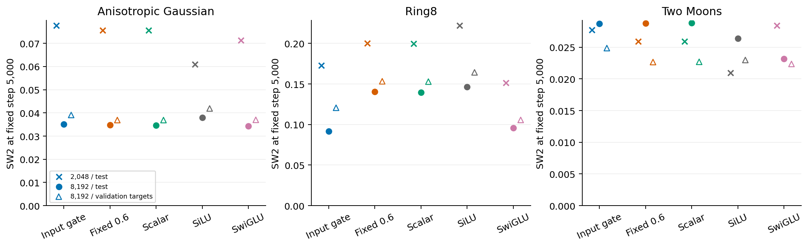
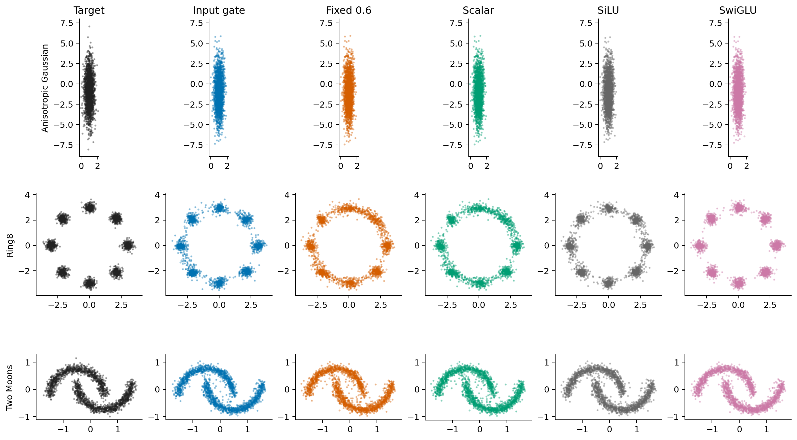

# Input gates improve Ring8 separation, but an ODE advantage is not established

We kept K=2 and trained the original input-gated ODEFFN, fixed-duration ODEFFN,
learned-scalar ODEFFN, SiLU and SwiGLU under the same protocol. All new comparisons
use the CPU backend, training seed 0 and 5,000 updates. The original GPU study
is not treated as a paired repeat. Report 1 is unchanged.

## Sample quality

The table shows test SW2 at the predeclared step 5,000: **2,048 / 8,192 samples**.
Lower is better. The larger evaluation holds checkpoints, solver and projection
directions fixed; it is a post-training measurement check, not a new selection rule.

| Model | Gaussian | Ring8 | Two Moons |
|---|---:|---:|---:|
| Input gate | 0.0777 / 0.0351 | 0.1729 / 0.0917 | 0.0277 / 0.0287 |
| Fixed 0.6 | 0.0756 / 0.0347 | 0.2002 / 0.1406 | 0.0259 / 0.0288 |
| Learned scalar | 0.0756 / 0.0347 | 0.1998 / 0.1396 | 0.0259 / 0.0289 |
| SiLU | 0.0610 / 0.0379 | 0.2219 / 0.1462 | 0.0209 / 0.0264 |
| SwiGLU | 0.0713 / 0.0343 | 0.1513 / 0.0959 | 0.0284 / 0.0232 |

Removing the input gate hurts Ring8 at both sample counts. It does not produce
a consistent loss on Gaussian or Moons. Fixed and learned-scalar durations give
almost identical results. They also represent the same function class when P
is unrestricted, since the constant duration can be absorbed into P.

These are not parameter-matched gate controls: removing the gate reduces the
model from 82,056 to 56,706 parameters, and forward linear MACs from 105,152 to
80,192 per example. The Ring8 gain may reflect input adaptation, extra network
capacity, or their interaction.

## Ring8 case study

The fixed and scalar models leave visible points between the eight modes.
At step 5,000, the fraction farther than 0.6 from every mode center is 19.9%
for fixed duration, 19.7% for scalar duration, 8.3% for the input gate and 3.4%
for SwiGLU. The real target sample has 1.0%. This descriptive threshold is three
times the component standard deviation in each coordinate; it is not a
one-dimensional “three-sigma” confidence statement.

SwiGLU also has lower analytic velocity error on Ring8: 0.0162 versus 0.0325
for the input-gated ODE. The input gate therefore improves mode concentration
relative to its simplified versions, but is not uniformly better than SwiGLU.

## Why we cannot choose a winner from one SW2 value

At 2,048 test samples, SwiGLU beats input-gated ODE on Ring8, 0.1513 versus
0.1729. At 8,192 test samples, ODE is slightly lower, 0.0917 versus 0.0959.
Against 8,192 validation targets using the same generated sets and directions,
SwiGLU is lower again: 0.1056 versus 0.1206. Both resolutions and both target
sets remain in the evidence.

The original validation rule selected step 1,000 for Ring8's three ODE variants.
For input-gated ODE this gives test SW2 0.2603, compared with 0.1729 at the fixed
step 5,000. We retain both endpoints rather than replacing the rule after seeing
test scores. The empirical validation-target/test-target distance is 0.1961 at
2,048 points and 0.1127 at 8,192; neither number is a lower bound on model SW2.

## What this says about P

On Ring8, the mean layer norm of P is **smaller** with the input gate than with
fixed duration, 1.837 versus 2.139. Yet the mean local full-layer Jacobian norm is
**larger**, 3.176 versus 2.703. The input gate contributes a rank-one Jacobian
term whose mean norm is 1.336. These are descriptive measurements over six
layers and sixteen hidden-input probes per layer.

The [exact counterexample](gate-counterexample.md) makes the distinction sharper:
P=I already has perfectly equal singular values, but the input gate can make the
standalone layer's Jacobian arbitrarily large over unrestricted inputs. This
does not prove instability of the surrounding normalized backbone. It shows why
P spectra, input magnitudes and gate derivatives must be examined together.

## Next decision

The next useful control is a bias-free SiLU FFN with hidden width 64. A constant-
duration ODE block is exactly B2 SiLU(B1 h), with B1 and B2 polynomially
parameterized. This control would separate the matrix parameterization from the
ordinary FFN structure before adding a new constraint on P.

No further training direction has been launched. The current evidence supports
studying the gate's role in multimodal separation; it does not yet support a
claim that this architecture is specifically better suited to flow matching.

Full numbers: [results.csv](results/results.csv),
[endpoint diagnostics](results/endpoint-diagnostics.json),
[sample-count check](results/sample-count-check.json), and
[training trajectories](results/training-trajectories.json).
