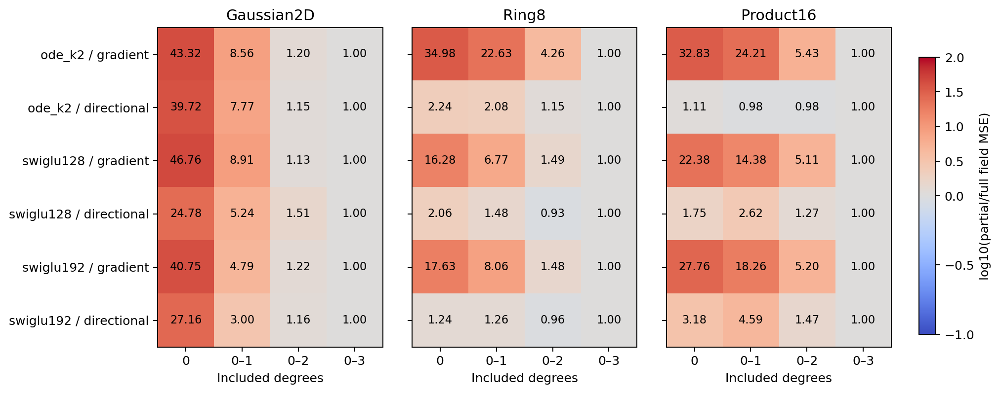
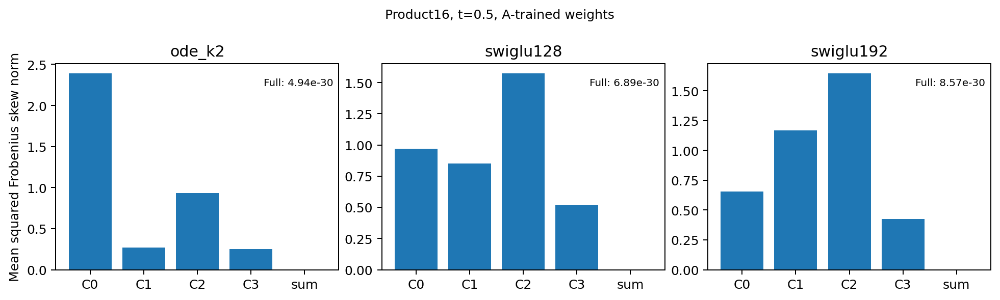

# The useful adjoint contains substantial cross-block computation

At the learned original-ODE weights, removing only the reverse path that passes through all three residual derivatives raises Product16 field MSE from.03732 to.20266. SwiGLU128 and192 show similar fivefold penalties. The successful readout therefore relies on learned cross-block computation across both model families. This does not identify a useful local replacement or establish an ODE-specific advantage.

This experiment decomposes saved predictors; it trains no new model. It follows the cold gate-removal test, which found that clock sensitivities are useful but are not a uniquely strong ODE mechanism. All three tasks, both A/B training orientations and every native validation input are retained.

## What is being decomposed

For each actual forward state, a residual block's input derivative is `I+Di`. The complete A readout includes the reverse product

```text
(I+D1^T)(I+D2^T)(I+D3^T).
```

Its exact eight paths group into four components: no Di factor, one, two or three. They sum to the existing field `.5*(G+J_G^T*x)`. The no-factor component includes half the raw prediction; every component still uses all actual forward blocks. These degrees count derivative paths across blocks, not the Taylor order of P. Partial sums use fixed learned weights and are not newly trained architectures.

| A-trained Product16 backbone | Keep degrees0–2 | Full degrees0–3 | Error ratio |
|---|---:|---:|---:|
| Original ODE K2 | .202665 | .037320 | 5.43 |
| SwiGLU128 | .218395 | .042770 | 5.11 |
| SwiGLU192 | .175930 | .033826 | 5.20 |

Errors are full uniform-time validation oracle MSE. On Ring8, the corresponding ODE penalty is4.26x, versus1.49x/1.48x for the two SwiGLUs. On Gaussian, the ratios are much smaller and similar across families. The dependency varies by task; the Product16 result is not an exclusively ODE effect.



The B-trained cases prevent interpreting the table as a universal benefit of extra reverse terms. For example, applying A to B-trained Product16 ODE weights gives.74976, while retaining degrees0–2 gives.73309. Neither is a good replacement for that model's native B prediction (.36107), much less the A-trained .03732 result. Fixed-weight truncation and native retraining answer different questions. All72 field evaluations and their exact finite-change risk terms remain in partial-field-errors.csv.

## Why a local symmetry constraint does not transfer automatically

Two local gradient maps `Ax` and `Bx`, with symmetric positive definite A and B, compose to `BAx`. This is a gradient only if the two matrices commute. Each map can also be the exact flow of a symmetric linear ODE. A deterministic contracting version has the same nonsymmetric-product counterexample. Thus local gradient flows alone do not guarantee that a predicted vector field is globally a gradient.

For the professor's original state-clock layer, symmetric P is insufficient even locally: the Jacobian also contains `(Ph+aP²h)*grad(a)^T`, which is generally nonsymmetric. An exact locally completed map `.5*(L+J_L^T*h)` is a gradient, but arbitrary compositions of completed maps do not inherit that guarantee. These statements constrain a mathematical motivation; they do not prove that local designs cannot learn good predictions. The derivation and verified examples are in [mathematics.md](../mathematics.md).

The complete predictor exhibits this interaction directly. At Product16 t=.5, the four ODE component skew energies are2.392,.273,.932,.254, while their summed field's skew energy is4.94e-30. The nonsymmetric parts cancel between components. The same cancellation occurs for both SwiGLUs. It would therefore be incorrect to treat one component's asymmetry as the complete predictor's geometric defect.



## What follows for design

The exact chain rule provides a valid global construction: if f is a gradient, `E^T*f(E*x+b)` and sums of such pullbacks are gradients. [GradNets](https://arxiv.org/html/2404.07361v3) use this established principle. Ordinary sequential composition needs additional conditions. This is a concrete design constraint, not a new architecture claim or an automatic reason to test another potential.

The evidence supports studying an explicitly coordinated forward/reverse computation if global gradient structure is the motivation. It does not support assigning the measured A gain to one P, its spectrum or one local clock term. No partial sum, coefficient, local substitution or longer run is selected here. A new cold experiment needs a separate architectural hypothesis with matched generic controls; this diagnostic cannot nominate a candidate.

The complete-field reconstruction, parameter gradients and finite differences pass. Numerical scope, all saved paths and figure provenance are recorded in [stats-appendix.md](stats-appendix.md). The broader useful-ODE objective remains open.
