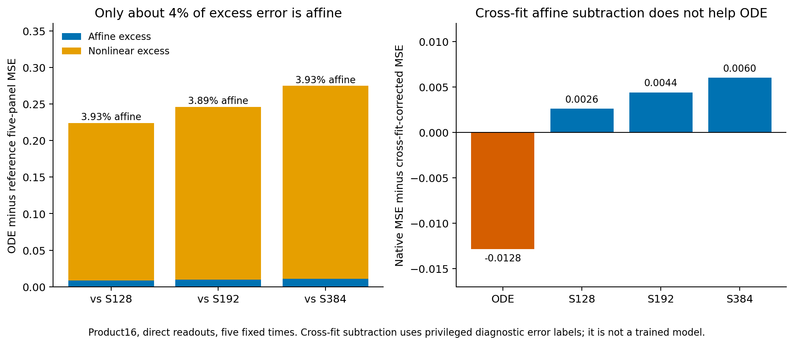
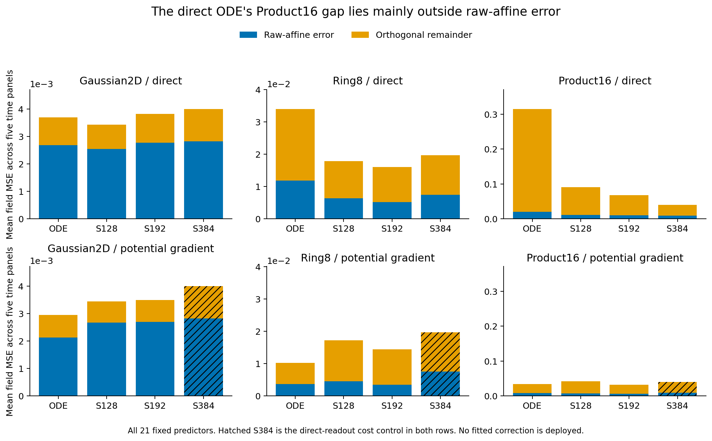

# The direct ODE's Product16 deficit is mainly nonlinear

Only3.89–3.93% of the original direct ODE predictor's excess five-panel error over three direct SwiGLU controls lies in raw-affine error. The remaining96.07–96.11% lies in the orthogonal remainder. Cross-fit affine error subtraction also fails to reduce the ODE error. This rejects the registered explanation that fitting physical-coordinate linear dynamics accounts for most of this deficit. It does not identify the cause in hidden coordinates or select a new architecture.

## What was measured

All21 final predictors from the completed conservative-readout study are retained: the original professor scalar K2 ODEFFN and SwiGLU128/192, each with direct or complete-potential-gradient readout, plus direct SwiGLU384. Gaussian2D, Ring8 and Product16 each have five fixed times and512 common inputs per time. These are existing predictions, not new training or newly generated evaluation data.

For each panel, project `E=prediction-oracle` onto the columns of `[1,X]`. This gives the best affine approximation to the **error** on that finite panel, not the best affine target field or a learned hidden-feature head. The affine and orthogonal error energies add exactly. To check reproduction across examples, fit the affine error on256 rows and evaluate on the other256, then swap. All coefficients and out-of-fold predictions are saved. Oracle error labels make this a privileged diagnostic, not a deployable corrected model.

The metric below equally averages five fixed-time field errors; it is not the separate uniform-time primary validation metric.

## Primary Product16 result

| Direct predictor | Total error | Affine error | Orthogonal remainder | Cross-fit error reduction |
|---|---:|---:|---:|---:|
| ODE K2 | .314433 | .019966 | .294467 | -.012848 |
| SwiGLU128 | .090384 | .011170 | .079214 | .002603 |
| SwiGLU192 | .068317 | .010383 | .057934 | .004416 |
| SwiGLU384 | .039693 | .009175 | .030518 | .006030 |

Against SwiGLU192, the total ODE excess is.246116. Its affine excess is only.009584; the remaining.236532 is orthogonal to raw affine functions on these panels. The three references agree:

| Reference | Total ODE excess | Affine share of excess | Cross-fit affine-reduction share of excess |
|---|---:|---:|---:|
| SwiGLU128 | .224049 |3.926% | -6.896% |
| SwiGLU192 | .246116 |3.894% | -7.015% |
| SwiGLU384 | .274740 |3.928% | -6.871% |

The negative cross-fit shares are preserved. They mean affine error fitting transfers less favorably for ODE than for these references; they are not negative projections or a noise-free population theorem. Both required50% conditions fail for every reference. No reference or time is selected retrospectively.

Even same-panel affine fitting, which has an optimistic advantage over out-of-fold prediction, explains little of the excess. Its failure to transfer reinforces the rejection without establishing that every possible linear architecture change would fail.

## Cases that limit the conclusion

On Gaussian2D, the direct ODE's own error is about72.7% affine, and cross-fit reduction closely tracks the affine energy. The method can therefore detect reproducible affine error. ODE is already competitive with the generic controls there; it does not have the large Product16 gap.

On Ring8, raw-affine excess explains30.7–37.3% of the direct ODE gap, with cross-fit shares28.3–35.4%. Linear error is more relevant than on Product16 but still fails the majority explanation against every direct reference.

The conclusion also depends on the readout. For Product16's **potential-gradient** ODE, total five-panel error is.034325, compared with.031536 for potential-gradient SwiGLU192. Of that much smaller positive gap,85.6% is affine and81.5% is reflected in cross-fit reduction. ODE instead beats potential-gradient SwiGLU128 and direct SwiGLU384 on this particular five-panel metric. These controls prevent the false generalization that all remaining ODE error is nonlinear. They do not reverse the primary direct-readout decision or reopen the stopped potential experiment.

All model/time values and signed differences remain in [panels.csv](panels.csv), [aggregates.csv](aggregates.csv), [gaps.csv](gaps.csv), and [per-time-gaps.csv](per-time-gaps.csv). The large middle-time errors are retained rather than replaced by a favorable endpoint or a small subset of examples.

## What changes next

The preceding depth-gradient diagnosis did not find an ODE-specific bank-mean cancellation signal. This separate calculation now rejects a predominantly raw-linear explanation of the original direct predictor's largest gap. Together, they weaken two specific rationales for immediately adding depth-dependent P or a physical-coordinate linear bypass.

Further ODELayer design needs a mechanism for improving the learned nonlinear field, with the original layer and strong generic controls still visible. A tighter P spectrum, a more accurate linear exponential, or an added affine term cannot be justified solely by these physical-coordinate covariance formulas. None of those statements is an impossibility theorem for a nonlinear network containing P.

This diagnosis selects no training. It preserves the original K2 model, all stopped branches and the submitted Report1. A subsequent hypothesis must explain a task-related nonlinear mechanism before receiving a new cold experiment, rather than reuse a favorable secondary row here.

The [registered protocol](protocol.md), [statistical scope](stats-appendix.md), [figure catalog](figure-catalog.md), and [QR replay](verify_and_plot.py) describe the exact boundary of this evidence.
