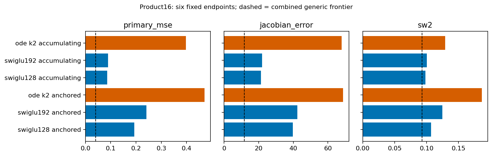
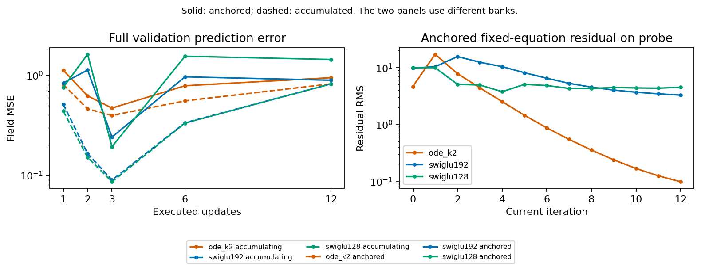

# Anchored-corrector Phase A

| Arm | Origin | Field MSE | Jacobian error | SW2 | Params | MACs |
|---|---|---:|---:|---:|---:|---:|
| ode_k2_accumulating_final | new six-arm screen | 0.3972584 | 67.85318 | 0.12904 | 33682 | 106944 |
| swiglu192_accumulating_final | new six-arm screen | 0.0895918 | 21.92284 | 0.10033 | 41936 | 106560 |
| swiglu128_accumulating_final | new six-arm screen | 0.0861674 | 21.24368 | 0.09836 | 33594 | 81792 |
| ode_k2_anchored_final | new six-arm screen | 0.4706430 | 68.75263 | 0.18632 | 33682 | 106944 |
| swiglu192_anchored_final | new six-arm screen | 0.2410771 | 42.38582 | 0.12485 | 41936 | 106560 |
| swiglu128_anchored_final | new six-arm screen | 0.1931136 | 39.80577 | 0.10685 | 33594 | 81792 |
| swiglu192_native_final | previous dense control | 0.0704226 | 19.88407 | 0.09271 | 108624 | 106560 |
| swiglu192_native_deep | previous dense control | 0.0487047 | 14.21999 | 0.09302 | 108624 | 106560 |
| swiglu192_cloned_final | previous dense control | 0.0639749 | 18.12841 | 0.09950 | 108624 | 106560 |
| swiglu192_cloned_deep | previous dense control | 0.0486151 | 14.00887 | 0.10118 | 108624 | 106560 |
| swiglu128_native_final | previous dense control | 0.0923258 | 24.88991 | 0.09572 | 83598 | 81792 |
| swiglu128_native_deep | previous dense control | 0.0409026 | 11.73333 | 0.10063 | 83598 | 81792 |

Decision: stop this setting

All six endpoints and all six reused dense controls were replayed from actual weights, including full field arrays, five Jacobian panels and Heun32 samples. The two repeated accumulated controls match their previous checkpoints bitwise at all four saved steps. Ratios are descriptive; no inference across training repetitions is made.



All three within-family anchored endpoints are worse than accumulated controls; exact effects and conditional intervals are in paired-evaluation.csv. No Ring8/Gaussian extension or longer training is triggered.



The paired probe diagnostic uses the same256 inputs for residual and task error:

| ODE anchored iteration | Probe field MSE | Hidden residual RMS |
|---|---:|---:|
| 3 | 0.4945378 | 4.3888220 |
| 6 | 0.8120150 | 0.8676313 |
| 12 | 0.9575216 | 0.0979079 |

From iteration3 to12, residual falls while field error rises on98.828% of those same inputs. This is a finite probe observation, not a global contraction certificate. The effect is also present in the anchored SwiGLU192 control, so it is not ODE-specific.

For a hypothetical contraction G with factor q<1 and an L-Lipschitz readout D, the residual only controls distance to its own fixed point:

```text
||h-h*|| <= ||G(h)-h||/(1-q)
||D(h)-target|| <= L*||G(h)-h||/(1-q) + ||D(h*)-target||
```

The last term is task bias and is not bounded by numerical convergence. No q or global Lipschitz certificate is inferred for the actual network. The practical implication is to specify what hidden evolution should accomplish before imposing additional solver or spectral properties; this screen does not select a new loss, constraint or architecture.

Claim candidates: keep the failure of the registered input-anchoring intervention; keep the observed separation of equation residual and prediction accuracy; reject a claim that the original P is now useful, that all implicit architectures fail, or that finite probes prove global stability.
