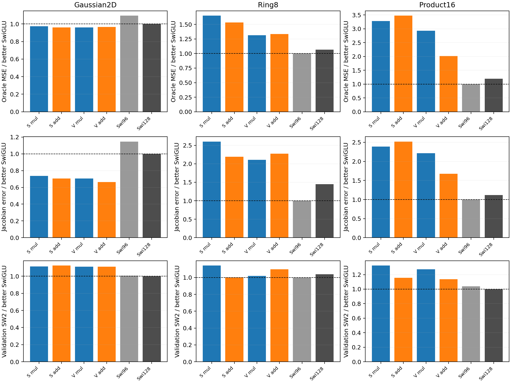
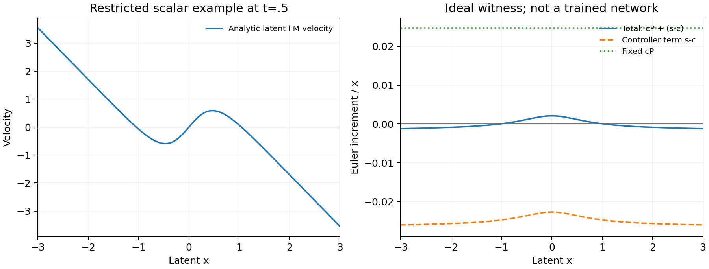

# Changing the controller's receiving feature is insufficient

The new block keeps the two K1 map solves and middle SiLU. Within each solve,
it replaces h+D(h)Ph by h+.6Ph+(D(h)-.6I)h. Mul/add pairs have identical
initial tensors and complete initial functions, parameter counts and dense
MACs. The change tests whether conditioning the generator through h helps
more than scaling Ph. Both scalar/vector gates and both SwiGLU budgets were
run together on the Mac CPU under the [registered protocol](../protocol-additive-generator.md).

Primary validation oracle MSE after5000updates:

| Arm | Gaussian2D | Ring8 | Product16 |
|---|---:|---:|---:|
| Scalar multiplicative | .003823 | .025089 | .298096 |
| Scalar additive | .003770 | .023278 | .315716 |
| Vector multiplicative | .003772 | .019930 | .266155 |
| Vector additive | .003795 | .020283 | .183215 |
| Small SwiGLU | .004304 | .015184 | .090831 |
| Full SwiGLU | .003928 | .016221 | .108234 |

The vector additive block reduces product16 error by31.2% relative to its
paired parent. Its Jacobian error falls from50.002 to37.850 and validation
SW2 from.120646 to.107673. These are real within-study improvements, but
the corresponding better SwiGLU values are.090831,22.596 and.094624. The
additive block still has2.02times the oracle error and worsens Ring8 relative
to its parent. The scalar change improves Ring8 by7.2% but worsens product16
by5.9%. Neither candidate passes the registered rule. Stop both settings.

## What the local theorem did predict

The [derivation](../clock-generator-mathematics.md) supplies an exact finite
SiLU-controller example: a single new scalar solve can expand around the
origin and contract in the tails while remaining monotone; a single fixed
positive-clock scalar linear generator cannot reproduce that relative sign
change. The existing product16 latent Bayes field also requires such changes.
This establishes a difference between local map families. It does not prove
an approximation lower bound for dense hidden VelocityNet blocks, nor predict
an optimizer advantage. The old and new local families are not nested.

The trained comparison is narrower than a claim that conditional generators
are better. Changing Ph to h changes both response direction and magnitude.
The strong product16 vector improvement and weak scalar result show why a
single scalar witness cannot stand in for a complete network analysis. The
remaining gap to SwiGLU does not justify a temperature or order sweep, and
the theorem alone is not a reason to extend this failed setting.

The next work is read-only: compare actual complete-network controller
responses in the paired saved models with the residual velocity errors,
including the downstream Jacobians and feature magnitudes. A local capacity
example should nominate a new design only when its measured restriction is
material in the trained network. No further training is selected here.

## Cost and verification

On product16, the vector parent/additive wall times are29.11/29.33seconds,
versus17.52seconds for small SwiGLU and20.08seconds for full SwiGLU. These
are the trainer's recorded wall intervals under two concurrent one-thread
workers; they include in-loop validation/sampling, exclude initial evaluation
and the separate final derivative diagnostic, and are not isolated hardware
benchmarks. Equal matrix MACs do not produce a speed advantage here.

Native frozen-source audits pass108 saved checkpoints and90 diagnostic
arrays, including exact initial mul/add tensor pairing, zero final controller
affines and common snapshot data-generator states. Separate endpoint replays
record prediction/Jacobian recomputation in the adjacent JSONs. All raw data
and checkpoints are local under the frozen Mac study root. No fresh holdout
or architecture success is claimed.

The first study's resource-monitor thread failed because psutil was missing.
Training logs/checkpoints remained intact. Installing psutil7.2.2 restored
normal telemetry for the second study, and a separate read-only queue monitor
was attached without changing training source or restarting jobs. The early
CPU/memory coverage gap is retained explicitly; it is not reconstructed.
