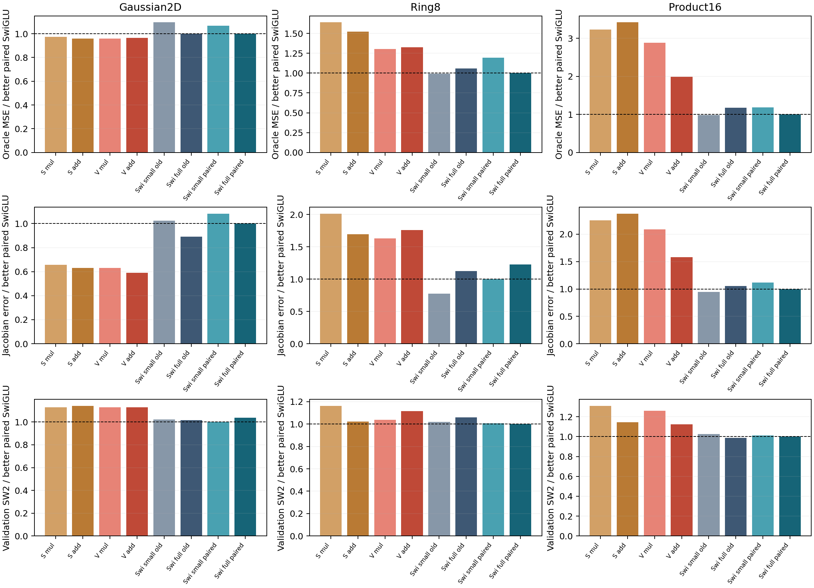
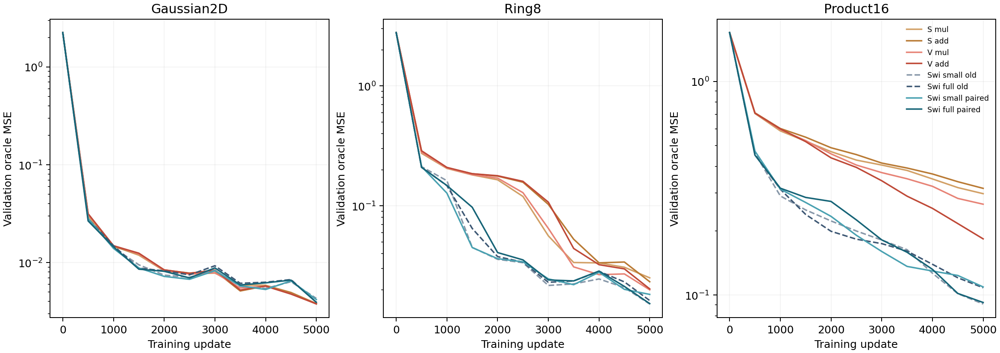

# Shared initialization changes baseline ordering, but does not close the ODE gap

All six SwiGLU control runs completed. Giving them the ODE models' exact
surrounding initialization changes which SwiGLU width performs better, while
the better baseline remains close to its previous error. The additive vector
block still has about twice the product16 field error and one-third more Ring8
error than the better paired baseline. No candidate passes the existing screen.

This resolves a concrete comparison gap: the original experiments shared a
backbone architecture, but the three FiLM layers did not start from identical
values across ODE and SwiGLU. It does not establish a new architecture, reopen a
stopped additive setting, or justify selecting whichever baseline looks weaker.

## Exact endpoint comparison

Primary validation oracle MSE at the fixed 5000-update endpoint, lower is better:

| Model | Gaussian2D | Ring8 | Product16 |
|---|---:|---:|---:|
| Scalar mul, reused | .00382281 | .02508905 | .29809618 |
| Scalar add, reused | .00377022 | .02327767 | .31571605 |
| Vector mul, reused | .00377155 | .01992964 | .26615519 |
| Vector add, reused | .00379472 | .02028304 | .18321462 |
| Small SwiGLU, original | .00430438 | .01518419 | .09083060 |
| Full SwiGLU, original | .00392798 | .01622068 | .10823413 |
| Small SwiGLU, paired backbone | .00418822 | .01825776 | .10916077 |
| Full SwiGLU, paired backbone | .00392725 | .01529629 | .09232577 |

The small baseline's Ring8/product16 errors increase by 20.2%/20.2%; the full
baseline's decrease by 5.7%/14.7%. The best error across the two sizes changes
only .015184→.015296 on Ring8 and .090831→.092326 on product16. Thus the old
small-versus-full ordering depended on initialization, but the main ODE deficit
does not disappear when surrounding initialization is exactly paired.

The control changes neither SwiGLU's FFN initialization nor its training draws.
It copies the common state after model construction and before AdamW. All 22
non-FFN state tensors and the actual Fourier runtime buffer now agree with the
hash-bound Stage15 vector_mul step0 reference for that dataset. Across these
architectures the six previously differing tensors were the three condition
weights and biases. Each native SwiGLU FFN and its initial global Torch RNG are
verified unchanged.

Every bar is an actual endpoint, normalized within its dataset and metric by
the better paired SwiGLU. S/V denote scalar/vector clocks; old ODE arms are
reused unchanged. Gaussian derivative error can favor ODE while sample SW2
does not; this is why no single diagnostic substitutes for the full comparison.

## Derivatives, generation and cost retain the same decision

| Nonlinear task | Model | Jacobian error | Validation SW2 |
|---|---|---:|---:|
| Ring8 | Vector mul, reused | .828581 | .23470066 |
| Ring8 | Vector add, reused | .895640 | .25258133 |
| Ring8 | Small SwiGLU, original | .393700 | .23038919 |
| Ring8 | Full SwiGLU, original | .571027 | .23958322 |
| Ring8 | Small SwiGLU, paired | .508748 | .22794788 |
| Ring8 | Full SwiGLU, paired | .624636 | .22636014 |
| Product16 | Vector mul, reused | 50.001937 | .12064604 |
| Product16 | Vector add, reused | 37.850097 | .10767347 |
| Product16 | Small SwiGLU, original | 22.596279 | .09822323 |
| Product16 | Full SwiGLU, original | 25.272591 | .09462354 |
| Product16 | Small SwiGLU, paired | 26.753885 | .09683395 |
| Product16 | Full SwiGLU, paired | 23.957835 | .09572154 |

The vector additive arm remains 1.58 times the better paired product16
Jacobian error, and its SW2 is 12.5% higher. Its Ring8 Jacobian error is 1.76
times the better paired reference. Both additive arms fail the unchanged
practical rule with either original or paired baselines; the exact descriptive
decisions are in [screen-decision.json](screen-decision.json).

Copying initial tensors does not change counts. Product16 vector ODE still uses
83,664 parameters/81,984 dense MACs; small and full SwiGLU use
71,376/69,696 and 83,598/81,792 respectively. Recorded new product16 training
intervals are 17.42/19.71 seconds versus 29.33 for the reused additive vector
run. These intervals include in-loop evaluations and separate concurrent CPU
conditions, so they do not certify a precise latency ratio. No cheaper ODE
result is established.

The figure retains all original ODE and baseline trajectories alongside the
new paired baselines. Dashed curves are original SwiGLU. No favorable checkpoint
was selected; the formal endpoint stays at 5000 updates.

## Verification and consequence

Frozen-native audits pass all 36 new checkpoints and 30 saved common-validation
arrays. Separate replay reloads all six final checkpoints with recorded runtime
buffers and reproduces every saved prediction/Jacobian exactly on this platform.
The analysis additionally checks every new step0 tensor/buffer against its
recorded reference, every FFN tensor against its old same-width SwiGLU, and all
six snapshots' data-generator states against each of the four reused ODE arms:
144 exact generator-state comparisons. Source manifests and checkpoint/array
hashes are preserved. Both studies have real process/memory telemetry.

These are validation controls and saved-field replays. No fresh holdout or
sampling-trajectory replay was performed. The four ODE outcomes were not
retrained; their source and initialization reuse were checked explicitly.

The corrected comparison strengthens the diagnosis that ODE's remaining
deficit is in the learned feature/update mechanism under this budget, rather
than being explained by the previously unpaired FiLM initialization alone.
It does not prove an expressivity limit or identify a particular new operator.
The next design should follow the complete-network response analysis, while
retaining this explicit initialization pairing. The useful-architecture goal
remains unmet.
