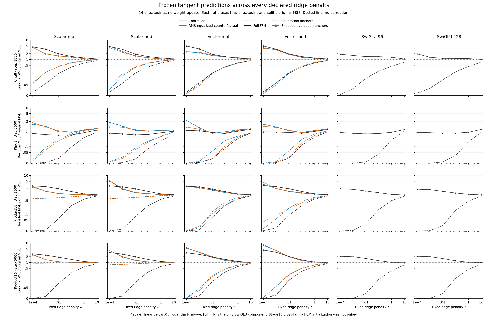
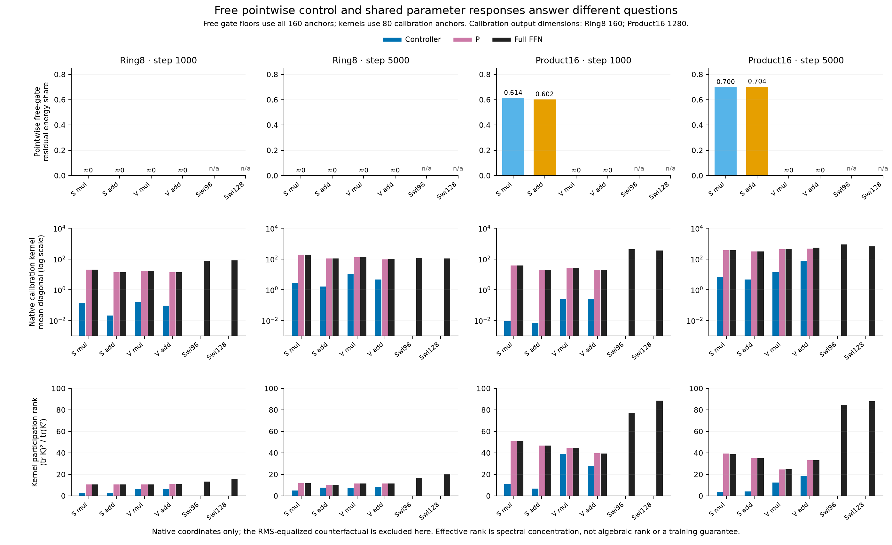

# What the frozen controller tangents show

The vector models have enough independent gate directions to remove the measured velocity residual **at each anchor separately**. On Product16, that pointwise capacity does not establish a useful shared-controller correction: fitting a shared tangent to 16 exposed paths usually worsens error on the other 16 paths, including for both SwiGLU references. This measurement rejects a missing-pointwise-direction explanation for the vector models; it does not identify a new architecture or explain the training gap by receiver amplitude alone.

## What was measured

The completed Stage15 networks were frozen at 1,000 and 5,000 updates: four ODE variants and two SwiGLU budgets, on Ring8 and Product16. All 24 cases are included. At each of five times (.1, .3, .5, .7, .9), path indices 0:16 supply calibration anchors and 256:272 supply evaluation anchors. These are existing, exposed validation paths with population-oracle velocity labels; neither split is a fresh holdout. The same paths recur across time.

Exact kernels describe the response to the six shared controller parameter blocks, the six projection matrices P, and the complete FFN parameters. All downstream gates recompute natively. The complete-FFN kernel excludes the input/output heads, time conditioning and other non-FFN parameters. SwiGLU is compared through its complete FFN, not a fictitious controller. The original Stage15 ODE/SwiGLU FiLM initial tensors were not paired; cross-family comparisons here remain external references. The [separate FiLM pairing control](../analysis-backbone-pairing/analysis-report.md) is now complete and audited: the better paired SwiGLU baseline has Product16 MSE .092326 versus .090831 previously, and Ring8 MSE .015296 versus .015184. Those training endpoints use the full validation bank, not this diagnostic's 16 evaluation paths. The tangent kernels here still use the original unpaired checkpoints; they were not recomputed for the new paired SwiGLU models.

Each kernel was divided by its calibration mean diagonal and evaluated at all six declared penalties, λ = 1e−4, 1e−3, .01, .1, 1, 10. No penalty was selected as a winner. Numerical results below at λ=.1 are one fixed illustration, not a tuned operating point. No weights were changed. A predicted tangent correction is not an achieved nonlinear-network error.

## 1. The scalar and vector restrictions differ

For one vector-gated solve, the direct output response is `G diag(q)`, where q is Ph for multiplication or h for addition, and G is the complete downstream Jacobian. Nonzero q coordinates preserve G's column span. Changing the receiver can change magnitudes and conditioning without creating new pointwise directions under the same G. Across trained networks G itself differs.

On Product16, all scalar checkpoints have free-gate rank six, the number of scalar controllers. Their unexplained residual energy is 60.2–61.4% at 1,000 updates and 70.0–70.4% at 5,000. Both vector models have rank 16 and numerical-zero floors (about 1e−30). On Ring8 every ODE case has rank two and a numerical-zero floor. These are unbounded, independent gate changes at each anchor; finite gate ranges and the shared MLP are relaxed. They are not approximation lower bounds after retraining.

## 2. Native controller sensitivity is small, but amplitude is not a diagnosis

The controller accounts for 0.0237–12.42% of native complete-FFN kernel trace across these ODE cases; P accounts for the remainder. This is a statement in the actual Euclidean parameter coordinates. It is not invariant to reparameterization, and the parameter blocks need not have equal sizes. The participation rank measures spectral concentration, not algebraic dimension. Both traces and ranks are shown without discarding the early checkpoints.

Receiver-RMS equalization changes each layer's response separately at each input. It therefore changes the shared fitting problem and is not an equivalent parameter coordinate system. It retains channel imbalance, gate slopes, controller features and downstream anisotropy. On Product16 both native and equalized controllers worsen evaluation in 46 of their 48 fixed-penalty cells. This supplies no clean amplitude-causality result and does not justify another amplitude tweak.

## 3. Calibration fit is not evaluation improvement

Product16's full-FFN tangent worsens evaluation in 67 of 72 fixed-penalty cells. The five exceptions are weak corrections at λ=10, with a best residual ratio of .965644; none constitutes a trained improvement. At λ=.1, all 12 Product16 checkpoints worsen evaluation, including both SwiGLUs. At the smallest penalty, the final full-FFN calibration residual shares are 0.0000118–0.000458, while evaluation shares are 2.09–4.36. Near-interpolation of this small calibration bank is therefore poor evidence of a useful repair.

Ring8 provides an important counterexample. At 1,000 updates, every full-FFN penalty worsens evaluation (36/36 cells). At 5,000, every one improves its linearized evaluation residual (36/36), with ratios .388477–.766472. This diagnosis depends on task and trained representation; it does not show that tangent fitting always fails. The per-time CSV preserves all five time panels without treating them as independent repetitions.

The tables retain each split's original MSE. Ratios across different starting models do not establish a performance ranking. The fixed λ=.1 columns are illustrative only; the figure and statistical appendix retain the complete ridge grid.

### Ring8: complete-FFN illustration at λ=.1

| Update | Model | Original calibration MSE | Original evaluation MSE | Calibration share | Evaluation share | Implied update norm |
| --- | --- | --- | --- | --- | --- | --- |
| 1000 | Scalar mul | 0.170246 | 0.157484 | 0.406587 | 1.44233 | 1.24241 |
| 1000 | Scalar add | 0.168544 | 0.156294 | 0.421733 | 1.41862 | 1.46695 |
| 1000 | Vector mul | 0.169317 | 0.157628 | 0.419431 | 1.40141 | 1.35001 |
| 1000 | Vector add | 0.170739 | 0.157826 | 0.419013 | 1.42333 | 1.45481 |
| 1000 | SwiGLU 96 | 0.137407 | 0.136133 | 0.25349 | 1.4117 | 0.499424 |
| 1000 | SwiGLU 128 | 0.132384 | 0.141064 | 0.23409 | 1.1463 | 0.47652 |
| 5000 | Scalar mul | 0.0204794 | 0.0238744 | 0.0930266 | 0.396477 | 0.11751 |
| 5000 | Scalar add | 0.0206624 | 0.0191565 | 0.0786302 | 0.422179 | 0.125073 |
| 5000 | Vector mul | 0.0194441 | 0.0166738 | 0.0825688 | 0.47388 | 0.125586 |
| 5000 | Vector add | 0.0156044 | 0.0161818 | 0.118551 | 0.485504 | 0.143961 |
| 5000 | SwiGLU 96 | 0.0148953 | 0.0166268 | 0.0429389 | 0.471985 | 0.117334 |
| 5000 | SwiGLU 128 | 0.0133217 | 0.0140126 | 0.036306 | 0.491332 | 0.105501 |

### Product16: complete-FFN illustration at λ=.1

| Update | Model | Original calibration MSE | Original evaluation MSE | Calibration share | Evaluation share | Implied update norm |
| --- | --- | --- | --- | --- | --- | --- |
| 1000 | Scalar mul | 0.489898 | 0.598689 | 0.273838 | 1.48297 | 4.81515 |
| 1000 | Scalar add | 0.509222 | 0.617258 | 0.280597 | 1.50258 | 6.61825 |
| 1000 | Vector mul | 0.502771 | 0.606524 | 0.282163 | 1.4705 | 5.71991 |
| 1000 | Vector add | 0.502191 | 0.617235 | 0.289483 | 1.49247 | 6.60226 |
| 1000 | SwiGLU 96 | 0.255549 | 0.303518 | 0.174268 | 1.28607 | 0.986883 |
| 1000 | SwiGLU 128 | 0.260635 | 0.3249 | 0.157748 | 1.24231 | 1.10725 |
| 5000 | Scalar mul | 0.243639 | 0.315154 | 0.289588 | 1.43748 | 1.03518 |
| 5000 | Scalar add | 0.266203 | 0.343837 | 0.32823 | 1.4264 | 1.20079 |
| 5000 | Vector mul | 0.220589 | 0.27419 | 0.324768 | 1.45571 | 0.896273 |
| 5000 | Vector add | 0.163468 | 0.170235 | 0.351781 | 1.35286 | 0.669659 |
| 5000 | SwiGLU 96 | 0.0907378 | 0.0939689 | 0.133533 | 1.23655 | 0.369882 |
| 5000 | SwiGLU 128 | 0.108778 | 0.100125 | 0.152137 | 1.2246 | 0.503261 |

## Case study: Product16 vector addition

At 5,000 updates the vector additive network has original evaluation MSE .170235, compared with .274190 for vector multiplication on these anchors. Its free-gate floor is already numerical zero, as is the parent's. At λ=.1 its shared controller gives evaluation ratio 1.257, and RMS equalization gives 1.242: neither is a repair. Its full FFN gives ratio 1.353 despite calibration ratio .352. Small SwiGLU starts at .093969 and also overfits this correction, giving evaluation ratio 1.237. Thus this diagnostic cannot turn the additive model's observed gain into evidence for a new pointwise direction or a universally bad ODE tangent.

Native controller update norms at this penalty are 4.854 for vector multiplication and 1.831 for vector addition; full-FFN norms are .896 and .670. A ridge penalty does not ensure a local, feasible nonlinear change. These are absolute Euclidean parameter norms without a relative parameter-norm or finite-step validation; no nonlinear update was applied. Counterfactual feature norms have no direct network-parameter meaning. All 432 norms and original MSEs are exported, including the much larger norms at small penalties.

## What follows, and what does not

The vector models' pointwise span is sufficient here, so a design justified only by adding those same directions lacks support. The weak transfer of tiny-bank corrections is shared by ODE and SwiGLU on Product16. It cannot isolate an ODE-specific optimization failure, an architecture lower bound, or a receiver-amplitude cause. The native controller/P contrast motivates separating learned projection features from controller accessibility, but does not choose feature sharing, a new generator, a temperature or a higher order.

A proposed architecture still needs an independent mechanism argument and matched control registration. The [completed FiLM pairing control](../analysis-backbone-pairing/analysis-report.md) leaves the main ODE deficit in place, but does not retroactively pair the original tangent checkpoints. This bundle remains a posthoc diagnostic of those existing checkpoints, not an additional training result.

## Files and verification

The analysis audited 24 cases, 72 kernels, 432 ridge rows, 96 layer summaries and 2,160 evaluation-by-time rows. It checked all 50 upstream file hashes and four frozen diagnostic-source hashes. The frozen manifest records six independently passed kernel tests. Stored evaluation corrections reproduce every evaluation MSE; kernel spectra reproduce every participation rank, and controller + P traces reproduce the ODE full-FFN trace. These are analysis consistency checks, not another training run.

- [Statistical appendix with every numeric ridge row](stats-appendix.md)
- [Exact case values](cases.csv), [kernel values](components.csv), [ridge values and norms](ridge-curves.csv), [layer values](layers.csv), [time panels](evaluation-by-time.csv)
- [Figure catalog](figure-catalog.md), [analysis audit](analysis-audit.json), [file hashes](SHA256SUMS.json)

CSV floats preserve Python's round-trip representation of the JSON/NPZ values. Markdown displays six significant digits; it does not replace the exact exports.
