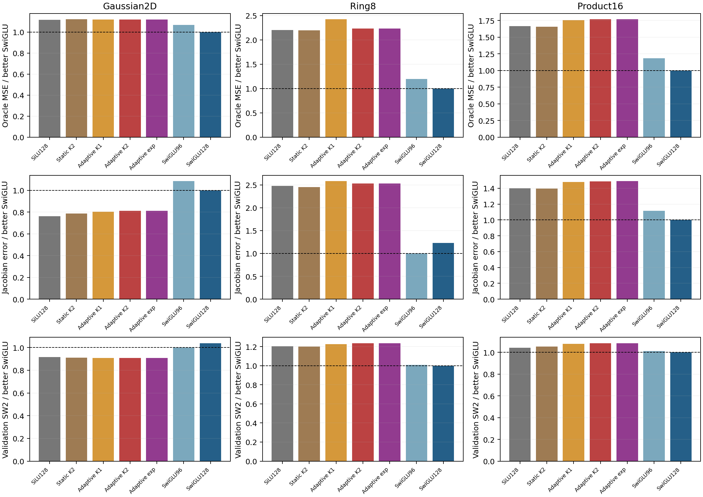
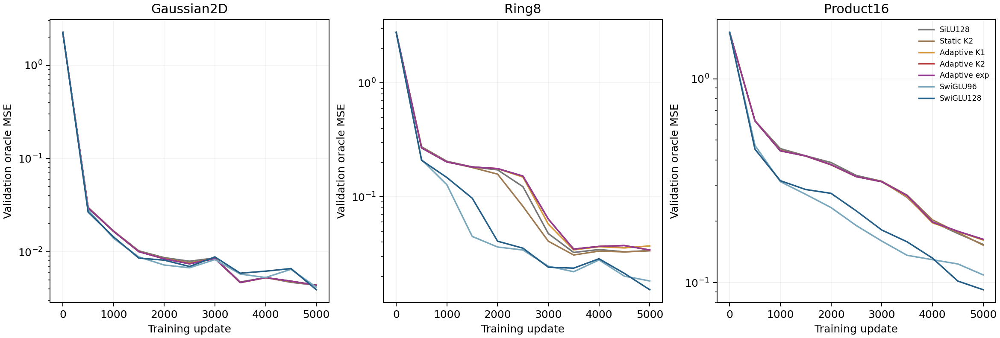
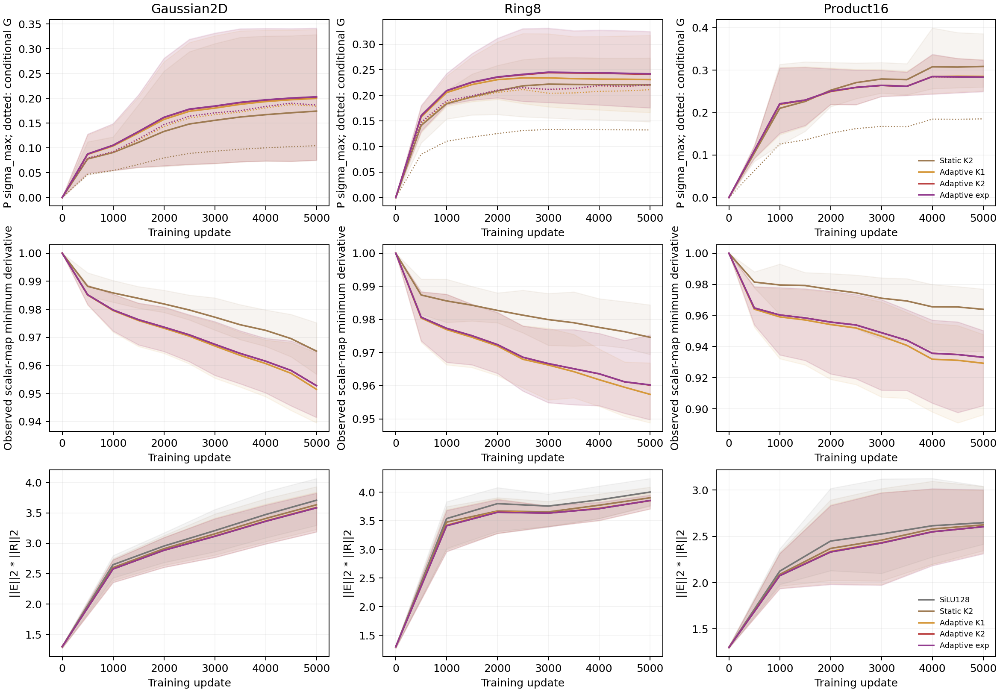

# Stage19: bounded diagonal-flow activations do not improve the reference

Neither adaptive K2 nor the conditional exponential passes the registered screen. Both remain close to the ordinary SiLU reference and substantially behind SwiGLU on the nonlinear tasks. K1 provides no practical lead either. The mathematical guarantees and initial tangent identities hold, but they do not translate into a useful architecture in this setting.

The [protocol](../protocol-diagonal-flow.md), [mathematical review](../diagonal-flow-design-review.md) and [prior-art review](../literature-diagonal-flow.md) were fixed before training. The [machine-readable decision](screen-decision.json) applies the original thresholds without adding a beta, clock, width or order rescue.

## The controlled question

Ordinary learned projections expand64 features to128 and project them back. Between them, two coordinatewise maps surround SiLU:

```text
z = E h + bE
F(z) = z * Q(lambda*s(z)),   lambda=tanh(eta)
FFN(h) = R F2(SiLU(F1(z))) + bR.
```

The adaptive clock is fixed at `.2+.8 sigmoid(z)`; the static control uses `.6`. Q is first order, second order, or exponential. Eta starts at zero, so every diagonal variant starts with the same complete SiLU function, E/R matrices and biases. Adaptive K1/K2/exp also have identical initial parameter Jacobians. Static K2 is exactly absorbable into E/R and their biases, so its function class equals the ordinary SiLU control even after training.

The exponential is exact for the linear diagonal system whose clock is fixed from the solve input. It is not the solution of the different nonlinear system that recomputes the clock continuously. This block is also exactly a learned coordinatewise activation MLP. Its scalar derivative bounds do not establish invertibility or stability of the middle SiLU, full FFN, velocity network or sampling trajectory.

## Fixed-endpoint results

Primary validation oracle MSE after5000 updates:

| Arm | Gaussian2D | Ring8 | Product16 |
|---|---:|---:|---:|
| Ordinary SiLU128 | 0.004384110 | 0.033713785 | 0.153892194 |
| Static diagonal K2 | 0.004402816 | 0.033584705 | 0.152763432 |
| Adaptive K1 | 0.004387793 | 0.037079890 | 0.161826089 |
| Adaptive K2 | 0.004388144 | 0.034134803 | 0.163065662 |
| Adaptive exp | 0.004388299 | 0.034137481 | 0.163192601 |
| SwiGLU96 | 0.004188221 | 0.018257763 | 0.109160768 |
| SwiGLU128 | 0.003927254 | 0.015296290 | 0.092325770 |



On Ring8, K2 reduces K1's MSE by7.94%, satisfying that one part of the screen. It is nevertheless1.25% worse than ordinary SiLU,1.64% worse than static K2, and2.232 times SwiGLU128. Its Jacobian error is1.286769, versus the better SwiGLU's0.508748; its SW2 is0.279586 versus0.226360. The extra quadratic term recovers part of K1's regression without establishing a useful gain.

On Product16, K2 is5.96% worse than ordinary SiLU and6.74% worse than static K2. It is also0.77% worse than K1 and1.766 times SwiGLU128's MSE. Exponentiation is slightly worse still. Product16 SW2 stays within the registered10% margin to the better SwiGLU, but the field and Jacobian criteria fail. On Gaussian2D, both higher-order candidates exceed the better SwiGLU's primary MSE by11.74%, independently failing the5% control-task margin.

Static K2 changes the optimization parameterization while retaining SiLU's function class. Its endpoint improvements are small:0.38% on Ring8 and0.73% on Product16. The adaptive variants do not improve on that control. These observations provide no evidence that input-dependent diagonal solve time adds useful features under the tested training protocol.



All curves and the fixed endpoint are retained in [learning-curves.csv](learning-curves.csv). SiLU and both SwiGLU baselines reproduce their historical saved model, optimizer, buffers and random states exactly at all six snapshots. They are deterministic reruns used to verify compatibility, not additional independent evidence.

## What the learned P actually did

The latent generator is `P=diag(lambda)`. Its singular maximum is `max(abs(lambda))`. The conditional generator is `G(z)=diag(s(z)*lambda)`, which depends on the probe input. Neither is the complete velocity Jacobian. Their trajectories, together with the actual scalar-map derivatives, are shown below.



Lines average six internal solves; shaded ranges describe variation across those solves. Projection panels instead average the three FFN blocks. These are not confidence bands. [eigenvalue-channels.csv](eigenvalue-channels.csv) preserves every recorded eta and lambda coordinate; [diagonal-trajectories.csv](diagonal-trajectories.csv) retains the conditional-generator and derivative summaries.

The generators learn nonzero values, but remain far from the parameter boundary. Across all logged diagonal settings, tasks and times, the largest absolute lambda is0.399185, in the static Product16 control. The corresponding tanh parameter derivative remains at least `1-lambda^2 > .84` at these logged coordinates. Saturation of the eigenparameterization is therefore not an observed explanation for this failure. This statement concerns logged parameters, not an assertion about every intervening update.

K1 can mathematically fold at sufficiently negative lambda, but it did not do so on the recorded probes. Every logged negative-derivative fraction is zero. The lowest recorded K1 scalar derivative is0.891045 on Product16; the most negative logged K1 lambda there is only−0.102602, far from the earlier−0.99 folding witness. The existence of that witness cannot explain the measured quality gap here.

K2 and exp remain close in both learning curves and endpoints. Their Ring8 MSE differs by0.0078%, and Product16 by0.0778%. The learned conditional arguments are modest: for K2, maximum logged `abs(lambda*s)` is0.253527 on Ring8 and0.334434 on Product16. At a fixed argument with absolute value at most a,

```text
abs(exp(q) - (1+q+q*q/2)) <= exp(a)*a^3/6.
```

Those ranges give scalar gain bounds of0.003500 and0.008710. This helps put the small higher-order distinction in context. It is not a bound on the difference between two independently trained networks, whose parameters and projections differ.

The E/R factors show no obvious compensating norm explosion in these summaries. On Ring8 the final mean `||E||2*||R||2` is4.004 for SiLU,3.904 for static K2 and3.856 for adaptive K2. Product16 gives2.649,2.625 and2.605. Full E/R singular maxima, drift from initialization and static absorbed-projection norms are retained in [projection-trajectories.csv](projection-trajectories.csv). Similar factor norms do not certify a small full-network Jacobian or identify the cause of the performance difference.

## Cost and disposition

Product16 model totals and recorded training wall time:

| Arm | Parameters | Dense MACs | Seconds |
|---|---:|---:|---:|
| Ordinary SiLU128 | 83664 | 81984 | 19.717 |
| Static K2 | 84432 | 81984 | 31.016 |
| Adaptive K1 | 84432 | 81984 | 32.668 |
| Adaptive K2 | 84432 | 81984 | 38.700 |
| Adaptive exp | 84432 | 81984 | 34.929 |
| SwiGLU96 | 71376 | 69696 | 18.284 |
| SwiGLU128 | 83598 | 81792 | 17.289 |

The diagonal variants add768 parameters and pointwise solver work. Equal dense MACs do not imply equal execution cost. Recorded times include in-loop evaluation and concurrent CPU work; they are not isolated inference benchmarks.

The internal diagonal maps behaved as designed. The useful-architecture hypothesis failed: neither higher-order option beats the generic controls, and K1 is also behind them. Keep the scalar-flow derivations as verified mathematics, but stop these settings as registered. Their guarantees and activation interpretation supply no FM-specific performance claim or reason to relabel this negative result as progress toward architecture acceptance.

Full audit and scope details are in [stats-appendix.md](stats-appendix.md). No fresh holdout or new generated-sampling replay was used in this analysis.
