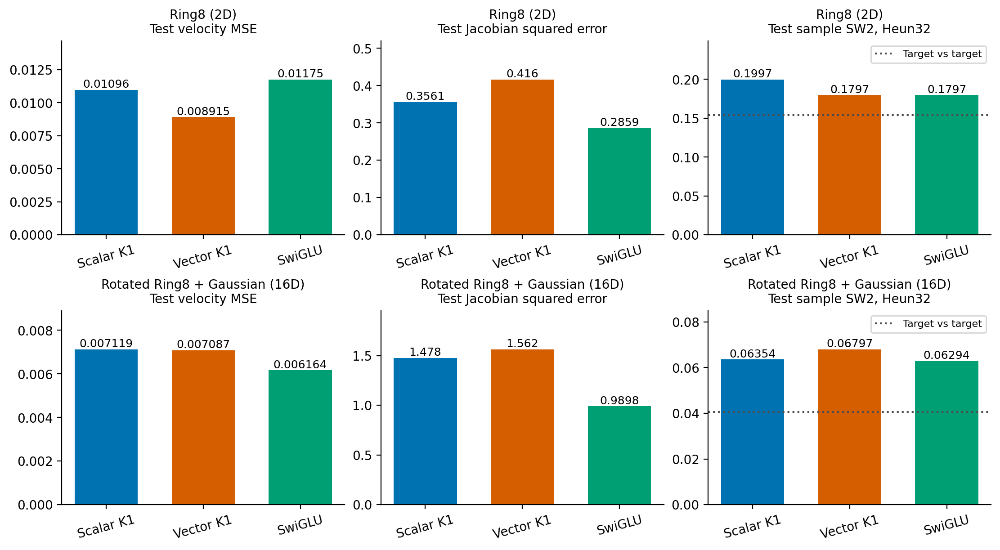
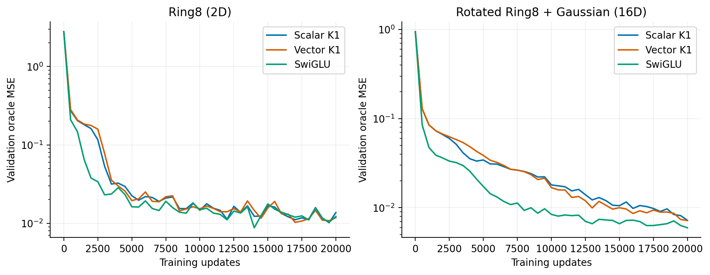
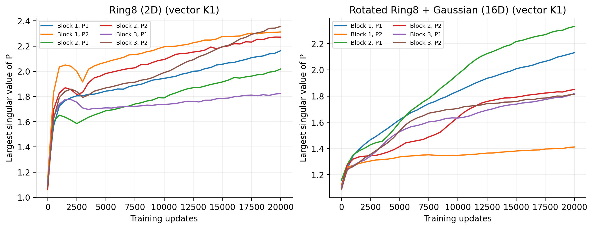
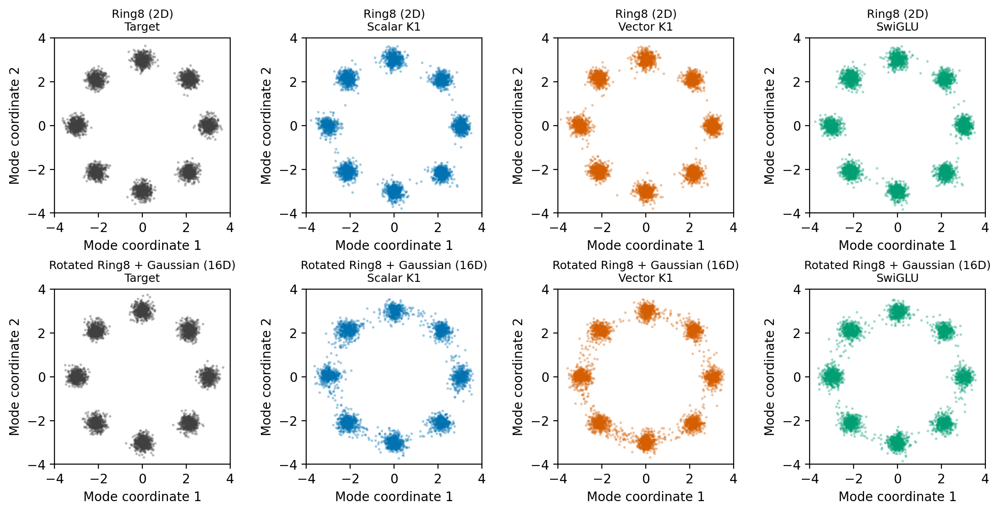

# Frozen vector-rate follow-up

The vector-rate K1 block is a useful diagnostic lead, but the current evidence does not establish a practical improvement over SwiGLU. Its Ring8 velocity fit improves after longer training; derivative quality does not improve with it, and the field advantage does not transfer to the rotated16D target.

## Exact final comparisons

All rows use the final20000-step checkpoint. Lower is better. Field MSE is per output coordinate. Jacobian error is mean squared Frobenius error. Sampling uses4096 shared Gaussian sources,128 fixed projection directions and Heun32.

| Task | Model | Test field MSE | Test Jacobian error | Test sample SW2 |
|---|---|---:|---:|---:|
| Ring8 2D | scalar_k1 | 0.01096226 | 0.356145 | 0.199666 |
| Ring8 2D | vector_k1 | 0.00891477 | 0.415992 | 0.179703 |
| Ring8 2D | swiglu | 0.01174843 | 0.285949 | 0.179726 |
| Rotated Ring8 16D | scalar_k1 | 0.00711918 | 1.477621 | 0.063539 |
| Rotated Ring8 16D | vector_k1 | 0.00708723 | 1.561746 | 0.067967 |
| Rotated Ring8 16D | swiglu | 0.00616431 | 0.989838 | 0.062941 |

Ring8 vectorK1 field error is24.12% lower than SwiGLU, but its Jacobian error is45.48% higher; their Heun32 SW2 values differ by only0.000023. On rotated16D the vector field error is14.97% higher and Jacobian error57.78% higher than SwiGLU. The rotated task's mode-subspace field MSE is.023525 vector versus.020445 SwiGLU, so averaging over background coordinates is not hiding an ODE win. Off-mode generated samples are6.20% versus3.91%, with1.25% in the target reference.

The different rankings matter: field error alone would accept the Ring8 lead prematurely. The16D task and generation checks reject that broad conclusion. The target-versus-target line is a finite empirical reference, not a lower bound or a significance threshold.

## Learning and operator behavior

The Ring8 curves approach each other at the longer budget. On rotated16D, SwiGLU learns faster and remains lower at the registered final endpoint. These complete curves do not support selecting a favorable intermediate checkpoint.

The six largest singular values of P grow gradually and remain layer-dependent. This is not evidence of a sudden numerical blow-up. The complete velocity-field Jacobian also contains gate derivatives, conditioning, normalization and the outer residual, so these curves cannot determine the full flow stability.

## Mode-space case study

The bottom row projects generated16D points onto the population's known2D mode plane; the network was not given this basis. Both ODE variants leave more points between neighboring modes than the target and SwiGLU. All methods still represent all eight clusters. This supports reporting leakage and mode masses, rather than calling the result mode collapse or relying on aggregate SW2 alone.

The rotated task is full-dimensional, but the state-dependent variation of posterior covariance remains confined to a2D subspace. It checks transfer in the presence of14 Gaussian directions. It cannot prove a need for a full-rank gate correction in16dimensions.

## Differential error case study

The oracle Jacobian is symmetric. Therefore its squared error decomposes exactly into symmetric fit error plus the squared norm of the model's skew part. On rotated16D, vectorK1 has symmetric error1.4351 and skew energy.12664; SwiGLU has.88410 and.10574. The symmetric component accounts for most of the gap. A curl-only penalty would not directly address the measured main error, and no such penalty was added.

At the largest-error vector16D test point (t=.7), the oracle expands at20.46 along its leading eigenvector while the model supplies8.40. This example is missing target expansion, not evidence that every error comes from an excessively large P. The Ring8 vector worst point has the opposite directional behavior (oracle7.93, model19.46), so a universal shrinkage explanation is also unsupported. Exact points and per-time decompositions are stored in geometry-breakdown.json.

## Next discriminating experiment

Validation-only hooks show that the extra SiLU between the two ODE solves frequently has near-zero derivative on Ring8. Delete only that activation, retaining all gate nonlinearities, and cross this factor with scalar/vector rates. This tests whether input-dependent clocks provide enough nonlinearity without an additional deformation between solves. The registered purpose, exact operator/Jacobian, sufficient singular-value condition, rival explanations and advancement rule are in ../protocol-composition.md. A mathematical identity limit does not itself establish performance.

## Claim candidates

- Keep: vector rates improve this longer-budget Ring8 field fit. Evidence: final heldout arrays and weights; allowed scope is this task and protocol. Do not turn this into a general generation advantage.
- Reject: vector rates already outperform SwiGLU as an architecture. The16D field, derivative and sample results contradict that claim.
- Keep: the full derivative error is not explained by curl alone. Evidence: the exact symmetric/skew decomposition; no claim of causality for the symmetric residual.
- Test: removing the intermediate SiLU improves the useful quality/compute frontier. This is unproven until the registered activation ablation and its continuation checks pass.

## Evidence and replay

Remote training audits checked126 saved checkpoints and30 common-validation arrays across these two studies. The Mac replay reloaded all six final checkpoints, verified frozen source/data and heldout-array hashes, recomputed30 heldout fields/Jacobians and saved-sample SW2. Replay maximum field and derivative discrepancies were below3e-14 after restoring the actual Windows Fourier-frequency buffer; see heldout-local-audit.json. Sampling trajectories were not replayed in that check. The buffer is saved separately because the historical implementation made it nonpersistent in checkpoints. Figures, audit metadata and raw final evidence are preserved; Report1 was not edited.
