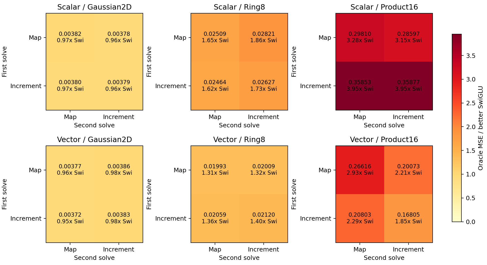
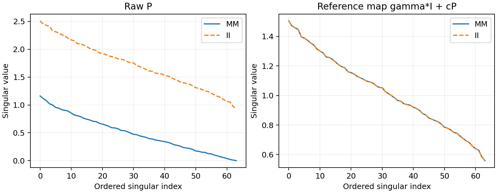

# Identity location does not close the SwiGLU gap

The first/second zero-order identities were separated in a complete MM/MI/IM/II
factorial, crossed with scalar/vector gates. M returns a map, I returns only
its increment. All eight ODE arms started at the same complete hidden
function: constant .6 gates and an I/.6 shift in each increment solve's P.
Everything else, including both SwiGLU controls, retained the registered setup.

Primary validation oracle MSE after5000updates (lower is better):

| Arm | Gaussian2D | Ring8 | Product16 |
|---|---:|---:|---:|
| Scalar MM | .003823 | .025089 | .298096 |
| Scalar MI | .003778 | .028213 | .285970 |
| Scalar IM | .003798 | .024639 | .358529 |
| Scalar II | .003787 | .026270 | .358768 |
| Vector MM | .003772 | .019930 | .266155 |
| Vector MI | .003861 | .020086 | .200734 |
| Vector IM | .003717 | .020594 | .208026 |
| Vector II | .003833 | .021198 | .168050 |
| Small SwiGLU | .004304 | .015184 | .090831 |
| Full SwiGLU | .003928 | .016221 | .108234 |

Neither mixed location recovers the intended tradeoff. Vector MI and IM reduce
product16 error, but remain over twice the small SwiGLU error and worsen Ring8
relative to vector MM. II is the strongest vector product16 result and still
has1.85times the small baseline's oracle error. Its product16 Jacobian error
is35.394 versus22.596; SW2 is.110686 versus.094624 for the better generation
baseline. All six candidates fail the preregistered screen and are stopped.

The scalar result is a useful case study. Under the earlier legacy
initialization, changing MM to II reduced product16 error from.292932 to.131388.
Under the present common-function initialization, II instead increases it from
.298096 to.358768. This does not erase the older observation. It prevents
attributing that improvement to identity removal independently of initialization.
The vector product16 benefit survives the matched initialization, but remains
insufficient for the practical objective.

The learning curves do not justify extending an otherwise failed arm. Complete
descriptive main and interaction contrasts are saved in `screen-decision.json`;
they are not population effect estimates or a reason to select a favorable cell.

## What the P trajectories do and do not establish

At initialization, the vector product16 mean raw P spectral norm across six
layers is1.124 for MM and2.496 for II; raw singular-value CV is.629 versus.236.
Nevertheless, their reference maps gamma*I+.6P agree to5.97e-8. The mean
reference-map norm is1.498 and CV.236 in both. A more uniform raw singular
spectrum can therefore accompany a pure change of representation at the same
function. Raw P uniformity alone is not a cross-architecture explanation of
better fitting. It remains meaningful to study truncation errors within one
fixed architecture and convention.

The centered-matrix curves use a fixed reference gate .6. They are neither the
actual state-dependent D(h) map nor its full input Jacobian. Full velocity
Jacobian errors are reported separately. This distinction matters because the
controller derivative term is omitted by a frozen-gate matrix spectrum.

The next question changes the generator's conditioning at fixed identities,
initial functions and dense MACs; see the [mathematical derivation](../clock-generator-mathematics.md)
and [registered protocol](../protocol-additive-generator.md). No identity sweep
or failed setting is extended. No architecture has met the original goal.

## Evidence scope

Native source/checkpoint/initialization/oracle audits pass. Selected raw data
and final checkpoints are SHA256-verified and collected; initial/intermediate
checkpoints remain immutable on Lenovo. The separate local replay JSONs record
which final velocity/Jacobian arrays were independently recomputed. These
checks do not constitute fresh holdout or sampling-trajectory replication.
Exact endpoints, budgets and wall times are in `comparison.csv`.
