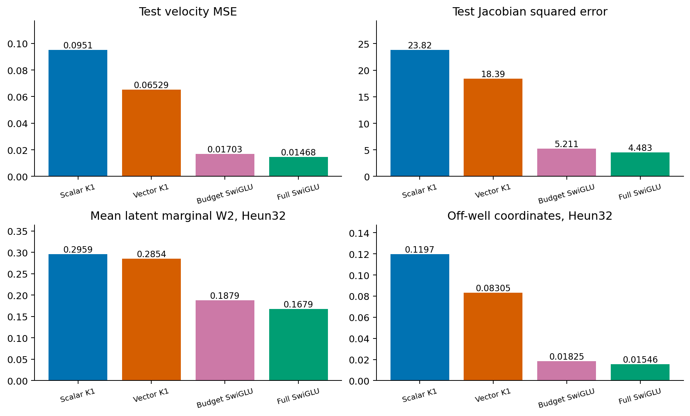
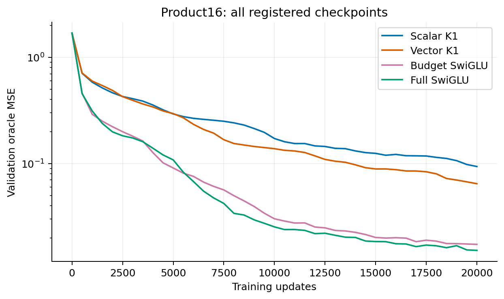
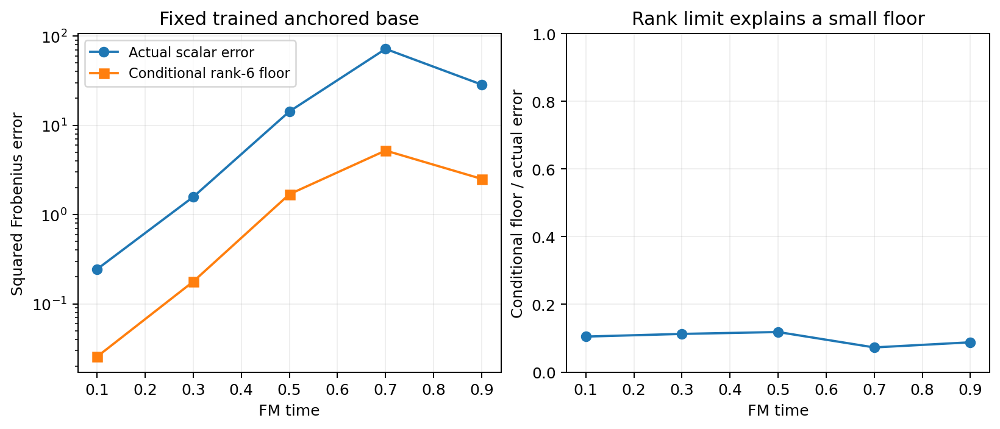

# The remaining problem is larger than scalar versus vector clocks

On the calibrated product16 population, vector clocks improve the professor block relative to scalar clocks, but the gap to SwiGLU widens. Both ordinary SwiGLU budgets recover the wells more accurately and learn the velocity/Jacobian substantially better. The current original linear-flow-map family is not a useful architecture under these comparisons.

## Frozen product16 comparison

All checkpoints are the registered final20000 updates. Test fields use common points; sampling uses8192 common Gaussian sources and Heun32. Lower is better for all table columns. Marginal W2 is the mean of sixteen latent1D distances and does not certify joint correctness.

| Model | Test field MSE | Test Jacobian error | Marginal W2 | Off-well coordinates |
|---|---:|---:|---:|---:|
| scalar_k1 | 0.095097 | 23.8232 | 0.29588 | 11.97% |
| vector_k1 | 0.065294 | 18.3885 | 0.28537 | 8.30% |
| swiglu_budget | 0.017030 | 5.2115 | 0.18793 | 1.82% |
| swiglu | 0.014683 | 4.4826 | 0.16794 | 1.55% |



Vector field error is about4.45 times full SwiGLU's error. Its off-well coordinate fraction is8.30%, compared with1.55% for full SwiGLU. Correcting more directions than the scalar controller does not close this practical gap. Its full SW2 also worsens relative to scalar despite the field improvement, so even the scalar/vector result cannot be described as a uniform generation benefit.



The complete learning curves show the baseline advantage through the final endpoint. No favorable intermediate checkpoint replaces the registered comparison. The population has about6–11 effective state-dependent directions early/mid-path and sparse late ambiguity; this is a stronger rank-related test than the previous2D Ring embedded among Gaussian nuisance coordinates. It is an explicitly constructed analytic population, not a claimed named-benchmark reproduction.

## What the rank calculation does and does not establish

Freeze all six scalar clocks at their native sample-wise forward values. The full derivative minus the anchored derivative has rank at most six by the chain rule. The measured corrections obey that limit. At the trained anchored base, the singular-value tail of the target residual beyond rank six gives a conditional best-correction floor.



This floor is7.3–11.8% of the scalar model's actual remaining Jacobian error across the five times. In the relaxed problem an arbitrary rank-six correction could therefore do much better than the learned correction. The count of clock outputs alone does not account for the measured error in that relaxation. This does not show that the actual network can realize every such correction, nor that rank has no causal role: gate-response directions, controller derivatives, optimization and the anchored base are constrained together. A later fixed-response-subspace analysis can separate those restrictions. The derivation and limits are in ../clock-rank-bound.md.

## Reuse did not solve the cost problem

The separate shared-controller screen saved about15% of whole-model parameters/MACs but lost to its precisely MAC-matched SwiGLU reference on Ring8. Tying controller weights while recomputing durations also failed. These variants are stopped under the registered rule; see ../clock-reuse-readout.md. The failed intermediate-SiLU deletion remains stopped as well.

## Next operator test

Retain the two matrices, first controller and SiLU, and put the nonlinearity inside one internal field:

```text
f_D(y) = D0 P2 SiLU(P1 y),  D0=diag(s(x)).
```

At K1 the internal increment is delta=D0 P2SiLU(P1x). Compare returning delta versus x+delta, using exactly the same weights, gate values, parameters and MACs. The comparison isolates whether injecting the additional normalized/conditioned input into the outer residual is useful. The preceding split-linear map remains a same-components reference; a fixed-rate ordinary SiLU MLP and both SwiGLU budgets prevent crediting generic nonlinearity or capacity to an ODE mechanism.

A correct nonlinear second Taylor coefficient is implemented and verified against an autograd field-JVP and RK4 local-error scaling. It is not trained in the initial screen. SuccessfulK1 fitting alone would establish neither a high-order advantage nor an FM-specific inductive bias. As a relevant methodological parallel, Mamba-3 distinguishes its formal order condition from its empirically preferred learned discretization setting; numerical order and prediction quality remain separate questions. [Mamba-3, Section3.1, Remark3](https://arxiv.org/html/2603.15569v1).

The operator screen registered in ../protocol-nonlinear-drift.md has now completed and failed its continuation rule. The nonlinear increment improves product16 versus its map counterpart but remains worse than budget SwiGLU, while Ring8 does not improve; see ../nonlinear-drift-readout.md. The goal is still unachieved. No failed variant is relabeled as useful, and historical Report1 is unchanged.
