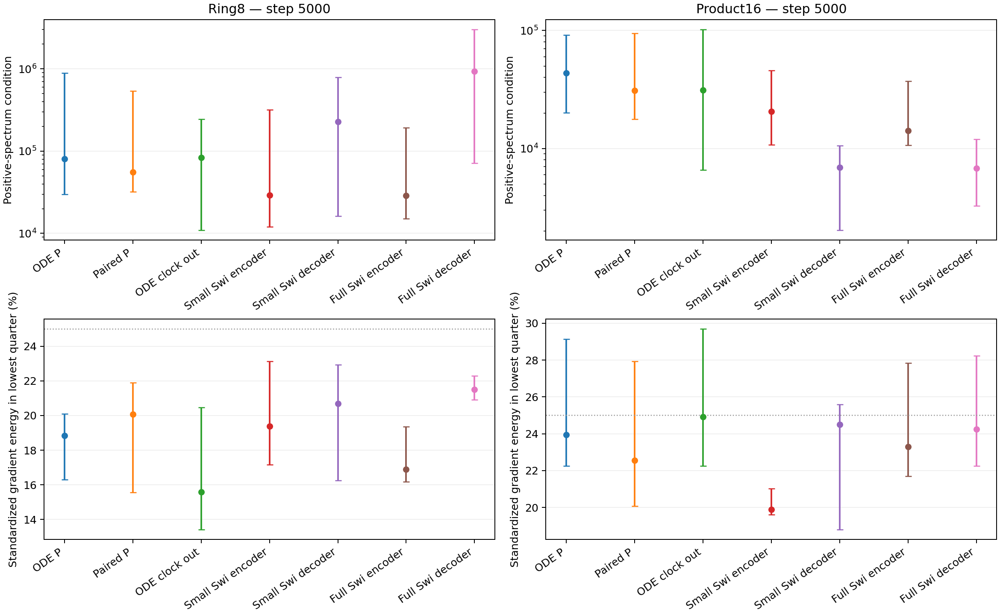
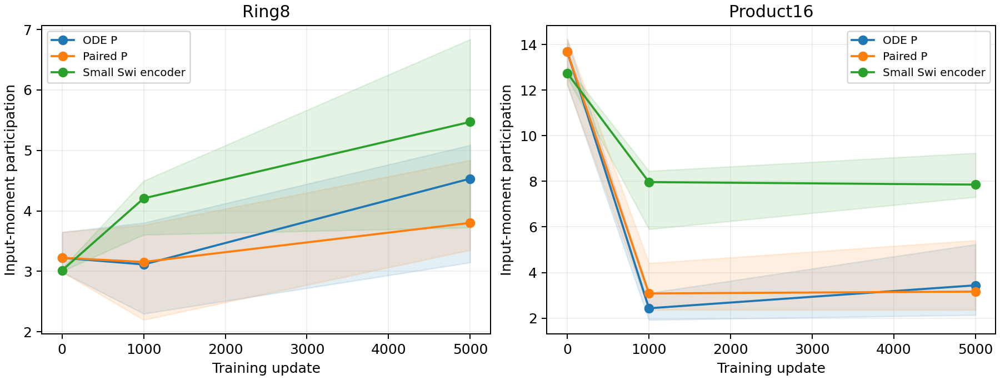

# Input conditioning is real, but not specific enough to select P whitening

The archived-checkpoint diagnostic does not justify a P-only whitening
architecture. Both ODE and SwiGLU have strongly anisotropic feature moments.
Small raw gradients in low-variance directions cannot establish that those
directions are irrelevant: the gradient itself contains the feature scale.
After correcting for that scale, their residual alignment overlaps across
the model families. This is a reason to withhold the proposed intervention,
not evidence that preconditioning can never help.

The diagnostic uses the registered four arms at steps0,1000,5000, common
bank-derived inputs and recorded runtime buffers. Every captured weight
gradient reconstructs the full-network autograd result, with maximum error
1.39e-16 on Ring8 and1.11e-16 on product16. Independent whole-network
directional finite differences validate the response formula for P,
both controller projections and both SwiGLU projections.

## Structural zeros and learned anisotropy

At every analyzed checkpoint and fixed time, the first FFN input has rank4
on Ring8 and18 on product16, exactly reaching the proven input_dim+2 bound.
Both backbones exhibit this. Pooling across time gives rank64 for the same
input. Structural fixed-time null directions therefore must not be counted
as failed training or used to motivate a singular-value constraint on P.

At5000 updates, the median positive-spectrum condition of P inputs is80769
on Ring8 and43754 on product16. Small SwiGLU's encoder has29044/20551 and
its decoder227885/6935; full SwiGLU's decoder is939980/6808. The comparison
does not show that all projections have the same job. It shows that a large
input condition number alone is insufficient to explain ODE's quality gap.
The exact group table is in [exact-table.md](exact-table.md).



Points are medians and whiskers are minima/maxima over the indicated
projections, not uncertainty intervals. The upper panels compare uncentered
positive spectra. The lower panels show the population-counterfactual
gradient after the scale correction below. The25% line is the fraction of
active dimensions selected, not a statistical null expectation.

## Correcting the misleading small-gradient interpretation

For G=U diag(lambda) U^T and weight gradient g, the raw energy in direction
j is ||g U_j||². An input-standardized coordinate has energy

```text
standardized_energy_j = ||g U_j||² / lambda_j.
```

This post-hoc correction was added after inspecting the raw gradients; it
was not a preregistered primary outcome. It is exactly the squared gradient
in coordinates using G^(-1/2)h, restricted to numerically positive directions.
It is not an optimizer-convergence estimate, a global approximation lower
bound, or the expected gain of whitening under Adam.

The lowest positive quarter contains only.0070%/.0560% of the original P's
raw coherent gradient energy on Ring8/product16 (median over six layers).
Standardization raises these shares to18.85%/23.95%. Small SwiGLU's encoder
has19.37%/19.88% and decoder20.70%/24.51%. Thus the apparently absent
low-direction signal mostly reflects feature scale. Its corrected share
does not select an ODE-specific bottleneck. Pair-label and population
counterfactual measurements are both saved, with their distinct meanings.



Lines are projection medians and bands span layers. Product16 participation
decreases after fitting begins in both backbones. This records a learned
change in features; it does not show that preventing it would improve the
field or the generated distribution. Initial backbone output responses are
exactly zero because the common output head starts at zero.

## Claim boundaries and next decision

- Claim: fixed-time first-input rank follows the affine/LayerNorm span bound.
  Evidence: exact derivation, arbitrary-affine unit test, all archived panels.
  Allowed: the structural zeros are predicted in both backbones.
  Forbidden: a global rank bound on the complete velocity Jacobian.
- Claim: raw low-direction gradient shares are suppressed by feature scale.
  Evidence: saved G and weight gradients, exact coordinate identity above.
  Allowed: scale correction changes their interpretation substantially.
  Forbidden: whitening is either proved useful or proved useless.
- Decision: do not launch P-only whitening from these measurements. The
  next structural question is the ordering of vector rates and P. The
  professor's scalar layer leaves that ordering undetermined because scalar
  rates commute with P; the vector extension does not. A separate protocol
  must specify that single-axis test before training.

Raw inputs and sufficient statistics are stored in geometry-ring/ and
geometry-product16/ under the clock_coordinates_20261024 evidence mirror.
Summary/array hashes and the plotting source hash are in provenance.json.
The original useful-architecture goal remains unproved.
