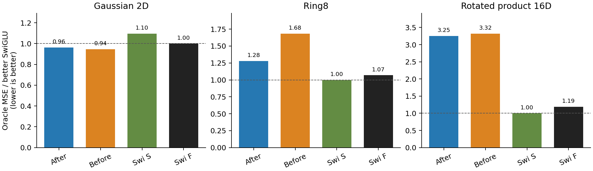
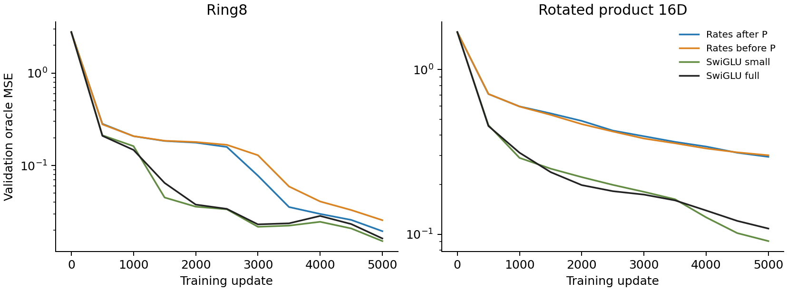
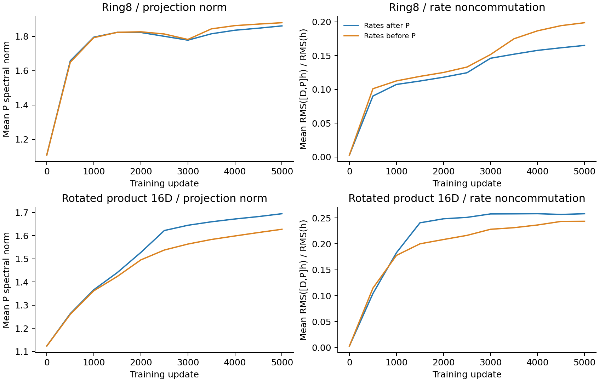

# Moving vector rates before P does not improve the nonlinear tasks

The PD variant fails its registered continuation rule and is stopped.
Its Ring8 oracle error is31.5% higher than the unchanged DP parent and68.4%
higher than small SwiGLU. On product16 it is2.2% worse than the parent and
3.32 times the small-SwiGLU error. A small Gaussian improvement does not
offset these failures. No ordering sweep, longer run or K2 rescue is selected.

| Architecture | Gaussian oracle MSE | Ring8 oracle MSE | Product16 oracle MSE | Ring8 Jacobian error | Product16 Jacobian error |
|---|---:|---:|---:|---:|---:|
| Rates after P, parent | .00377666 | .01943755 | .29524142 | .91532 | 53.73663 |
| Rates before P | .00371177 | .02556943 | .30168399 | 1.06176 | 54.85178 |
| Small SwiGLU | .00430438 | .01518420 | .09083060 | .39370 | 22.59627 |
| Full SwiGLU | .00392798 | .01622070 | .10823417 | .57103 | 25.27259 |

Oracle MSE is the uniform-time validation readout. Jacobian errors use the
same five fixed-time512-point panels and full velocity derivatives, not P.
All rows use the frozen5000-update, seed0 bank-pair protocol.

Bars normalize each task to its better SwiGLU oracle MSE. Both nonlinear
panels reject the candidate; the Gaussian result is a control, not a lead.
There are no error bars or significance claims. Exact numeric values and
ratios are in comparison.csv and screen-decision.json.

## Why this was a mathematical control

The professor's scalar s commutes with P, so it cannot determine whether a
channel-rate extension should use DP or PD. At a common positive D/P these
two generators are similar and have equal eigenvalues. Their complete
state-dependent derivatives differ. The derivation and an exact controller
case are in [rate-order-mathematics.md](../rate-order-mathematics.md).

In that constructed case, both frozen generators have eigenvalues
+/-.612832. Complete-map eigenvalues are(.470871,1.759713) after P and
(.474080,1.525920) before P. The controller is exactly representable by the
existing two-layer SiLU architecture. This shows why a frozen P-spectrum
argument cannot choose the ordering. It is not an argument that the before
variant should fit better; the actual training screen rejects it.

Parent and candidate have exactly the same initial tensors, RNG draws,
parameter counts and linear MACs. Both predicted velocities initially vanish
because of the common zero head. Their internal features generally differ,
so this is an architecture comparison, not a pure optimizer-coordinate
equivalence. Scalar commutation, full Jacobians and local P gradients are
tested directly. Both independent clocks and the middle SiLU are retained.

## Neither derivatives nor sampling rescue the variant

| Architecture | Ring8 validation SW2 | Product16 validation SW2 |
|---|---:|---:|
| Rates after P | .242779 | .114273 |
| Rates before P | .255667 | .111153 |
| Small SwiGLU | .230389 | .098223 |
| Full SwiGLU | .239583 | .094624 |

The slightly smaller product16 SW2 than the ODE parent accompanies worse
field/Jacobian fitting and remains17.5% above the better SwiGLU. It does not
pass the registered rule or establish improved generation. These are the
existing validation samples and Heun32 protocol; no fresh test split is used
to rescue a failed validation candidate.

The before variant has a slower Ring8 trajectory and does not close the
product16 gap by the fixed endpoint. The claim is confined to this budget;
the stop rule deliberately does not extend failed candidates speculatively.

## What P and the gate actually did

P norms alone again do not explain quality. Mean final norms are1.86064/
1.87921 on Ring8 and1.69476/1.62758 on product16, after/before respectively.
The candidate has a smaller product16 P norm but worse error. At each
model's actual hidden inputs, mean RMS([D,P]h)/RMS(h) is.16514/.19876 on
Ring8 and.25810/.24355 on product16. Thus the gate is not effectively scalar
at convergence. These are within-model diagnostics at different learned
anchors, not an intervention holding D/P/h fixed.

At dimension16 both ODE orientations use83664 parameters and81984 linear
MACs per example, versus71376/69696 for small SwiGLU and83598/81792 for
full SwiGLU. Observed product16 training times are54.63/54.61 seconds for
after/before and36.36/40.08 seconds for the SwiGLU sizes on this two-worker
CPU queue. This candidate provides no practical quality/cost gain.

## Verification and decision

Native audit passes72 checkpoints and60 common-field arrays, including
initial-tensor pairing and all snapshot data-generator states. Unchanged
parent and both SwiGLU endpoints exactly reproduce the preceding bank-mode
readouts. The new operator also passes a native4060 forward/backward check;
formal jobs use the faster CPU configuration with10s telemetry. Collection
and independent Mac field/derivative replay are recorded in collection.json.

Selected raw collection is complete: the65.10MB archive passes its recorded
SHA256 check. Independent Mac replay reloads all12 final checkpoints and
matches all60 saved velocity/Jacobian fields, with maximum forward difference
6.67e-15 and derivative difference2.76e-14. Saved runtime buffers are restored.
This replay covers validation fields, not optimization or new test samples.

The PD ordering stops. The current evidence still does not establish a
useful final ODE architecture. The next structural question should return
to the original layer's zero-order identity term, which the professor's
provided code explicitly offered as optional. It requires its own derivation
and registration, not an automatic combination with this rejected variant.
