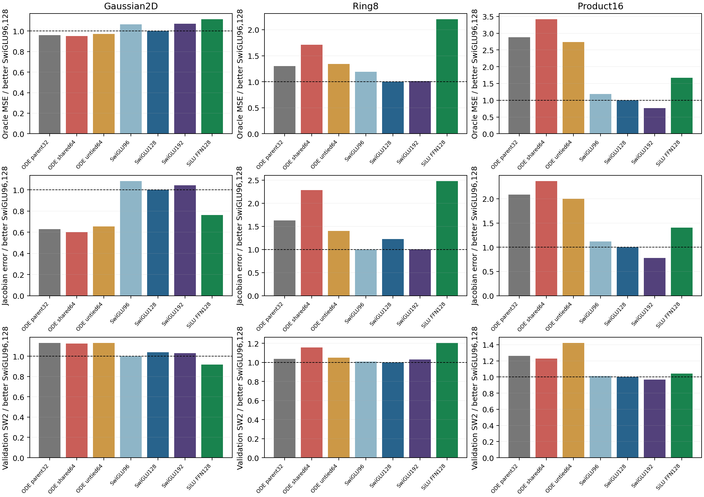
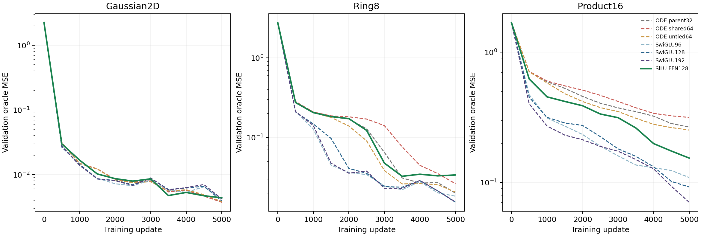

# Plain SiLU reference: the ODE gap depends on the task

The ordinary two-projection SiLU FFN substantially improves Product16 over the original vector ODE at exactly the same parameter and matrix-product budget, but performs worse on Ring8. SwiGLU remains better on both nonlinear tasks. This control rules out a universal explanation in either direction: the Product16 gain does not require SwiGLU-specific gating, while an ordinary expanded FFN does not generally close the ODE gap.

The [protocol](../protocol-reference-silu.md) was registered before the one authorized launch. The unchanged `ffn` implementation uses `Linear(64,128) -> SiLU -> Linear(128,64)`. No model, loss, optimizer, or diagnostic source changed. Only the missing reference was trained on the three existing tasks; the six Stage17 arms were reused after source, initialization and data-RNG checks.

## Results at the fixed endpoint

Primary validation oracle MSE after5000 updates:

| Arm | Gaussian2D | Ring8 | Product16 |
|---|---:|---:|---:|
| ODE parent32 | 0.003771550 | 0.019929635 | 0.266155193 |
| Plain SiLU FFN128 | 0.004384110 | 0.033713785 | 0.153892194 |
| SwiGLU96 | 0.004188221 | 0.018257763 | 0.109160768 |
| SwiGLU128 | 0.003927254 | 0.015296290 | 0.092325770 |
| SwiGLU192 | 0.004208339 | 0.015447624 | 0.070422554 |

All seven arms, including the failed shared/untied settings, remain visible in [comparison.csv](comparison.csv) and the figure.

**Product16:** plain SiLU reduces the parent's oracle MSE by42.18%, Jacobian error by32.85%, and SW2 by17.38%. Its Jacobian error is33.577529 versus50.001937; SW2 is0.099678 versus0.120646. These improvements occur without a SwiGLU product gate. However, its MSE remains1.667 times SwiGLU128's0.092326, and1.410 times the smaller SwiGLU96's0.109161. There is a generic FFN benefit relative to this ODE on Product16, followed by an additional SwiGLU benefit under the tested configurations.

**Ring8:** the ordering reverses. Plain SiLU increases oracle MSE by69.16% relative to ODE, Jacobian error by52.14%, and SW2 by16.01%. Its Jacobian error is1.260573 versus0.828581; SW2 is0.272279 versus0.234701. Its oracle MSE is2.204 times SwiGLU128. This prevents the claim that replacing the ODE by any ordinary expanded SiLU FFN improves these tasks.

**Gaussian2D:** SiLU has16.24% higher oracle MSE than the ODE parent but18.89% lower SW2. The field and generation metrics are not interchangeable, even on the control distribution.

## Budget and interpretation

Each FFN has16576 parameters and16384 dense MACs, exactly equal to the parent's two vector32 K1 solves. Full models have81858 parameters/80192 MACs for either2D task, and83664/81984 for Product16. Biases are included in parameter counts; nonlinear and elementwise operations are excluded from dense MACs. The ordinary FFN is the expanded128 baseline, not the earlier width64 collapsed-map control.

The models share the initial input, time conditioning, normalization and output tensors, including actual Fourier buffers. Their native FFN draws remain different, and no nonzero-head function equivalence between SiLU and ODE is claimed. The result compares complete architectures under a fixed budget and training protocol. It does not isolate expansion width, gate multiplication, bias placement or optimization geometry as a sole cause.

The new reference is the solid green curve; dashed curves are immutable Stage17 controls. All recorded points and the registered5000-update endpoint are retained. The Ring8 failure is not hidden by choosing an earlier checkpoint, and no extra width or training-length search follows this control.

The necessary conclusion for subsequent mathematical design is narrower than a new architectural proposal. A proposed ODE activation must account for both the strong expanded-SiLU Product16 result and its Ring8 weakness, while retaining the stronger SwiGLU controls. A useful reparameterization or derivation cannot be credited with benefits that an ordinary FFN already provides. This reference does not nominate an ODE architecture or revise earlier failed settings.

Training used seed0 and the unchanged5000-update protocol. The three jobs completed in one queue submission, with real CPU telemetry and no GPU reservation. All18 new snapshots and15 diagnostic arrays passed the native audit; all three final fields/Jacobians replay exactly. Details, hashes and reuse conditions are in [stats-appendix.md](stats-appendix.md).
