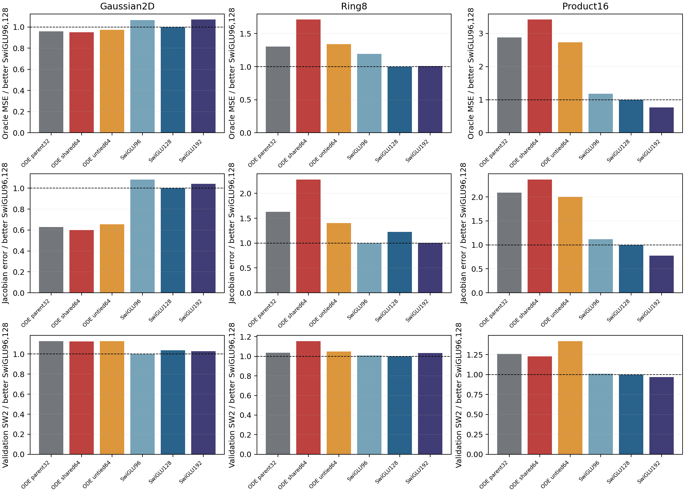
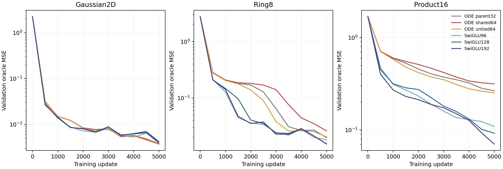
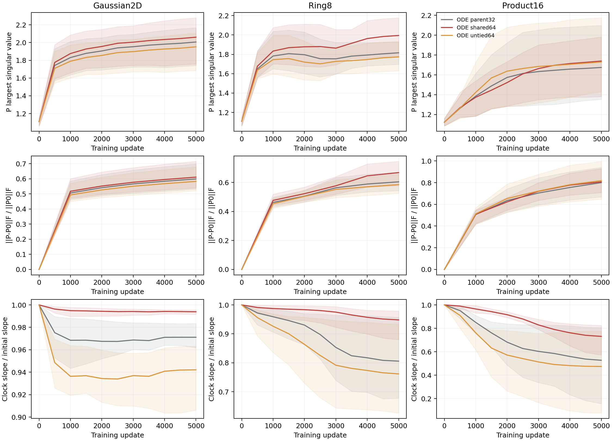

# Stage17: sharing the value projection with the clock features

Neither new setting passes the registered screen. Sharing P with the clock's first projection worsens both nonlinear tasks. Allowing a separate, wider clock projection recovers some of that loss, but still falls well behind SwiGLU at comparable computation. This closes the fully shared feature setting tested here; it does not support a width, temperature, or Taylor-order rescue.

The [registered protocol](../protocol-shared-features.md) and [design review](../shared-feature-design-review.md) preceded training. Exact endpoint values are in [comparison.csv](comparison.csv); the [screen decision](screen-decision.json) retains every failed condition.

## What changed

The parent uses an independent hidden32 controller in each K1 solve. The shared64 solve computes `z=P h` once, then `s=.2+.8 sigmoid((Wg SiLU(z+b)+bg)/10)` and `F=h+s*z`. Untied64 instead computes the clock features from `R h+b`, with R initialized to P. Two independent solves and the middle SiLU remain intact. This shares features inside each solve; it does not share clocks between solves.

Shared64 and untied64 start with identical feature tensors, b=0 and Wg=bg=0. Their complete initial functions and input Jacobians match after a common nonzero output head is inserted. Their initial FFN parameter kernels also match, as verified before training. Subsequently the shared P receives the sum of the value-path and feature-path gradients. Untied64 separates those updates. Their kernel difference contains signed cross terms, so sharing has no guaranteed optimization benefit. The untied function family contains the shared family.

All six arms use the same hash-bound initial non-FFN tensors and runtime buffers. Training retains seed0, 5000 updates, batch512, width64/depth3, the cached-bank pair objective, and the existing evaluation streams. Both child studies completed, with two monitored one-thread CPU workers and no GPU allocation.

## Endpoint evidence

Primary validation oracle MSE, lower is better:

| Arm | Gaussian2D | Ring8 | Product16 |
|---|---:|---:|---:|
| ODE parent32 | 0.003771550 | 0.019929635 | 0.266155193 |
| ODE shared64 | 0.003735928 | 0.026203069 | 0.315822079 |
| ODE untied64 | 0.003821606 | 0.020539034 | 0.252547954 |
| SwiGLU96 | 0.004188221 | 0.018257763 | 0.109160768 |
| SwiGLU128 | 0.003927254 | 0.015296290 | 0.092325770 |
| SwiGLU192 | 0.004208339 | 0.015447624 | 0.070422554 |

Shared64 is 31.48% worse than its parent on Ring8 and 18.66% worse on Product16. It reaches 1.713 and 3.421 times the better established SwiGLU MSE, respectively. Its nonlinear Jacobian errors are also worse: 1.159787 on Ring8 and 56.655235 on Product16, against the better established baseline's 0.508748 and 23.957835. Its SW2 exceeds that baseline by 15.53% and 22.75%. The small Gaussian improvement does not offset these failures.

Untied64 is 5.11% better than its parent on Product16, while Ring8 is 3.06% worse. The comparison with SwiGLU192 is decisive: both require 106560 dense MACs per Product16 forward pass, but untied64 has 3.586 times its oracle MSE, 2.573 times its Jacobian error, and 1.467 times its SW2. This result does not establish a useful advantage from wider independent clock features.

The generation metric does not simply follow field MSE. On Product16, shared64 has worse field MSE than the parent but slightly lower SW2, 0.117499 versus 0.120646. Untied64 improves field MSE but worsens SW2 to 0.136012. All remain worse than the SwiGLU controls. This is why the registered decision retains both field and generation checks.

## Learning and learned projections

The nonlinear gap appears well before the endpoint. At update2000, Ring8 MSE is 0.181644 for shared64 and 0.139281 for untied64, compared with 0.035508–0.040770 for the three SwiGLU sizes. On Product16 the corresponding values are 0.512251 and 0.418300 versus 0.212948–0.274217. The complete curves remain available in [learning-curves.csv](learning-curves.csv); no checkpoint was selected retrospectively.

The plot shows means across the six solves, with their minimum-to-maximum range. The band describes layer variation, not statistical uncertainty. Every saved layer/time record is retained in [P-trajectories.csv](P-trajectories.csv).

On Ring8, mean final sigma_max(P) is 1.816 for the parent, 1.995 for shared64, and 1.773 for untied64. Relative P drift from initialization is 0.605, 0.668, and 0.586. Shared64 therefore changes P somewhat more while learning a worse field. On Product16, the corresponding sigma_max values are much closer: 1.674, 1.739, and 1.730. These summaries do not establish spectral instability or a reason to impose a new cap.

Shared64 also retains *more* clock-logit sensitivity. On Product16 its average slope relative to initialization is 0.731, against 0.527 for the parent and 0.474 for untied64. The outer-saturated fraction is only 1.274%, against 18.073% and 25.824%. Thus a low saturation fraction is not sufficient for a good learned field. These measurements are on the existing fixed diagnostic probes and do not describe all states encountered during sampling.

Untied64 moves away from R=P: mean final `||R-P||F/||P||F` is 1.397 on Ring8 and 1.778 on Product16. The trained untied network is no longer using the shared feature constraint. Together with the worse shared result, this is consistent with a cost to requiring one matrix to serve both roles. It does not prove gradient conflict or identify which feature directions are needed; the parameter distance alone is not an intervention.

## Costs and disposition

Product16 totals:

| Arm | Parameters | Dense MACs | Recorded training seconds |
|---|---:|---:|---:|
| ODE parent32 | 83664 | 81984 | 31.936 |
| ODE shared64 | 83856 | 81984 | 30.000 |
| ODE untied64 | 108432 | 106560 | 30.204 |
| SwiGLU96 | 71376 | 69696 | 17.679 |
| SwiGLU128 | 83598 | 81792 | 21.305 |
| SwiGLU192 | 108624 | 106560 | 21.741 |

Dense MAC accounting was checked against executed linear operations before training. It excludes activations and elementwise operations. Recorded wall time includes in-loop validation and shares the CPU with another worker; it is not an isolated inference benchmark.

The intended computational saving is real: shared64 obtains64 clock features at the parent's matrix-product budget. The performance hypothesis fails under the registered setting. Neither sharing nor its independent control is nominated. The next architectural argument must explain a different measured failure; these results do not warrant another variant along the same sharing/width axis.

All final outputs and input Jacobians replay exactly from saved checkpoints. Source, initialization, aliasing, optimizer deduplication, data RNG, oracle reconstruction, and tooling limitations are recorded in [stats-appendix.md](stats-appendix.md). This is evidence about the current synthetic backbone and validation tasks, not a claim about JiT image generation.
