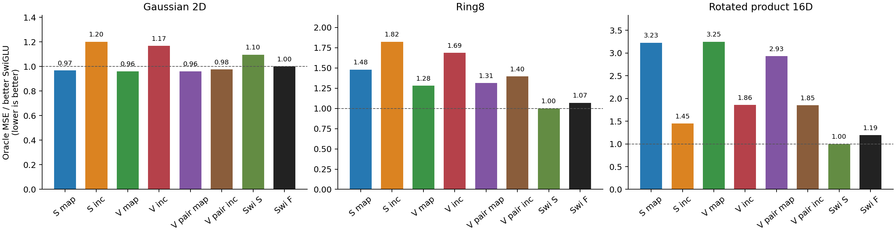
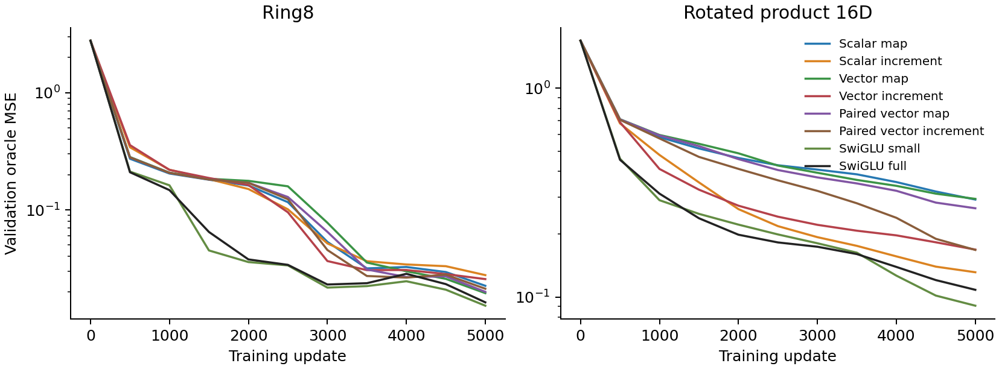
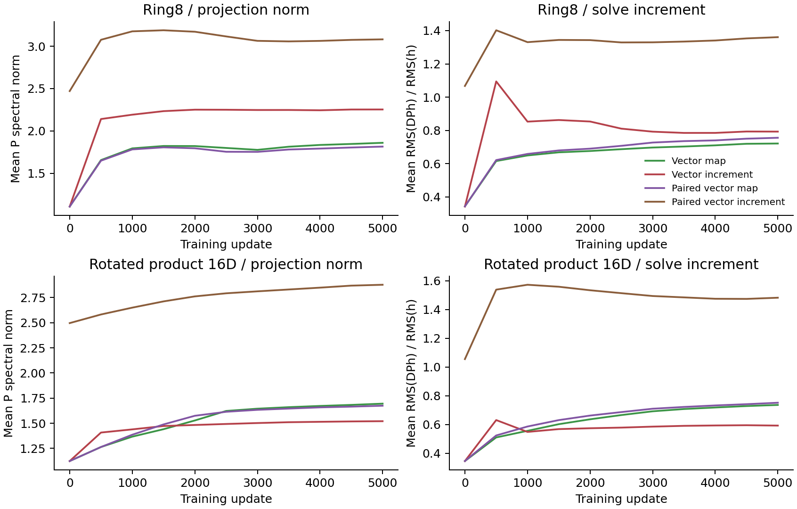

# The zero-order term matters, but removing both copies is not a useful architecture

Returning only the increment in both original solves improves product16
fitting and derivatives, while worsening Gaussian/Ring8 fitting. The paired
initialization control retains the product16 benefit, so a large difference
in initial hidden features is not necessary for that observation. No arm
passes the registered practical screen against SwiGLU. These settings stop.

| Architecture | Gaussian oracle MSE | Ring8 oracle MSE | Product16 oracle MSE | Product16 Jacobian error | Product16 SW2 |
|---|---:|---:|---:|---:|---:|
| Scalar map | .00380177 | .02245710 | .29293213 | 53.27521 | .130629 |
| Scalar increment | .00472064 | .02770813 | .13138824 | 28.90334 | .096206 |
| Vector map | .00377666 | .01943755 | .29524142 | 53.73663 | .114273 |
| Vector increment | .00458535 | .02561661 | .16868836 | 33.99748 | .112178 |
| Paired vector map | .00377155 | .01992968 | .26615522 | 50.00193 | .120646 |
| Paired vector increment | .00383318 | .02119812 | .16804954 | 35.39413 | .110686 |
| Small SwiGLU | .00430438 | .01518420 | .09083060 | 22.59627 | .098223 |
| Full SwiGLU | .00392798 | .01622070 | .10823417 | 25.27259 | .094624 |

All are5000-update seed0 runs under the same bank-pair objective, validation
streams and shared backbone. Oracle MSE is the uniform-time readout;
Jacobian errors use complete velocity derivatives on the fixed-time panels.

The product16 reductions are substantial relative to the ODE parents, but
every increment remains above the practical baseline. Gaussian/Ring failures
also reject transferring the change as a general improvement. The complete
registered decision is in screen-decision.json; no derivative or sampling
metric is substituted for a failed primary comparison.

## What the initialization control isolates

For constant D=cI, map P and increment Q=P+I/c give the same solve function.
Zeroing only the last controller affine makes that correspondence valid at
initialization while allowing both controllers to train subsequently. The
paired comparison preserves the entire initial hidden function mathematically,
and measured native float32 defects are below1.91e-6. All other raw tensors
and RNG draws match. Nonzero-head CPU/CUDA tests expose rather than mask
these small numerical defects.

The paired increment lowers product16 oracle MSE by36.9% and Jacobian error
by29.2%, but raises Ring8 oracle MSE by6.4%. This is a task-dependent
structural/learning-response observation. It is not a theorem about a global
expressivity advantage or optimizer convergence. The dynamic model families
are not related by one constant P translation after their rates adapt.

The legacy comparison changes initial hidden features substantially. Its
scalar increment has a55.1% product16 MSE reduction but24.2%/23.4% higher
Gaussian/Ring error than its map parent. Both comparisons must be retained;
neither supports removing all internal identities unconditionally.

The curves retain all eight arms. The paired map and increment start from
the same full output function, as do all zero-head models, and their stronger
hidden-function pairing is checked separately. Their later separation is
expected from the different controller responses derived in
[zero-order-mathematics.md](../zero-order-mathematics.md).

## Why the P spectrum alone is not the explanation

The paired increment begins with a larger raw P because the identity has
been absorbed into it, despite an unchanged complete hidden function. A raw
P bound would describe a different family of complete maps in the two
representations. The figure reports actual per-solve increment RMS alongside
P norms; neither is the complete velocity Jacobian.

At the paired initial function P gradients agree, but the last-controller
gradient gains a term proportional to q*h/c. The resulting tangent-kernel
difference contains signed cross terms and can be positive or negative;
an exact full-parameter counterexample tests both signs. This distinguishes
the change from a uniform increase in gate gradient scale. See
[the additional derivation](../zero-order-tangent-kernel.md).

## Sampling and cost do not establish a practical win

The scalar increment's product16 SW2 is close to full SwiGLU(.096206 versus
.094624), but its oracle error is44.7% above small SwiGLU and its Jacobian
error27.9% higher. SW2 alone cannot certify accurate joint mode structure.
Its product16 training time is42.70 seconds versus31.78/35.45 for small/full
SwiGLU. Removing additions does not reduce the dominant linear MAC count;
this is not a cheaper equivalent-quality result.

## Verification and next question

Native audits pass144 checkpoints and120 saved oracle arrays, including
initial tensors, expected P shifts, zero last-controller affines and all
snapshot data-generator states. Compact evidence is collected and hash
verified. All source runtimes remain immutable; raw collection and independent
endpoint replay are tracked separately in collection.json.

Selected collection and replay are now complete: the101.55MB archive passes
SHA256 verification; Mac reloads24 final checkpoints and reproduces120 saved
velocity/Jacobian fields (max forward9.77e-15,derivative3.36e-14). Actual
runtime buffers are restored. This does not replay optimization or new samples.

The unresolved issue is location: changing both solves at once cannot tell
whether the first and second identity terms serve different roles. The chain
derivative places a first-solve controller response through the second solve,
while the second controller acts directly on activated features. A separate
factorial location test with common initial hidden functions is the next
identified question. No failed both-increment arm is accepted as the final
architecture, and the full useful-architecture goal remains unmet.
