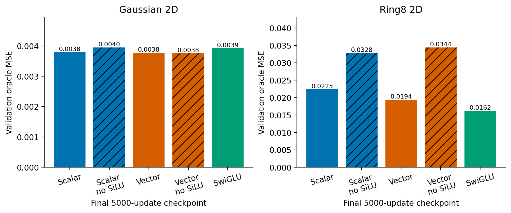

# Intermediate activation ablation

Removing only the SiLU between the two K1 ODELayer solves failed the registered screen. The same initial tensors, parameter count, linear MAC budget, source/target/time draws and5000-step endpoint were retained within each activation pair. Gate nonlinearities remained active. Both reference architectures and SwiGLU reproduced the earlier screen endpoints exactly.

| Task | Gates | With SiLU: oracle MSE | Without: oracle MSE | Relative change |
|---|---|---:|---:|---:|
| gaussian_aniso_2d | scalar | 0.00380177 | 0.00395396 | +4.00% |
| gaussian_aniso_2d | vector | 0.00377666 | 0.00375727 | -0.51% |
| gmm_ring8_2d | scalar | 0.02245710 | 0.03284583 | +46.26% |
| gmm_ring8_2d | vector | 0.01943755 | 0.03443119 | +77.14% |

The identity composition remains nonlinear through its gates and has a cleaner zero-generator identity limit. Neither fact was enough for better Ring8 learning. Ring8 derivative error also worsened: scalar.91835→1.50636 and vector.91532→1.56971. The small Gaussian improvements in some metrics do not compensate for this failure. Neither deletion arm will be extended under the registered rule.

This does not prove that the intermediate activation is necessary for every task, budget or gate parameterization. It does reject this specific deletion under the current matched protocol. Near-zero derivative coordinates in the trained model were a diagnostic observation; treating them as evidence that those coordinates should be deleted would have been an incorrect inference.

The audit checked60 checkpoints and50 validation arrays, recomputed the analytic oracle and validation error, verified frozen source/data hashes, and checked initial pairing. See evidence/composition_20261024/audit.json and comparison.csv. Historical Report1 was not modified.
