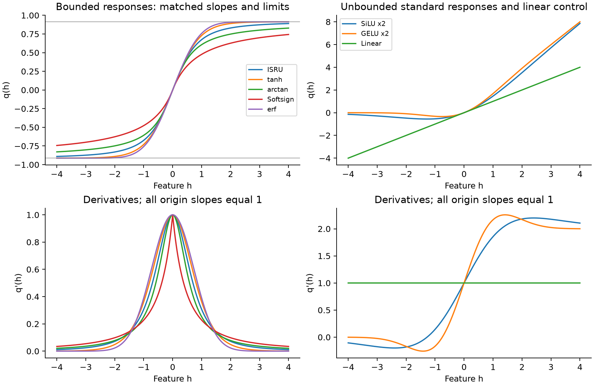

# Response-family comparison before CelebA transfer

15 November 2026. Planning revision after the user's request to compare more
than tanh. Tanh is an incumbent, not a selected winner. No training is
launched in this planning turn.

## Question and limits

Which response q(h), inserted through D(h)=diag(q(h)/h), gives a better
quality/cost tradeoff in the existing frozen-generator ODE-FFN? Does its
ranking depend on K1 versus K8? Select a response empirically before the
next expensive CelebA run.

Changing q changes the actual input-dependent generator, its derivatives and
the initial hidden function. Identical trainable tensors do not make initial
functions identical. This study cannot prove PD(h)>s(h)P, a universal best
activation, or an ODE-specific advantage. The earlier two-candidate test was
enough to challenge ISRU's necessity, but not to select the best response.

## Fixed architecture

Use the existing pinned synthetic trainer and paired width64/depth3 models.
For each of the two local solves around the unchanged middle SiLU:

```text
d = d(h0), calculated once and kept differentiable
term0 = h0
termj = P[d * term(j-1)] / j
FK(h0) = sum(term0,...,termK)
```

K is1 or8. Two independent P matrices per FFN; each is reused within its own
series. No other architectural change, learned response scale, norm penalty,
optimizer sweep or feedback update. All eight response families add zero
trainable parameters. At the same K their dense matrix work is identical;
pointwise costs differ and must be measured.

## Representative candidate set

Let c=sqrt(1.2), L=1/c, z=c h. All entries have q(0)=0 and q'(0)=1.
Five bounded odd functions share limits +/-L, keeping local slope and output
ceiling fixed while comparing response shape.

| Family | q(h) | d(h), with continuous zero value | Role |
|---|---|---|---|
| ISRU | h/sqrt(1+z^2) | 1/sqrt(1+z^2) | Existing response anchor |
| tanh | L tanh(z) | tanh(z)/z; d(0)=1 | Existing response anchor |
| arctan | (2L/pi) atan(pi*z/2) | atan(w)/w, w=pi*z/2; d(0)=1 | Slow algebraic approach to saturation |
| Softsign | h/(1+abs(z)) | 1/(1+abs(z)) | Rational response with different smoothness |
| erf | L erf(sqrt(pi)*z/2) | (sqrt(pi)/2) erf(w)/w, w=sqrt(pi)*z/2; d(0)=1 | Gaussian derivative decay |
| SiLU, slope normalized | 2 h sigmoid(h) | 2 sigmoid(h) | Unbounded, asymmetric standard response |
| GELU, slope normalized | 2 h Phi(h) | 2 Phi(h)=1+erf(h/sqrt(2)) | Unbounded, asymmetric standard response |
| Linear | h | 1 | Remove input-dependent diagonal |

The SiLU/GELU factor2 is fixed algebraic slope matching, not a tuned
hyperparameter. Their lack of odd symmetry and finite saturation is deliberate:
compare the whole alternative response, without attributing results to a
single shape property. Keeping only odd bounded candidates would assume
those properties were already optimal. For these two candidates d lies
between0 and2 rather than0 and1, which affects high-order amplification;
measure it and stop nonfinite arms instead of adding a special rescue.

Softsign q is continuously differentiable, but d is not differentiable at
zero. At K>=2 the complete conditional polynomial can be nonsmooth on
coordinate hyperplanes even when q is C1. Record the native subgradient
convention and one-sided behavior; do not claim smooth full Jacobians there.

Reuse the prior ISRU/tanh implementations. New operations should call
PyTorch's existing atan, softsign, erf, silu and exact GELU/Phi functionality;
only fixed scaling and the ratio-to-diagonal adapter are project code.
Use continuous limits/verified local series at zero for the ratio forms.
These are established functions, not newly invented activations.

## Grid, reuse and resource boundary

Two datasets: Ring8 and Product16. Eight responses x two orders x two tasks
give32 cells, all seed0,20k updates,batch512,AdamW3e-4,weight decay0,grad clip1.
This fixes update budget, not training FLOPs across orders.

The eight ISRU/tanh cells already exist. Two linear-K1 cases exist.
Thus22 cells need new training if all ten source anchors are available and
replay-compatible. Bind those anchors and sample identities first. If an
anchor is unavailable, record the missing case and obtain a deterministic
replay decision; do not silently compare incompatible historical scores.

The ordinary SwiGLU and Free ISRU references remain visible. Their actual
parameterizations/optimizers are labeled and are not response-only ablations.
Do not narrow the qualified native CelebA baseline.

Proposed execution uses145 physical GPUs4-7 only, initially at most two cards.
Benchmark one versus two independent workers on a card for200 updates before
choosing concurrency. Use CPU threads1 per worker, the warm environment,
persistent monitoring and a separate frozen runtime. Register walltime from
actual throughput. Stop nonfinite arms, retain their artifacts, and report
failures; no coefficient/LR/order rescue within this wave. There is no claim
of an optimal GPU count before that measurement.

## Selection and final confirmation

Historical common banks have already been inspected repeatedly. Keep their
scores as historical evidence; do not relabel them as unseen validation.
Before any new training, register separate selection and confirmation probes
and sample arrays from the known laws, with SHA256 bindings. Reevaluate all
available old and new focal checkpoints on the same new arrays.

- Selection field probe:4,096 independently generated state/time points and
  analytic conditional velocity targets per dataset.
- Selection sampling:8 common Gaussian/target banks of4,096 points,
  256 directions, native Heun128. Use selection-only RNG stream2026111500.
- Confirmation: the same sizes using disjoint RNG stream2026111600.
  Confirmation measurements do not change the shortlist.
- These array RNG streams are evaluation settings, not training seeds.
- Primary checkpoint is20k. Show15k as a training trajectory check;
  do not choose the best of15k/20k after seeing the scores.
- Primary selection quality is pooled SW2; field MSE, per-bank differences,
  mode balance/examples, finiteness and measured cost remain required.
  A favorable sliced score alone cannot override visibly wrong Product16
  gap mass or missing modes.

For each K separately, a candidate is eligible only if its selection field
MSE is no worse than the worse of the two incumbents (ISRU,tanh) on each
task. Rank eligible candidates by the worst across tasks of
SW2(candidate)/min(SW2(ISRU),SW2(tanh)). Lower is better. This is a prespecified
practical shortlist rule, not a mathematical optimality or significance test.
Show the full per-task table and quality/cost Pareto plots so the scalar rule
cannot hide a tradeoff. Tanh and ISRU enter the same ranking as all candidates.

Freeze at most the best two eligible K8 responses for confirmation, breaking
ties within numerical recomputation tolerance by lower measured latency and
then the listed family order. Evaluate their own K1 counterparts as well;
they are controls, not two more opportunities to choose a winner. If a
shortlisted K8 is dominated by its K1 counterpart in both task qualities and
measured cost, report that and return to the K choice before image transfer.
Do not replace it post-hoc with the third-place response on confirmation.

No automatic image launch follows a small or inconsistent lead. If the two
datasets favor different candidates, retain that task dependence instead of
declaring a universal winner. Confirmation determines whether the selected
lead survives new sampling; it is not an independent training replication.
Publish all32 cell dispositions, including reused, missing, failed and poor
ones, before recommending a CelebA choice.

## CelebA decision

The earlier tanh-only proposal is superseded by this comparison. Once a
response is selected, propose at most two new image trajectories, preserving
JiT-B/16,CelebA128,width1200,seed0,100epochs andFID50k every20epochs.
Native SwiGLU and widened ISRU-D references remain the practical and response
controls. Reconfirm recipe, initialization, source, runtime and evaluation
compatibility; qualify each transfer with actual FID, not synthetic rank.

A gain over ISRU-D alone supports a response change. A useful replacement
also needs a competitive tradeoff against original SwiGLU. No activation
search, synthetic symmetry control or faster matrix-exponential approximation
by itself establishes that result.

## Sources and proposed artifacts

- [ISRU original paper, section5](https://arxiv.org/html/1710.09967v2#S5).
- [PyTorch Softsign](https://docs.pytorch.org/docs/stable/generated/torch.nn.Softsign.html),
  [atan](https://docs.pytorch.org/docs/stable/generated/torch.atan.html),
  [erf](https://docs.pytorch.org/docs/stable/special.html#torch.special.erf),
  [SiLU](https://docs.pytorch.org/docs/stable/generated/torch.nn.SiLU.html),
  [GELU](https://docs.pytorch.org/docs/stable/generated/torch.nn.GELU.html).
- [Completed response/order evidence](../2026-11-15-order-response/findings.md).
- Proposed artifacts: source-bound grid and old anchors, selection/confirmation
  manifests, completion records, full metrics, response/derivative curves,
  P-action and Taylor-term summaries, and a short recommendation.

[Formula checks and curve plot](response-screen-formulas.json) verify the
normalization used in this proposal. They are algebra checks, not model
training, autograd readiness or performance results. Finalized Reports1/2,
training code, existing runtime outputs and checkpoints remain preserved.



