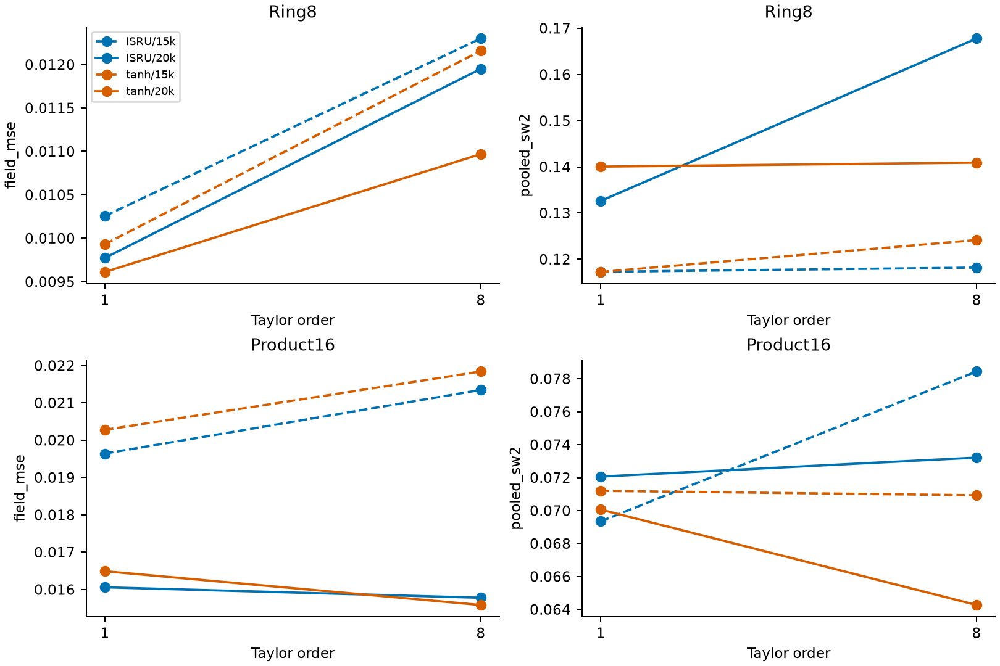
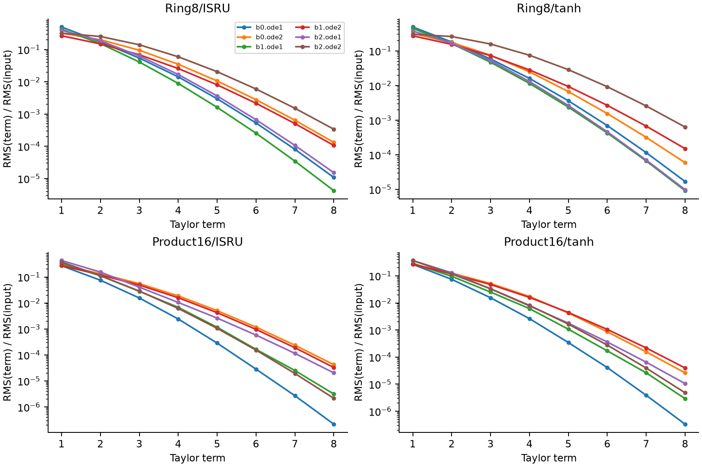
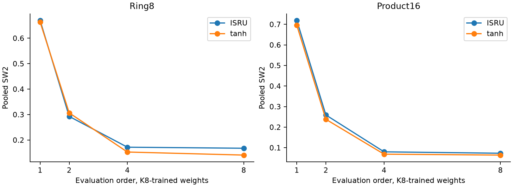
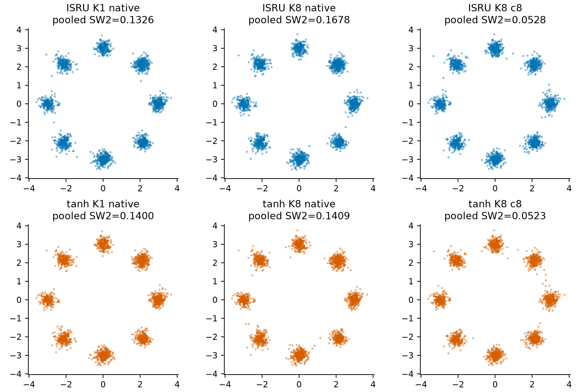

# Higher order changes the learned map, but does not favor ISRU

15 November 2026. Four new K8 trajectories completed on 145 GPUs 4–7.
The comparison reuses four verified K1 checkpoints and changes only Taylor
order. All runs use seed 0, AdamW 3e-4, batch 512 and 20,000 updates.
Parameters and initialization are identical across orders. K8 performs eight
P applications per solve; the comparison fixes updates, not compute.

## Does ISRU benefit specifically from K8?

No consistent ISRU-specific benefit appears in this comparison. On Ring8,
K8 worsens ISRU field MSE by 22.3% and pooled SW2 by 26.5%. On Product16,
ISRU field MSE improves by 1.7% but pooled SW2 worsens by 1.6%. Tanh-K8 is
the positive case: on Product16 it improves field MSE by 5.5% and pooled SW2
by 8.3% relative to tanh-K1, with lower SW2 in seven of eight common banks.

| Dataset | Response | K1 field MSE | K8 field MSE | K1 pooled SW2 | K8 pooled SW2 |
|---|---|---:|---:|---:|---:|
| Ring8 | ISRU | 0.009773 | 0.011951 | 0.13261 | 0.16779 |
| Ring8 | tanh | 0.009611 | 0.010969 | 0.14005 | 0.14090 |
| Product16 | ISRU | 0.016059 | 0.015779 | 0.07206 | 0.07321 |
| Product16 | tanh | 0.016489 | 0.015585 | 0.07006 | 0.06427 |

These are the registered 20k endpoints. At 15k, all four K8 field errors are
higher than their K1 counterparts; Product16 tanh's sampling advantage is
only 0.00027. Its larger gain develops between 15k and 20k. The
[paired-bank differences](results/order-contrasts.json) and
[response-by-order interaction](results/interaction.json) preserve both
checkpoints. Bank variation describes sampling conditional on the saved
weights.

The unchanged Product16 ordinary controls have pooled SW2 0.06787 for Free
ISRU and 0.06487 for SwiGLU192/AdamW. Tanh-K8 reaches a similar endpoint to
SwiGLU192; the 0.00060 difference and extra recurrent matrix work do not
establish a useful quality/cost advantage. These ordinary models are context,
not the order-only controls. Their evidence is in the
[previous complete comparison](../2026-11-15-professor-execution/results/metrics.csv).

## Are the high-order terms actually used?

Yes. Across the six ISRU layers, RMS(sum of terms 2–8) divided by RMS(term 1)
ranges from 0.45 to 1.50 on Ring8, and 0.31 to 0.69 on Product16.
The measurement uses 512 fixed validation states and reproduces the native
layer outputs exactly.

Deleting terms from a trained K8 model strongly changes its result:

| Trained K8 model | Evaluate at K1 | Evaluate at K2 | Evaluate at K4 | Evaluate at K8 |
|---|---:|---:|---:|---:|
| Ring8 / ISRU | 0.66986 | 0.29292 | 0.17188 | 0.16779 |
| Ring8 / tanh | 0.66365 | 0.30671 | 0.15291 | 0.14090 |
| Product16 / ISRU | 0.71916 | 0.25928 | 0.08005 | 0.07321 |
| Product16 / tanh | 0.69606 | 0.23830 | 0.06873 | 0.06427 |

Entries are pooled SW2. All weights remain fixed. These are interventions
on K8-trained models, not independently trained K1/K2/K4 results. In particular,
Ring8 ISRU trained at K1 achieves 0.13261, whereas truncating K8-trained
weights to K1 yields 0.66986. The model learns to use the supplied terms;
this does not imply that supplying more terms improves the trained architecture.

## Is K8 still an inaccurate matrix exponential?

On the inspected states, its approximation error is small. We compare the
double-precision polynomial with `matrix_exp(P D(h)) h` at eight entrance
states per layer. Maximum relative vector error is 1.60e-4 for Ring8 ISRU,
1.45e-4 for Ring8 tanh, 2.75e-5 for Product16 ISRU, and 2.29e-5 for Product16
tanh. These are local probes, not global error bounds.

The implemented map freezes D at the layer entrance:
`F_K(h) = sum_j (P D(h))^j h / j!`.
Thus K8 closely approximates the specified conditional linear flow on these
probes. It does not follow that the learned generator gives a better physical
velocity field or a better generated distribution. The results provide no
reason to prioritize K16 or a more accurate exponential next.

## Ring8's symmetry defect remains at K8

At 20k, projecting the physical velocity field onto C8 rotation equivariance
reduces pooled SW2 from 0.16779 to 0.05283 for ISRU-K8 and from 0.14090 to
0.05231 for tanh-K8. Sector imbalance L1 falls from 0.07288 to 0.00665 and
from 0.06897 to 0.00562, respectively. Projected K1 endpoints are similar:
0.05268 for ISRU and 0.05232 for tanh.

Higher Taylor order therefore does not remove this observed defect. C8 is a
frozen-checkpoint diagnostic requiring eight transformed predictions per
field evaluation; it is not the proposed replacement FFN. The sample panels
below use the same 2,048 starting noise points; their titles report the full
32,768-sample metric.

## What this changes

Retain tanh-K8 as a positive Product16 response/order result, and retain ISRU
as its matched control. Do not promote ISRU-K8 to a better image architecture
or widen it again on this evidence. No image runs were added.

The most concrete remaining mechanism is Ring8 mode allocation under a
known symmetry. The next small experiment should test whether one-pass
training with jointly rotated FM pairs removes the defect in both ISRU-D and
ordinary SwiGLU. That would distinguish a general training explanation from
a need for a constrained hidden generator. The corresponding algebraic
candidate requires `A(rho h) = rho A(h) rho^-1`; higher order alone does not
impose that relation. A dedicated equivariant ODE design should be compared
with an equally equivariant ordinary FFN if that stage becomes justified.
Ring8 rotation symmetry is not an assumption about CelebA images.

The two training-only augmentation runs and any constrained architecture
remain proposed. The broader question of an ODE-specific quality/cost
advantage remains open; this four-run study is complete.

## Execution and verification

Native training took 268/345/265/329 seconds on GPUs 4/5/6/7.
The complete monitored pipelines took 329/425/305/379 seconds and exited zero;
all four GPUs returned idle. GPU utilization snapshots during these tiny
native models averaged 13–16%; evaluations briefly used more of the GPU.
The study ended in about seven minutes and did not retain idle workers.
For another such small wave, two processes per card is a reasonable measured
throughput test before occupying four cards again.

Runtime source remains frozen at `9f72bd3`. Explicit polynomial/Jacobian checks,
unchanged initialization, exact native continuations and evaluator restoration
passed before launch. Each final checkpoint exactly reproduces its native
saved sampling result. Independent NumPy recomputation matches sampled SW2
within 2.8e-17; all historical checkpoint and common-bank hashes match.

[Protocol](protocol.md), [readiness](readiness-witness.md),
[completion](completion.json), [metric verification](results/verification.json),
[all metrics](results/metrics.csv), and [protected reports](protected-reports.json).
Raw inputs and outputs:
`/data2/zz5070/ODE_FFN/order-response-20261115/`;
local sampled-evidence mirror:
`/Users/mr.z/ode-workspace-prep/order-response-20261115/`.
Reports 1/2 are unchanged.

