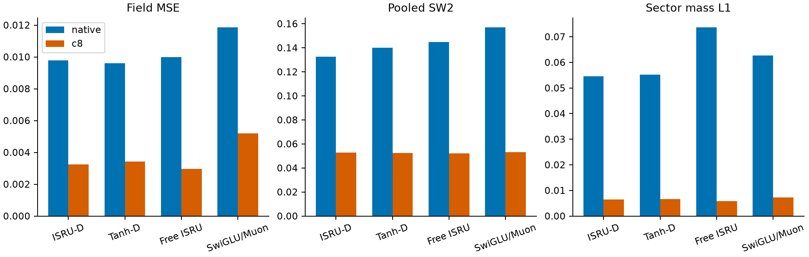
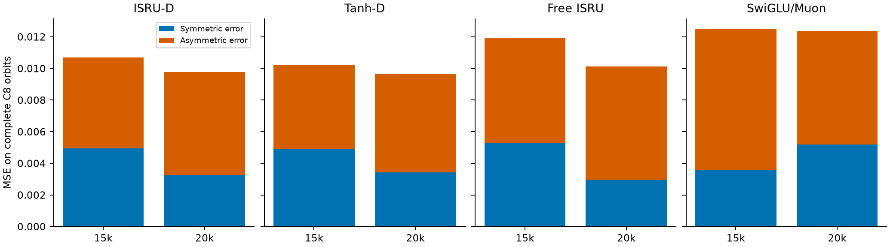

# What the professor follow-up establishes

15 November 2026. Five registered seed 0 trajectories and their frozen
checkpoint evaluations completed on 145 GPUs 4-7. An additional original-script
SwiGLU/Muon replay checks a cross-machine discrepancy. The image experiments
and finalized reports are unchanged.

## 1. High-rank updates need not produce high-rank weights

The original Product16 Free ISRU records exhibit the professor's example.
Muon raises update stable rank from 4.57 to 32.78, but final weight stable rank
falls from 13.02 to 10.53, entropy rank from 55.55 to 43.79, and mean condition
number rises from 109 to 691. For ISRU-D, stable rank increases but entropy rank
decreases slightly. Rank summaries and conditioning capture different aspects
of the spectrum. See the [full spectral analysis](spectrum-findings.md).

## 2. Ring8 symmetry explains a substantial sampling defect

At20k, enforcing45-degree rotation equivariance on the frozen physical velocity
field substantially reduces mode imbalance in every tested architecture.
The intervention is

`v_C8(x,t) = mean_k R_k^-1 v(R_k x,t)`, for k=0,...,7.

It changes no weights. Native and projected fields use identical Gaussian
sources, targets and Heun128 integration. Eight4096sample banks are evaluated
separately and pooled into 32,768 samples; all bank hashes match.

| Ring8 model,20k | Native pooled SW2 | C8 pooled SW2 | Native sector L1 | C8 sector L1 |
|---|---:|---:|---:|---:|
| ISRU-D |0.13261|0.05268|0.05450|0.00647|
| Tanh-D |0.14005|0.05232|0.05524|0.00659|
| Free ISRU |0.14467|0.05229|0.07373|0.00574|
| SwiGLU64/Muon |0.15714|0.05309|0.06268|0.00720|

All four improve in six of eight paired banks, with lower mean SW2. The exact
mixture oracle sampled with the same source banks and solver has pooled SW2
0.05528 and sector L1 0.00659. This is a finite-sample reference, not a lower
bound. C8 costs eight transformed predictions per field evaluation; the table
measures a symmetry intervention, not an equal-compute architecture advantage.

### Why MSE can improve while sampling worsens

Let Pi be the C8 group projection and u the exact equivariant field. On an
invariant state/time distribution, squared error decomposes orthogonally:

`||v-u||^2 = ||Pi(v)-u||^2 + ||v-Pi(v)||^2`.

We verify the identity on complete C8 orbits of the fixed validation states,
in float64. The maximum numerical residual is below 3e-17. This orbit-balanced
measurement differs from the original finite validation-probe MSE.

| ISRU-D checkpoint | Symmetric error | Asymmetric error | Total orbit MSE | Native pooled SW2 |
|---|---:|---:|---:|---:|
|15k|0.004955|0.005745|0.010700|0.11727|
|20k|0.003256|0.006532|0.009788|0.13261|

The symmetric component improves enough to reduce total MSE, while the
asymmetric component grows. At20k it accounts for 66.7% of orbit error.
Removing it restores balanced mode populations and lowers sampling error.
Free ISRU and Tanh-D show the same component tradeoff. This identifies a
concrete explanation for the fitting/sampling mismatch on Ring8, shared by
ODE-inspired and ordinary models.

[Samples](results/isru-samples.png) and
[paired trajectories](results/isru-trajectories.png) show the same checkpoints.
For C8, rotating the initial noise rotates the generated trajectory up to
floating-point error. C8 symmetry does not by itself prohibit sector crossings.

## 3. ISRU's specific response is not essential in these controls

The new response is `q(h)=tanh(sqrt(1.2)h)/sqrt(1.2)`. It matches ISRU's slope
at zero, odd symmetry, saturation and parameter count. Only response shape
changes; both remain K1, AdamW 3e-4,20k updates, batch 512, identical initialization
and data streams. The complete derivative and native continuation tests passed.

| Dataset | Response | Field MSE | Native pooled SW2 |
|---|---|---:|---:|
|Ring8|ISRU|0.009773|0.13261|
|Ring8|scaled tanh|0.009611|0.14005|
|Product16|ISRU|0.016059|0.07206|
|Product16|scaled tanh|0.016489|0.07006|

Tanh slightly improves field fitting on Ring8 and slightly worsens it on
Product16; sampling moves in the opposite directions. There is no consistent
ISRU advantage over this matched saturating response. Product16's ordinary
Free ISRU and SwiGLU192 controls remain strong (pooled SW2 0.06787 and 0.06487).
The evidence supports studying response shape and field geometry; it does not
make ISRU's closed-form ODE interpretation necessary for the observed gains.

## Verification and provenance

New native sampling is reproduced exactly from each saved20k checkpoint.
Independent NumPy recomputation agrees with GPU SW2 within 6e-17; historical
Product16 sample hashes and all common-bank hashes match. Raw weights, samples,
logs and monitor histories remain under the separate145 runtime.

Ring8 weights were replayed because Lenovo is unavailable. ISRU-D and Free ISRU
field MSE match their historical values within 3e-8. SwiGLU/Muon differs:
0.011869 here versus0.011279 historically. A full 20k run through the original
cycle13 entry reproduces the new entry's model, optimizer and RNG states
exactly. Thus the new wrapper does not explain that discrepancy; its cause
relative to the unavailable Lenovo run is not isolated. The C8 comparisons use
one checkpoint before/after the intervention and do not mix those cohorts.

[Numerical verification](results/verification.json),
[all metrics](results/metrics.csv), [paired banks](results/paired-c8.json),
[replay comparison](results/replay.json), and [completion receipt](completion.json).

## Next decision for ODE-FFN

Keep the original image baseline and pause further order/spectral-cap sweeps.
The next ODE design should make a testable prediction about the field's
geometry, rather than rely on higher-order expansion alone.

For a hidden state with a specified symmetry representation rho, require
`A(rho h)=rho A(h) rho^-1`. Then every frozen-generator Taylor polynomial
`F_K(h)=sum_{j=0}^K A(h)^j h/j!` obeys `F_K(rho h)=rho F_K(h)`.
An arbitrary dense P and coordinatewise D do not ensure this condition.
A concrete small-data route is a permutation representation, a P commuting
with that permutation, and the current pointwise ISRU diagonal. The algebra
works for both K1 and K8; whether the extra evolution helps remains empirical.

Before implementing that constrained architecture, use a single-pass control:
apply a uniformly sampled C8 rotation jointly to each existing FM training pair,
keeping batch size, updates and optimizer fixed. Compare ISRU-D and ordinary
SwiGLU against their current trajectories. If this training-only control removes
the mismatch, retain it as the ordinary explanation; if not, test the equivariant
generator with an equally equivariant ordinary FFN. This keeps the next question
about ODE structure identifiable. Ring8's45-degree symmetry is not an assumption
about CelebA faces. These next training runs are proposed, not launched here.
