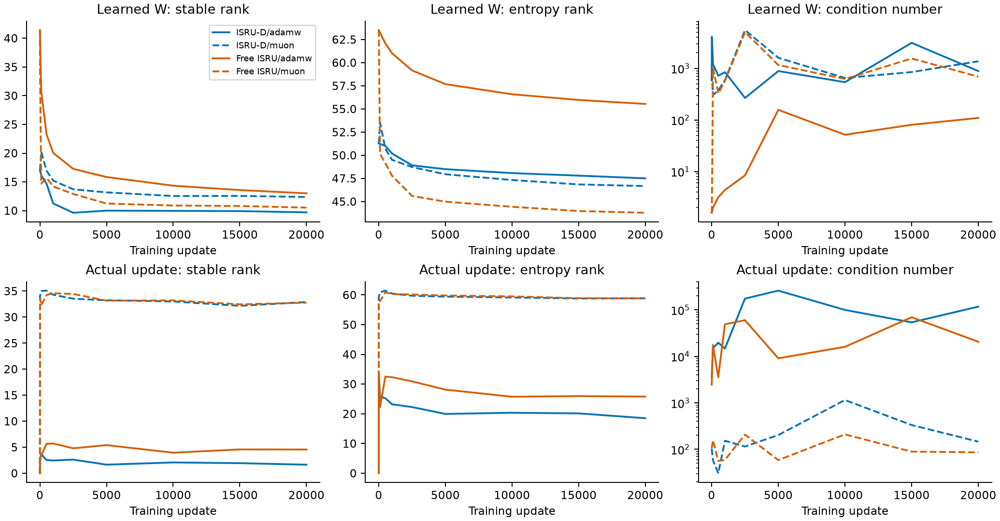
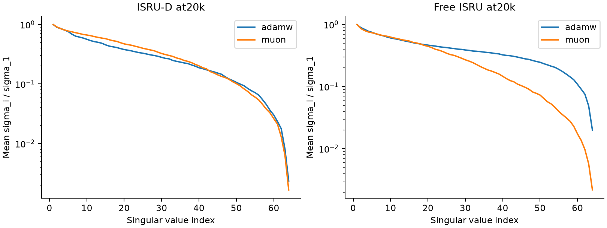

# Actual weights versus updates: Product16

The retained cycle13 records already contain the behavior motivating the first
comment. In Free ISRU, Muon produces broader updates while the final weights
have lower effective rank and a larger condition number than AdamW.

All values below average the same six64x64learned matrices at20k updates.
These are the original seed0trajectories, AdamW3e-4 and Muon.02.

| Model/optimizer | Update stable rank | Weight stable rank | Weight entropy rank | Weight condition number |
|---|---:|---:|---:|---:|
| Free ISRU / AdamW |4.5666|13.0177|55.5471|109.2672|
| Free ISRU / Muon |32.7757|10.5253|43.7890|690.6320|
| ISRU-D / AdamW |1.6480|9.7031|47.5099|885.5268|
| ISRU-D / Muon |32.9054|12.3785|46.6737|1368.7097|

ISRU-D also illustrates why rank definitions must be stated: Muon increases
stable rank here, while entropy rank decreases slightly. Stable rank measures
energy relative to the largest singular value; entropy rank uses the full
normalized singular-value distribution. Neither determines the smallest
singular value or the condition number.

Weights accumulate matrix updates with changing directions. The singular
values of that sum are not sums of the singular values of its terms, so
high-rank individual updates do not prevent concentration or cancellation in
learned weights. The observation is consistent with this explanation; it does
not isolate optimizer geometry from the different selected learning rates.

There is no reason from these results alone to flatten or shrinkP. Those would
change the learned transformation; this analysis is a diagnostic, not a new
regularizer. Ring8's original raw files remain on unavailable Lenovo. Replayed
Ring8 weights will be reported as new trajectories, separately from the archived
rank statistics.

The extraction checks archived stable/entropy ranks against recomputation
from all singular values. Condition numbers are sigma_max/sigma_min without
clamping; singular matrices are flagged. [Layer table](spectra-product16/layers.csv),
[endpoints](spectra-product16/endpoints.json), and
[source hashes](spectra-product16/binding.json) retain matrix and run identities.
The initial extraction completed numeric output but lacked matplotlib on145;
`--no-plots` completed successfully in a second output directory. Figures were
rendered locally from the same1080rows, with no training-environment changes.
