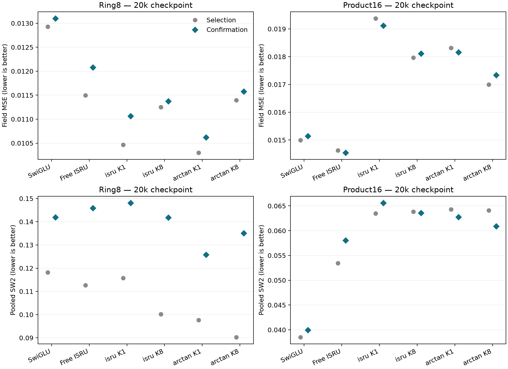

# Response screen: completed evidence and CelebA decision

**Arctan-D K1 is the first new response to consider for a bounded CelebA
readiness test. No response establishes an overall advantage over SwiGLU
across these two tasks, so a full image training run is not yet justified.**

All 36 training/selection pipelines and 12 independent confirmation evaluations
completed successfully on Mac mini CPU. The training queue and analysis watcher
have exited. [Complete tables and figures](current-comparison.md),
[completion receipt](completion.json).

## What was compared

The same small, time-conditioned velocity network receives eight response
functions at K1 and K8 on Ring8 and Product16. Each local solve computes
`d(h)` once, then evaluates the Taylor polynomial of `A = P diag(d(h))`.
This is a synthetic velocity model, not the JiT image architecture.
The native trainer, 20k-update checkpoint, sampler and metric are fixed.
All focal cells use AdamW at 0.0003, batch512 and training seed0.

Five bounded odd responses share their slope at zero and saturation level.
Slope-normalized SiLU/GELU and linear provide additional controls. This
comparison changes the response and its induced initial function; it does
not impose equal initial functions across families.

Ordinary references retain their existing configurations: Ring8
SwiGLU64/Muon0.02, Product16 SwiGLU192/AdamW0.0003, and Free ISRU/AdamW0.0003.
They benchmark the complete configurations, rather than isolating optimizer
effects. Free ISRU has exactly the focal models' parameter count; Product16
SwiGLU has 108,624 parameters versus 58,512 for the focal models.

## Selection: Softsign wins Ring8, but misses the field-fitting gate

The [complete eight-response table](current-comparison.md) includes both
ordinary references. Softsign-K8 gives the lowest Ring8 selection pooled SW2,
0.06956 versus SwiGLU's 0.11823. Its Product16 SW2 is also relatively low,
0.06090. However, Product16 field MSE is 0.02013, worse than both ISRU-K8
(0.01797) and tanh-K8 (0.01833). It fails the prespecified eligibility rule.
Softsign therefore has selection evidence only; it was not quietly added to
confirmation because of its attractive Ring8 score.

The field-fitting gate compares a response with the worse ISRU/tanh MSE on
each task at the same order. Eligible K8 families are ranked by their worst
task-relative sampling score. This freezes **ISRU and arctan**, followed by
their K1 counterparts and ordinary references, before confirmation arrays
are opened. The [shortlist](results/shortlist.json) retains its original hash.
This selection rule ranks alternatives within the response family; it is
not a claim that its winner defeats ordinary FFNs.

## Confirmation: arctan improves Ring8; SwiGLU leads Product16

Confirmation evaluates the same 20k weights on fresh, prebound field probes
and eight common sample banks. Each bank has 4,096 samples; pooled SW2 uses
all 32,768 samples and 256 directions under Heun128.

| Model | Ring8 field MSE | Ring8 pooled SW2 | Product16 field MSE | Product16 pooled SW2 |
|---|---:|---:|---:|---:|
| SwiGLU | 0.013102 | 0.141952 | 0.015143 | **0.039954** |
| Free ISRU | 0.012078 | 0.145836 | **0.014545** | 0.058042 |
| ISRU-D K1 | 0.011062 | 0.148122 | 0.019117 | 0.065610 |
| ISRU-D K8 | 0.011374 | 0.141806 | 0.018115 | 0.063602 |
| Arctan-D K1 | **0.010620** | **0.125849** | 0.018161 | 0.062764 |
| Arctan-D K8 | 0.011578 | 0.135097 | 0.017335 | 0.060880 |

Arctan-K1 reduces Ring8 pooled SW2 by **11.34%** relative to SwiGLU and wins
all eight paired banks. It also has lower Ring8 field MSE. Arctan-K8 reduces
pooled SW2 by 4.83% and wins six banks. Unlike the selection ordering, K1
beats K8 on Ring8 confirmation. This is evidence for this response/configuration,
not for increasing the Taylor order.

On Product16, arctan-K1 and K8 have **57.09% and 52.38% higher** pooled SW2
than SwiGLU, respectively. Neither wins any of the eight paired banks.
Parameter-matched Free ISRU also beats both, in field MSE and sampling.
Thus the Product16 deficit cannot be dismissed solely as a consequence of
the wider SwiGLU reference.

These gray/teal points use different evaluation arrays, not new training
runs. The strong Product16 reference ordering persists. Ring8 arctan's
K1/K8 ordering changes, so the lowest selection score alone is a poor guide
to an expensive image run.

## Higher order and practical cost

For arctan, K8 improves Product16 confirmation SW2 by only 3.00% over K1,
while worsening Ring8 by 7.35%. Its measured whole-network CPU forward cost
is 1.22x K1 on Ring8 and 1.48x on Product16. There is no consistent
quality improvement to justify selecting K8 by default.

Arctan itself is expensive in this small CPU implementation: K1 costs
4.590ms per batch512 on Ring8 versus 0.673ms for SwiGLU; Product16 costs
4.645ms versus 0.989ms. Those are warmed, single-thread M1 CPU measurements.
Image GPU training requires its own measurement; these ratios are not
projected onto Torch GPUs.

## Disposition and the smallest useful next step

| Candidate | Decision | Evidence |
|---|---|---|
| Arctan-D K1 | First candidate for an image readiness benchmark | Best confirmed Ring8 result; cheaper than arctan-K8; still loses Product16 |
| Arctan-D K8 | Keep as a higher-order comparison, not the first run | Small Product16 gain over K1, Ring8 loss, extra work |
| Softsign-D | Retain as a diagnostic lead | Strong selection SW2 but fails the registered Product16 field gate; no confirmation |
| ISRU-D | Keep as historical anchor | Confirmation does not beat SwiGLU consistently; already tested on CelebA |
| tanh/erf/SiLU/GELU/linear | No immediate image promotion | No better cross-task selection case under the fixed rule |

Before committing image training time, benchmark Arctan-D K1 inside the
unchanged JiT block at the existing matched width1200: check outputs and
gradients, then measure forward/backward throughput and memory against native
SwiGLU on the same GPU. Retain the existing matched image recipe, seed0 and
FID every20 if a formal transfer is subsequently authorized. Change the
response only; do not combine it with an optimizer change or new dynamics.
This recommendation is not an automatically approved training submission.

## Claim candidates

- **Claim:** arctan-K1 improves the tested Ring8 configuration over SwiGLU.
  **Source:** confirmation CSV and eight paired bank differences.
  **Allowed wording:** 11.34% lower pooled SW2, with eight of eight banks better.
  **Stronger wording excluded:** universal response or ODE-specific superiority.
  **Uncertainty:** applies to these fixed weights and optimizer configurations.
  **Next check:** image GPU readiness. **Decision:** keep the measured comparison.
- **Claim:** K8 is not consistently preferable to K1 in this response screen.
  **Source:** both complete tasks and both evaluation streams.
  **Allowed wording:** arctan-K8 loses Ring8 confirmation while gaining only
  3.00% on Product16, at extra cost.
  **Stronger wording excluded:** high-order methods can never help.
  **Uncertainty:** finite20k budget and this entrance-frozen generator.
  **Next check:** only revisit order after a concrete image benefit.
  **Decision:** revise the earlier default preference for K8.

Inputs: raw artifacts under
`/Users/mr.z/ode-workspace-prep/response-screen-20261115/`.
Outputs: this directory's tables, figures and completion bindings.
Both metric streams independently recompute within 5.56e-17. Frozen runtime
sources, the dataset assets, the qualified image baseline and all 96 protected
Report1/2 files remain unchanged.
