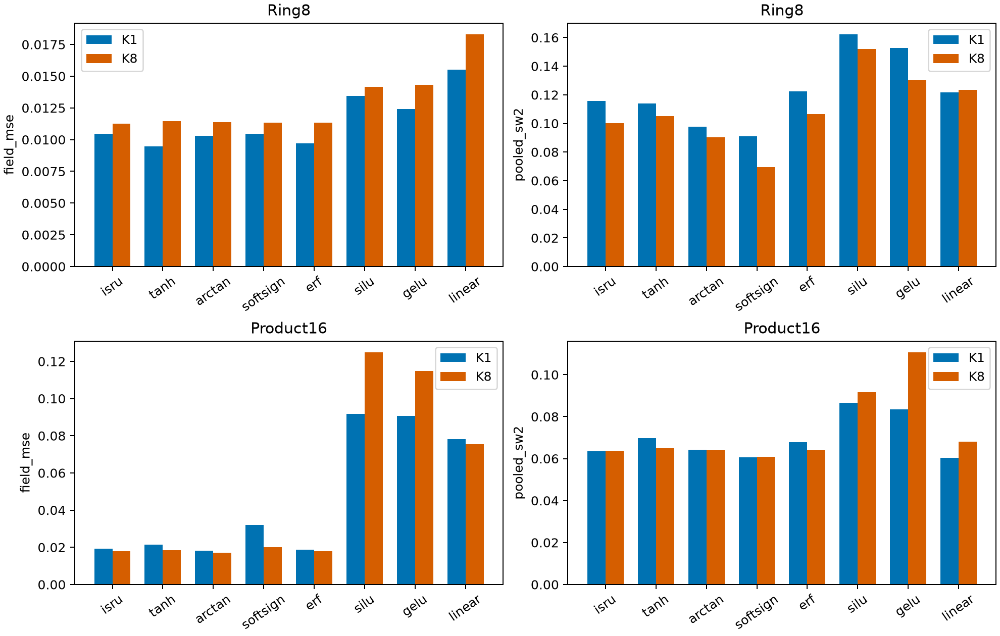
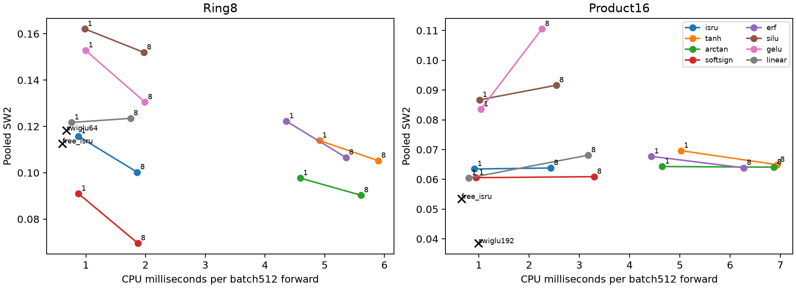
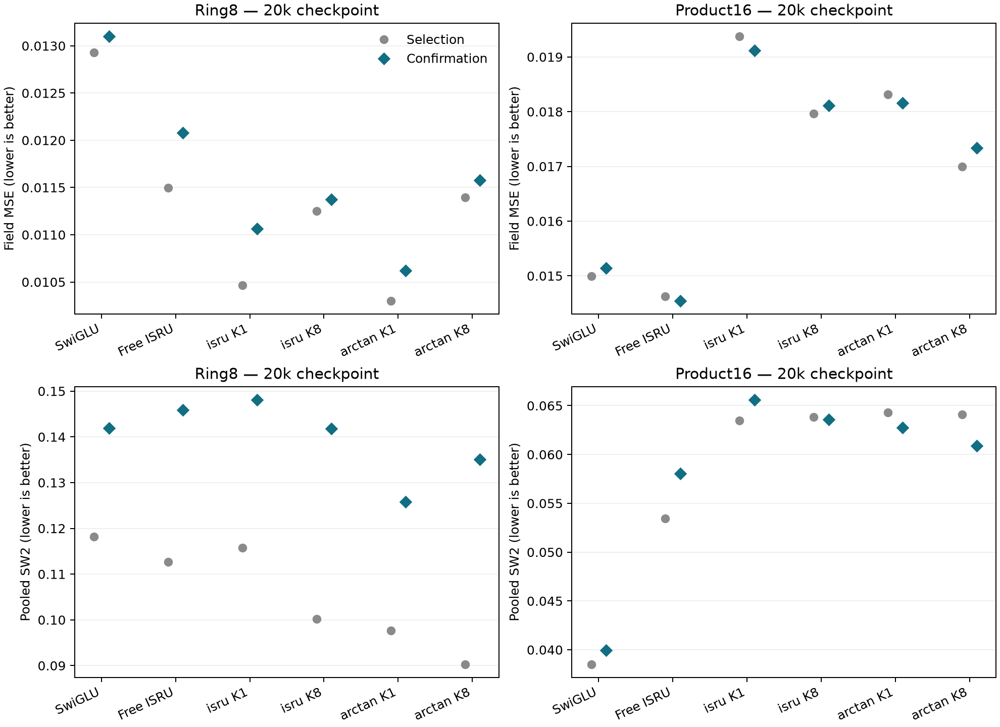

# Completed response comparison

All 36 Mac mini CPU training/selection pipelines and the registered independent
confirmation completed. Each trajectory uses 20k updates; every sampling score
uses eight common banks of 4,096 samples, 256 directions and Heun128. Lower is better.
Selection and confirmation use different prebound arrays.

[CelebA decision and interpretation](analysis-report.md) |
[Paired-bank analysis](stats-appendix.md) | [Figure catalog](figure-catalog.md)

## All response families: selection pooled SW2

| Response | Ring8 K1 | Ring8 K8 | Product16 K1 | Product16 K8 |
|---|---:|---:|---:|---:|
| isru | 0.11578 | 0.10024 | 0.06348 | 0.06382 |
| tanh | 0.11389 | 0.10524 | 0.06964 | 0.06492 |
| arctan | 0.09769 | 0.09030 | 0.06431 | 0.06408 |
| softsign | 0.09097 | 0.06956 | 0.06057 | 0.06090 |
| erf | 0.12226 | 0.10658 | 0.06772 | 0.06388 |
| silu | 0.16210 | 0.15197 | 0.08671 | 0.09162 |
| gelu | 0.15285 | 0.13049 | 0.08355 | 0.11054 |
| linear | 0.12173 | 0.12348 | 0.06046 | 0.06812 |
| swiglu (ordinary) | 0.11823 | 0.11823 | 0.03852 | 0.03852 |
| free_isru (ordinary) | 0.11265 | 0.11265 | 0.05342 | 0.05342 |

Ordinary references have no Taylor order; their values repeat in both columns
to show the common reference for K1 and K8.

## Ordinary references and frozen shortlist: independent confirmation

| Model | Ring8 MSE | Ring8 SW2 | Product16 MSE | Product16 SW2 |
|---|---:|---:|---:|---:|
| swiglu | 0.013102 | 0.141952 | 0.015143 | 0.039954 |
| free_isru | 0.012078 | 0.145836 | 0.014545 | 0.058042 |
| isru-K1 | 0.011062 | 0.148122 | 0.019117 | 0.065610 |
| isru-K8 | 0.011374 | 0.141806 | 0.018115 | 0.063602 |
| arctan-K1 | 0.010620 | 0.125849 | 0.018161 | 0.062764 |
| arctan-K8 | 0.011578 | 0.135097 | 0.017335 | 0.060880 |

Ring8 ordinary SwiGLU is width64/Muon.02; Product16 is width192/AdamW.0003.
All focal responses use AdamW.0003. Their configuration labels remain explicit.
The shortlist was frozen before confirmation and is preserved in shortlist.json.
Responses outside it have selection results only.

## Same-host forward cost

| Dataset | Model | Parameters | Batch512 forward, ms | Relative to SwiGLU |
|---|---|---:|---:|---:|
| gmm_ring8_2d | free_isru | 56706 | 0.608 | 0.90x |
| gmm_ring8_2d | arctan-K1 | 56706 | 4.590 | 6.82x |
| gmm_ring8_2d | arctan-K8 | 56706 | 5.607 | 8.33x |
| gmm_ring8_2d | isru-K1 | 56706 | 0.872 | 1.30x |
| gmm_ring8_2d | isru-K8 | 56706 | 1.861 | 2.76x |
| gmm_ring8_2d | swiglu64 | 56766 | 0.673 | 1.00x |
| rotated_product_bimodal_16d | free_isru | 58512 | 0.653 | 0.66x |
| rotated_product_bimodal_16d | arctan-K1 | 58512 | 4.645 | 4.70x |
| rotated_product_bimodal_16d | arctan-K8 | 58512 | 6.875 | 6.95x |
| rotated_product_bimodal_16d | isru-K1 | 58512 | 0.914 | 0.92x |
| rotated_product_bimodal_16d | isru-K8 | 58512 | 2.433 | 2.46x |
| rotated_product_bimodal_16d | swiglu192 | 108624 | 0.989 | 1.00x |

These are M1 CPU timings of the complete small velocity network, warmed up,
one CPU thread, median of three 20-forward repeats. They are not image-model
GPU timings. The corresponding image architecture needs its own benchmark.

## Figures

[All selection metrics](results/selection-metrics.csv),
[confirmation metrics](results/confirmation-metrics.csv),
[selection rule and shortlist](results/shortlist.json),
[verification](results/verification.json),
[confirmation verification](results/confirmation-verification.json).
