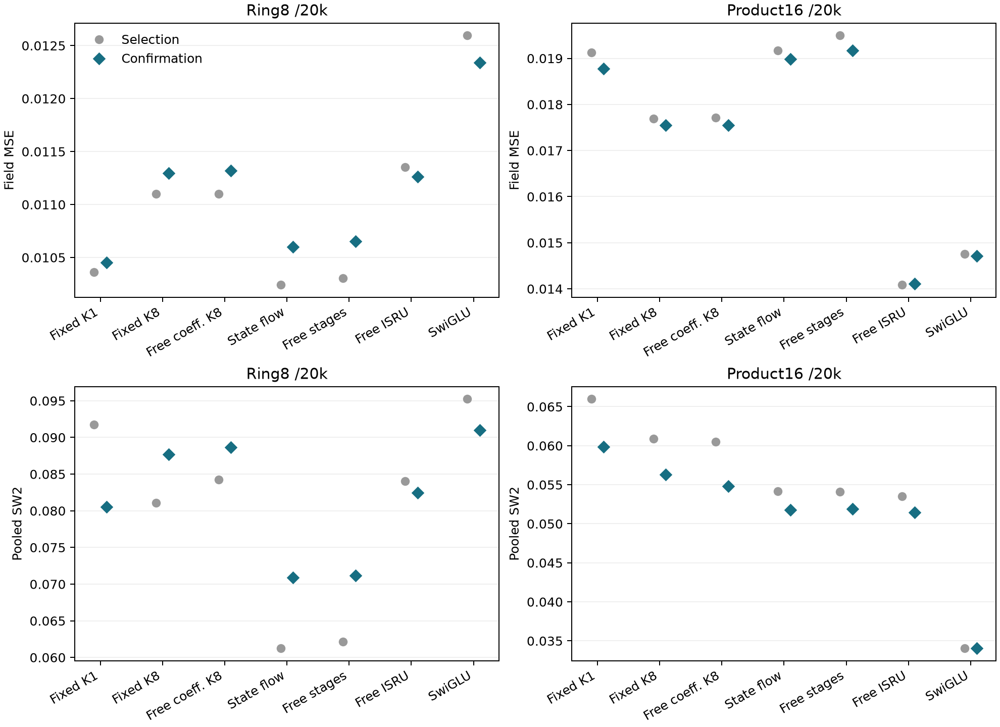

# Completed mechanism comparison

Seed0;20k native training updates; new prebound selection/confirmation streams.
All sampling uses Heun128, eight4096-sample banks and256directions.
Displayed scores have three decimals; CSV/JSON retain full precision.

| Task | Model | Selection MSE | Selection SW2 | Confirmation MSE | Confirmation SW2 |
|---|---|---:|---:|---:|---:|
| Ring8 | Fixed K1 | 0.010 | 0.092 | 0.010 | 0.081 |
| Ring8 | Fixed exponential K8 | 0.011 | 0.081 | 0.011 | 0.088 |
| Ring8 | Free coefficients K8 | 0.011 | 0.084 | 0.011 | 0.089 |
| Ring8 | State flow / midpoint4 | 0.010 | 0.061 | 0.011 | 0.071 |
| Ring8 | Free-stage midpoint4 | 0.010 | 0.062 | 0.011 | 0.071 |
| Ring8 | Free ISRU | 0.011 | 0.084 | 0.011 | 0.082 |
| Ring8 | SwiGLU | 0.013 | 0.095 | 0.012 | 0.091 |
| Product16 | Fixed K1 | 0.019 | 0.066 | 0.019 | 0.060 |
| Product16 | Fixed exponential K8 | 0.018 | 0.061 | 0.018 | 0.056 |
| Product16 | Free coefficients K8 | 0.018 | 0.060 | 0.018 | 0.055 |
| Product16 | State flow / midpoint4 | 0.019 | 0.054 | 0.019 | 0.052 |
| Product16 | Free-stage midpoint4 | 0.019 | 0.054 | 0.019 | 0.052 |
| Product16 | Free ISRU | 0.014 | 0.054 | 0.014 | 0.051 |
| Product16 | SwiGLU | 0.015 | 0.034 | 0.015 | 0.034 |

Ring8 SwiGLU64 uses Muon0.02; Product16 SwiGLU192 uses AdamW0.0003.
All ODE/free-ISRU variants use AdamW0.0003. Comparisons to SwiGLU
benchmark those labeled configurations, not isolated optimizer effects.
Free Taylor coefficients add42scalars; free midpoint stages add24.
Fixed state-flow and fixed ODE share parameter counts. State-flow uses
four second-order midpoint substeps, not an eighth-order Taylor method.

Paired intervals in paired-effects.json describe conditional bank variation,
not training variability or uncertainty of the pooled statistic.
All 6 new trajectories and all independent metric checks completed.
