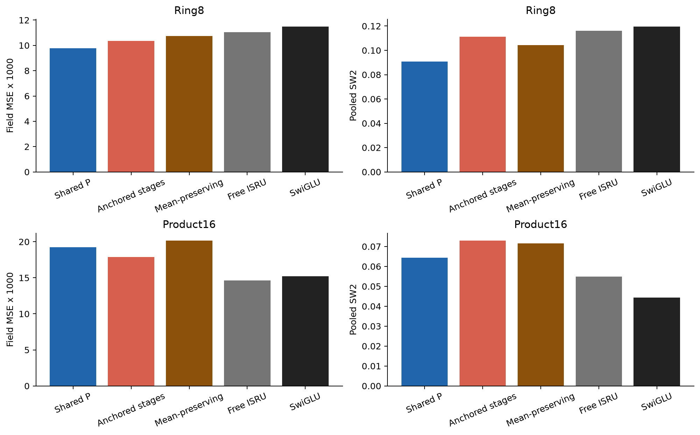
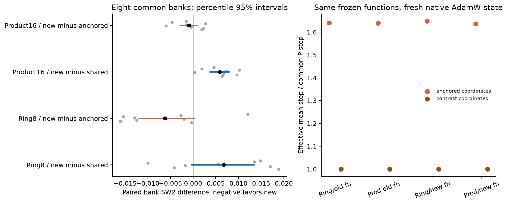

# Stage-coordinate control: completed comparison

The mean-preserving release improves the pooled SW2 point estimates over the
anchored release on both tasks. Shared P retains the lower Product16 SW2 in
all eight common banks. Ring8's new-versus-shared bank comparison is unresolved.
The same-function optimizer probes establish an update-coordinate effect;
they do not establish how much of the training gap it causes.

## Question and intervention

Does releasing the four stage matrices hurt generation because it removes a
stationary generator, or because the release also changes optimizer geometry?
Keep the response, four explicit-midpoint substeps (eight matrix applications
per local solve), native AdamW recipe and training data fixed. The new release
uses orthogonal zero-mean contrasts, so the mean effective matrix is exactly P.
It has the same function class and parameter count as the anchored release.
See the [preregistered derivation](../sharing-optimization-control.md) and
[native execution instructions](../contrast-execution.md).

The two new trajectories finished 20k updates on Mac mini CPU, one thread
each, seed 0. Source cdd79e58ad1336e82bb9ca716138ccfefa30a7ba remained frozen.
Both workers exited 0. Native step 0 initialization and training-data RNG
states at 0/15k/20k match the bound original references. Two full native
continuation and two real evaluator witnesses passed independently.

## Fixed 20k comparison

Lower is better. All methods use the same eight 4,096-source evaluation
banks and Heun128 sampling. Pooled SW2 combines 32,768 samples; bank means
and standard deviations are in the full-precision CSV. Historical filenames
retain selection/confirmation, but these reused banks are a matched control,
not fresh model-selection confirmation. Neither checkpoints nor settings
were selected from these results.

| Model | Ring8 MSE | Ring8 pooled SW2 | Product16 MSE | Product16 pooled SW2 |
|---|---:|---:|---:|---:|
| Shared P | 0.010 | 0.091 | 0.019 | 0.064 |
| Anchored stage release | 0.010 | 0.111 | 0.018 | 0.073 |
| Mean-preserving stage release | 0.011 | 0.104 | 0.020 | 0.072 |
| Free ISRU | 0.011 | 0.116 | 0.015 | 0.055 |
| SwiGLU reference | 0.011 | 0.120 | 0.015 | 0.044 |

The shared model has 56,706 / 58,512 parameters on Ring8 / Product16;
both released variants have 130,434 / 132,240. All three use 227,648 /
229,440 dense MACs per example. Pointwise operations and effective-matrix
materialization are excluded from dense MACs and included in measured runtime.
The ordinary controls remain in the comparison: the Ring8 SwiGLU64 reference
uses Muon 0.02; Product16 SwiGLU192 uses AdamW 0.0003. Free ISRU uses AdamW
0.0003. These ordinary references contextualize performance; they do not
isolate the stage-sharing intervention.

On one CPU thread, batch512 forward medians are 3.622 / 3.613 ms for shared,
3.685 / 3.674 ms for anchored, and 3.955 / 3.954 ms for mean-preserving.
The 64-source Heun128 sample medians are 0.274 / 0.275 s, 0.289 / 0.288 s,
and 0.337 / 0.337 s, respectively. This is a host-specific forward/sampling
benchmark, not a total training FLOPs claim. See [cost receipts](cost.json).

## Paired sampling evidence

Against shared P, the new release is worse in five of eight Ring8 banks and
all eight Product16 banks. The mean bank differences, new minus shared, are
0.007 and 0.006. Ring8's percentile interval spans zero; Product16's is
[0.004, 0.008]. Full-precision intervals and four-comparison Holm-adjusted
sign tests are in the [statistics appendix](stats-appendix.md).

Against anchored release, the new model is better in seven Ring8 banks and
five Product16 banks. Both difference intervals span zero. Thus the pooled
point improvements are observable, while a resolved improvement over anchored
release is not established by this eight-bank comparison.

## Same function, different native AdamW update

Each of the four frozen released models is represented exactly in both
coordinate systems. Predicted fields agree exactly; reconstructed effective
matrix gradients agree within 1.39e-17. With eight fixed loss batches, native
clipping and fresh AdamW state, the median effective-mean step relative to
the common-P step is 1.636--1.648 in anchored coordinates and 1.000 in
zero-mean coordinates. The coordinate effect therefore exists at identical
functions and effective gradients. This is a fresh-state probe, not a replay
of the historical AdamW momentum state. It does not identify a causal
percentage of the final sampling gap.

For plain SGD, the induced four-stage gradient metric has condition number
22.956 in anchored coordinates versus 4.000 in zero-mean coordinates.
These are stage-coordinate metrics, not the learned P spectrum or AdamW's
preconditioner. The latter requires its actual state.

## What this changes

- Keep: a same-function coordinate choice changes native updates materially.
- Keep: Product16 shared P remains better in SW2 than this same-class release
  after removing the mean-offset update, at the fixed training budget.
- Weaken: Ring8's earlier sharing advantage is not resolved against the new
  control across the eight common banks.
- Discard: treating the original anchored release as a pure test of stationary
  generators with no optimizer-coordinate change.
- Do not infer: a general advantage over ordinary FFNs. Product16's ordinary
  SwiGLU reference still generates better samples at lower dense work.

The new control's solver sensitivity and joint-density/width measurements
remain pending. Reuse the already fixed density sources and completed
reference observations. Until those measurements finish, the original
shared-versus-anchored KL result must not be attributed to the new control.
No image run or finalized report is changed.

## Verification and artifacts

Native training/evaluation completion is bound in [COMPLETE.json](COMPLETE.json).
The independent collector reconstructs all ten model/task rows within
2.78e-17. [Pairing](pairing.json), [confirmation verification](confirmation-verification.json),
[full statistics](comparison.json), [analysis checks](analysis-verification.json)
and [native documented witness](native-doc-witness.json) are retained.
Raw checkpoints, arrays, full probe and logs remain outside Git at
`/Users/mr.z/ode-workspace-prep/coefficient-20261116/mean-preserving/`.
