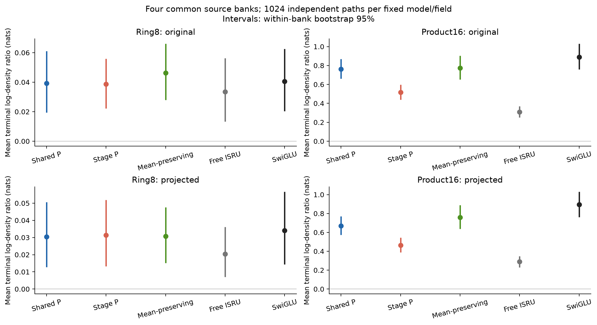
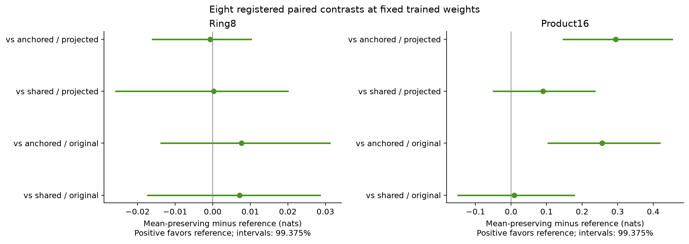
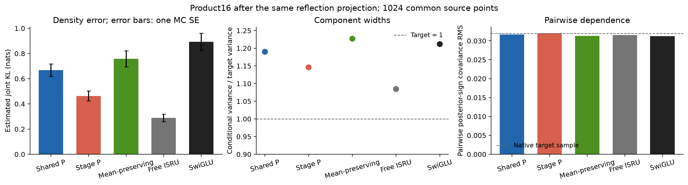

# Mean-preserving stages: density and component geometry

Changing the stage coordinates changes the learned Product16 distribution,
but does not establish a shared-P joint-density advantage. The mean-preserving
release has higher joint KL than the anchored release; its paired differences
from shared P remain unresolved on both datasets. This completes the
registered density follow-up to the [coordinate-control experiment](../analysis-report.md).

## Purpose and comparison

The anchored and mean-preserving models represent the same four-stage
function class and have the same parameter count. The new coordinates keep
the average stage matrix exactly equal to P. Both use the same ISRU response,
four midpoint steps, initial function, data stream and native AdamW recipe.
This tests the effect of parameter coordinates, rather than adding capacity.
Shared P, ordinary Free ISRU and native SwiGLU remain in the comparison.
These are synthetic velocity MLPs, not image JiT models or the frozen-D
Taylor-K8 layer.

Density is measured on 1,024 common Gaussian starting points per model/field.
Every point is retained and numerically qualified. The signed density-source
integral estimates KL(rho_model || p_target) for each learned generative flow; it is not an exact
likelihood for a finite Heun map. Full-precision values and resolution checks
are in [the statistics](statistics.json) and [the source audit](new-cases-independent.json).

## Joint-density observations

Lower KL is better. Units are nats. Projection applies the same C8 averaging
on Ring8 or selected reflections on Product16 to every model.

| Model | Ring8 original KL | Ring8 projected KL | Product16 original KL | Product16 projected KL |
|---|---:|---:|---:|---:|
| Shared P | 0.039 | 0.030 | 0.763 | 0.668 |
| Anchored stages | 0.039 | 0.031 | 0.516 | 0.464 |
| Mean-preserving stages | 0.046 | 0.031 | 0.773 | 0.758 |
| Free ISRU | 0.033 | 0.020 | 0.310 | 0.289 |
| SwiGLU | 0.041 | 0.034 | 0.890 | 0.894 |

Purpose: determine whether the SW2 sharing signal extends to joint density
when the release preserves the mean matrix. On Ring8, all four new-versus-
reference paired intervals include zero. Product16's new-minus-shared
contrasts also include zero, before and after projection. There is no
resolved shared-P density lead against this control.

The comparison with anchored coordinates is different. Product16's new-minus-
anchored KL is 0.256 originally, with adjusted interval [0.102, 0.421], and
0.294 after projection, interval [0.145, 0.455]. Both releases have the same
function class. Their different training coordinates therefore lead to a
measured difference in the fitted distribution under this recipe.

Intervals allocate the nominal error across all eight registered comparisons.
They measure source-sampling uncertainty at fixed trained weights. The
[statistics appendix](stats-appendix.md) retains every comparison and its
previous-resolution estimate.

## Product16 case study: component widths

Purpose: locate a concrete distribution discrepancy. After projection, the
mean-preserving model's conditional variance is 1.227 times the target,
versus 1.146 for anchored stages and 1.190 for shared P. Free ISRU is closer
at 1.085. Pairwise posterior-sign covariance stays near the target sample
floor, around 0.031--0.032. Width changes are visible; this pairwise statistic
does not supply a comparable separation.

The new model's moment-based KL plug-in bound is 0.353, including a width
term of 0.267. Anchored stages have 0.223 and 0.140. These moments identify
broader components, but are not an additive decomposition of the measured
KL. The same finite-sample calibration is retained for all models.

The earlier original-field pooled SW2 point estimates change from 0.073
anchored to 0.072 mean-preserving, while original joint KL changes from
0.516 to 0.773. The SW2 difference is unresolved across the eight primary
banks; its direction is not evidence of a general density improvement.
That primary SW2 uses 32,768 sources. The separate 1,024-source SW2 values
remain diagnostic and do not replace it.

## Research decision

Anchored coordinates amplify mean updates, but removing that amplification
does not consistently improve transport. Coordinate choice affects the
learned error geometry; the original anchored release is not a pure test
of autonomous dynamics. A general shared-P density regularizer is not
supported by the completed comparisons.

The next structural question is narrower: does the order-dependent part of
stage variation help or hurt when parameters and optimizer coordinates are
held fixed? A [matched schedule-order control](../../schedule-order-control.md)
can cancel its leading bracket term without removing the second matrix.
It is a proposed falsification test, not a new observed advantage. Reports 1/2
and the native image baseline remain fixed.
