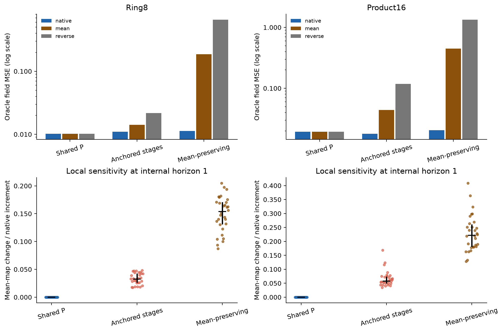
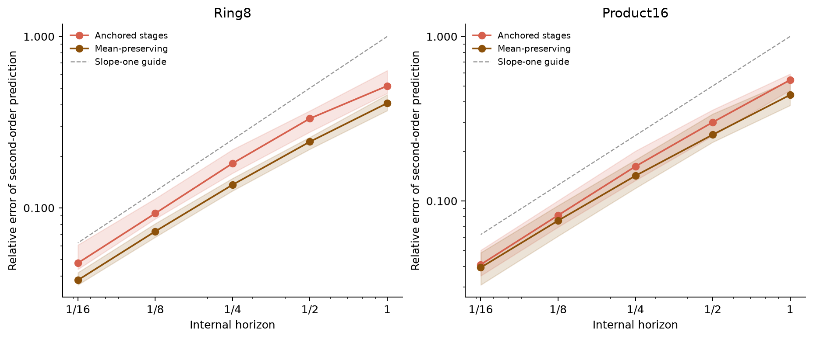

# Fixed-mean stage-flow decomposition

The released models use their stage directions and ordering to fit the
field. In the mean-preserving models, collapsing the stages to their mean
changes local feature increments by median 0.154 on Ring8 and 0.222 on Product16.
The second-order bracket prediction has the correct small-horizon limit,
but relative errors at the trained horizon 1 remain 0.408 and 0.441.

## Question and matched local maps

Does changing the stage matrices add a measurable computation beyond their
average? Compare each fixed checkpoint with its own mean-generator and
reversed-order maps. Keep the response, four midpoint steps and original
entrances. These are the state-evolving midpoint controls; they are distinct
from the original frozen-D Taylor-K8 block.

The original sharing diagnostic established activity and ordering sensitivity.
This extension includes the mean-preserving checkpoints and tests the entire
four-stage prediction: scheduled minus mean map equals internal-horizon
squared times the bracket sum divided by 32, plus a cubic remainder.
[Direct derivation and primary-source attribution](../mean-flow-derivation.md).

A fresh native documented run at 2f8dd60 exited 0. All 180 local formulas match
the actual native layer exactly before float64 analysis. Parameters stay
unchanged. Independent NumPy reconstructs every captured local map and
field MSE: maximum vector error 7.11e-15 and scalar error 1.34e-15.

## Field fitting and local action

The oracle MSE below uses the fixed 4,096-example selection field bank.
It is not the earlier primary confirmation metric and is not a sampling
score. Mean and reverse are frozen-weight counterfactuals without retraining.
Local columns are medians over six layers and five fixed physical clocks;
each local record uses the same 16 interpolation pairs.

| Model / task | Native MSE | Mean MSE | Reverse MSE | Relative local mean-map change | Unit prediction error | Error at 1/16 |
|---|---:|---:|---:|---:|---:|---:|
| Shared P / Ring8 | 0.010 | 0.010 | 0.010 | 0.000 | 0.000 | 0.000 |
| Shared P / Product16 | 0.019 | 0.019 | 0.019 | 0.000 | 0.000 | 0.000 |
| Anchored stages / Ring8 | 0.011 | 0.014 | 0.022 | 0.033 | 0.515 | 0.048 |
| Anchored stages / Product16 | 0.018 | 0.044 | 0.118 | 0.057 | 0.544 | 0.041 |
| Mean-preserving / Ring8 | 0.011 | 0.186 | 0.656 | 0.154 | 0.408 | 0.038 |
| Mean-preserving / Product16 | 0.020 | 0.449 | 1.333 | 0.222 | 0.441 | 0.039 |

For example, the Ring8 mean-preserving checkpoint has native oracle MSE 0.011;
mean collapse gives 0.186 and reversal gives 0.656. Product16 changes from 0.020
to 0.449 and 1.333. The stage directions are therefore used by the fitted
models. The shared models give exact null interventions in this computation.

The anchored releases depend less on stage variation: median relative local
changes are 0.033/0.057 versus 0.154/0.222 for the mean-preserving releases.
The two releases have the same function class and parameter count, but
learned different computations under their different native optimizer
coordinates. This connects the same-function update-coordinate probe to a
measured difference in the trained representation. It does not quantify how
much of the final sampling gap the optimizer causes.

## How far does the local theory explain the unit-time map?

For the new release, median relative prediction error falls from 0.408/0.441
at internal horizon 1 to 0.038/0.039 at 1/16. The corresponding median prediction
cosines at 1 are 0.917/0.910. Small-horizon cubic remainder orders are 2.977/2.996.
The second-order term predicts much of the direction, while higher-order
terms remain substantial at the actual trained horizon.

Independent linear matrix exponentials give remainder order 3.001; nonlinear
midpoint gives 3.000. The scalar-clock control has a vanishing second-order
bracket but a nonzero cubic finite-midpoint difference, order 2.999. This
rules out equating every finite-step mean-map change with noncommutation.

## Claims and next decision

- Keep: releasing stages introduces active, order-dependent feature computation
  at a fixed average generator. Evidence: native interventions and independently
  reconstructed local maps.
- Keep: the four-stage bracket expansion quantitatively describes the shrinking
  internal-horizon limit. It is classical composition mathematics applied here.
- Weaken: the leading second-order term alone explains the full trained map;
  unit-horizon relative errors remain material.
- Do not infer: stage variation is necessary for all models, or that suppressing
  it improves generation. The shared model learns a different representation;
  frozen ablation is not the retrained comparison.

Complete the already running solver/density controls before selecting another
architecture. The same-degree-of-freedom schedule comparison can subsequently
isolate cancellation of the leading order term if the full results justify it.
No response function, optimizer recipe, image trainer or finalized report changes.

## Evidence

[Independent reconstruction](independent.json), [full descriptive summary](summary.json),
[kernel checks](kernel-checks.json), [statistical scope](stats-appendix.md),
[figure definitions](figure-catalog.md). Actual entrances, effective matrices
and counterfactual predictions are retained outside Git under
`/Users/mr.z/ode-workspace-prep/coefficient-20261116/schedule-decomposition/`.
