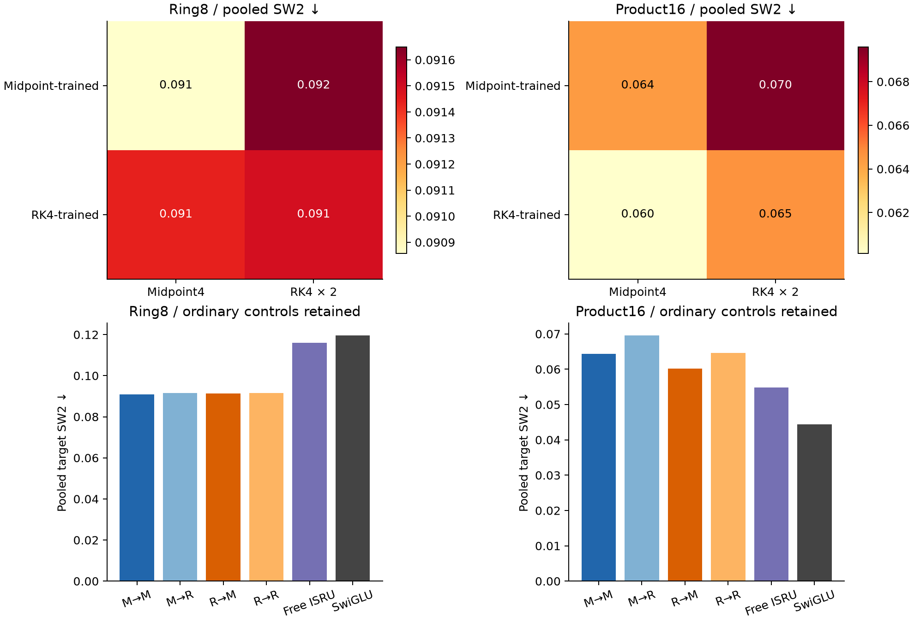
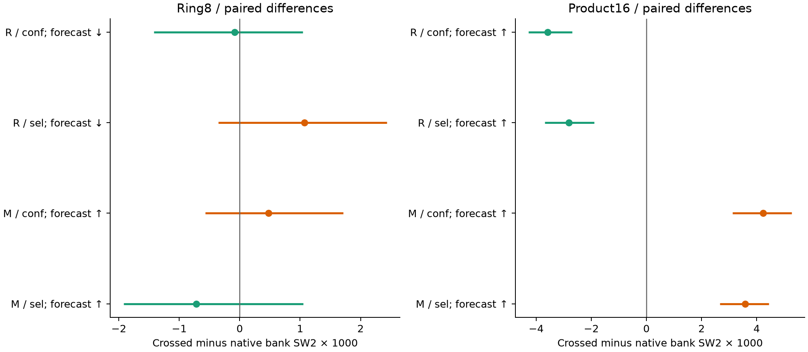

# Do field-based solver rankings predict generation?

On Product16, RK4-trained weights sampled with midpoint improve confirmation
pooled SW2 from 0.065 to 0.060; both source bank splits support the improvement.
The field-MSE-based forecast had predicted the opposite direction. On Ring8,
a clear field-fitting benefit does not yield a consistent sampling benefit.
Thus directed hidden numerical bias affects generation, but average field MSE
is insufficient to explain its useful direction. No model was retrained.

The complete prebound ranking has 4/8 point-supported
cases and 2/8 adjusted-supported cases. Every case,
split and bank is retained.

## Controlled substitution

Each of four20kweight sets is evaluated with the other hidden discrete solver.
Both methods use eight P applications per local solve. The original native
Heun32 final samples replay exactly before substitution; then the copied native
evaluator uses unchanged Heun128, eight 4096-source banks and 256 directions.
Independent NumPy reconstructs every field, sample and mode/gap metric.

Rows fix trained weights, columns select the inference solver. Bottom labels
mean training→inference (M=midpoint, R=RK4). Ordinary SwiGLU and Free ISRU controls
remain unchanged; Ring8 SwiGLU64 uses Muon, Product16 SwiGLU192 uses AdamW.
The field diagnostic and sampling test answer different questions: a field-risk
benefit is not counted as a generation gain without the target comparison.

| Task | Trained solver | Inference solver | Field MSE | Pooled SW2 |
|---|---|---|---:|---:|
| Ring8 | midpoint | midpoint | 0.010 | 0.091 |
| Ring8 | midpoint | rk4 | 0.010 | 0.092 |
| Ring8 | rk4 | rk4 | 0.010 | 0.091 |
| Ring8 | rk4 | midpoint | 0.009 | 0.091 |
| Ring8 | free_isru | native | 0.011 | 0.116 |
| Ring8 | swiglu64 | native | 0.011 | 0.120 |
| Product16 | midpoint | midpoint | 0.019 | 0.064 |
| Product16 | midpoint | rk4 | 0.020 | 0.070 |
| Product16 | rk4 | rk4 | 0.019 | 0.065 |
| Product16 | rk4 | midpoint | 0.019 | 0.060 |
| Product16 | free_isru | native | 0.015 | 0.055 |
| Product16 | swiglu192 | native | 0.015 | 0.044 |

Intervals concern paired-bank mean differences; pooled scores are reported
separately. Negative favors the crossed solver. Green points have lower bank
SW2; orange points have higher bank SW2. Label arrows record the prebound
field-based forecast. M/R denote midpoint/RK4 training. All original common sources and checkpoint identities are preserved.

## Claim candidates

- Claim: the specific recorded field-based ranking transfers to generation
  in the listed cases and fails in the others.
  - Evidence: complete selection/confirmation banks and independent reconstruction.
  - Allowed wording: retain the per-case dispositions in summary.json.
  - Forbidden stronger wording: universal field-MSE or ODE-solver advantage.
  - Uncertainty: fixed learned weights and conditional sampling-bank variation.
  - Next check: choose the next mechanism from the complete result, not one bank.
  - Decision: keep case-specific evidence and revise any broader claim.
