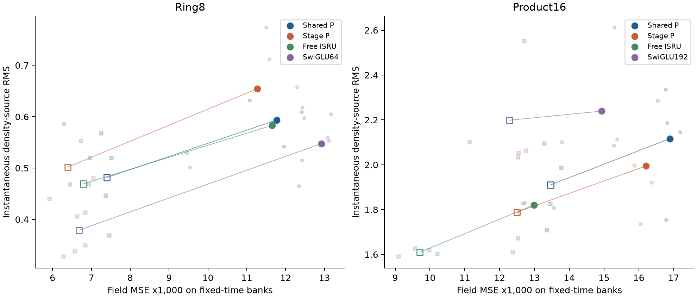
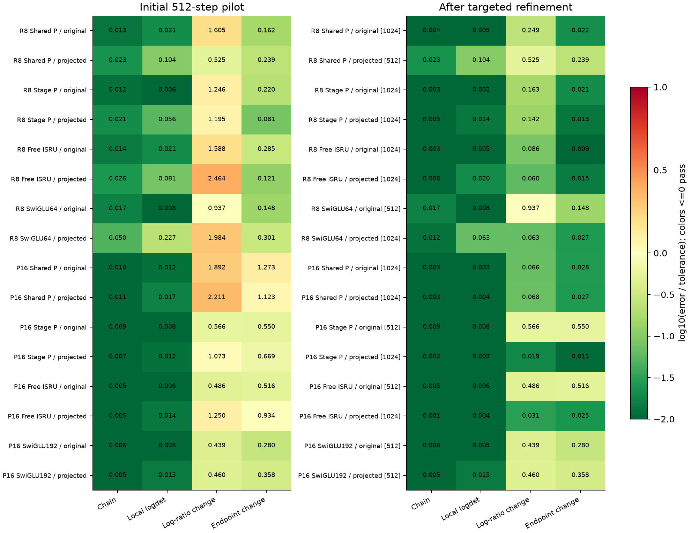

# Density changes require a path measurement

The exact density observer works on all eight frozen models and leaves
native Heun endpoints unchanged. Its numerical pilot is now qualified for
all 16 original/projected cells: six at 512 steps and ten at 1024 steps.
No new training was added. The larger prebound density comparison is next;
eight numerical pilot sources are not used to rank population KL.

## Why this measurement

The completed symmetry test left a Product16 shared-generator sampling
advantage even though its oracle field MSE was worse. A velocity-error norm
does not specify how probability mass changes. Writing e=v-v* and s=grad(log p),
the relevant density source is a=div(e)+e dot s. On an exact model trajectory:

```text
d log(rho_t(X_t)/p_t(X_t)) / dt = -a(X_t,t).
```

The [derivation](../post-symmetry-decision.md) keeps this terminal density
ratio as the intended object. This is continuous-normalizing-flow calculus,
not a new theorem. Both ordinary and ODE-inspired FFNs admit this diagnostic.

## Oracle, derivative and sampler checks

Purpose: ensure the new quantity measures density transport rather than
an implementation change. Analytic Ring8/Product16 oracle values reproduce
the pinned native velocity and log_density. Score and divergence agree with
autograd and decreasing-step central differences; the maximum oracle
continuity residual is 1.03e-12.

Every learned model passes input-Jacobian checks, sample separability and
exact native endpoint identity for original/projected fields. Finite
differences of eight complete native sampling maps independently reproduce
the observer's local-map log determinants within 5.25e-8.
[CPU readiness](cpu-doc-readiness.json), [full-map check](full-map-finite-differences.json).

A Gaussian example gives a concrete distinction: rotational and radial
velocity errors have equal MSE. The rotational field preserves the Gaussian;
the radial field has analytic terminal KL 0.222. The observer reproduces
their closed solutions and second-order endpoint convergence. This verifies
the mathematical distinction without attributing it to a trained architecture.

## Local density-source norms do not explain the sharing ranking

Purpose: check whether a smaller instantaneous source norm already explains
the previous Product16 result. New field banks use four independent 64-point
draws at each of five fixed times, for 1280 points per task. Original fields:

| Model | Ring8 MSE x1,000 | Ring8 source RMS | Product16 MSE x1,000 | Product16 source RMS |
|---|---:|---:|---:|---:|
| Shared P | 11.775 | 0.593 | 16.889 | 2.116 |
| Stage P | 11.272 | 0.654 | 16.208 | 1.995 |
| Free ISRU | 11.655 | 0.583 | 12.984 | 1.820 |
| SwiGLU reference | 12.925 | 0.548 | 14.935 | 2.239 |



Filled circles are original fields; open squares are projected fields.
Faint markers show the four field banks. On Product16, shared P has both
higher MSE and higher local source RMS than stage P, while the separate
completed sampling comparison favors sharing. SwiGLU also has a larger
source RMS but better previously measured SW2. Thus these local norm values
do not supply a common explanation of the known sampling ordering.

The exact formula accumulates a signed source on model-generated paths,
not its RMS on oracle-marginal points. These field observations therefore
reinforce the need for the path measurement. They are not a substitute KL
estimate. The fixed-time banks also differ from P1's time distribution;
absolute MSE values must not be pooled across those protocols.

## Numerical pilot and targeted refinement

Purpose: determine the step resolution required before interpreting density
ratios. All eight models and both fields used the same eight fresh source
points at Heun128/256/512. Only 6/16 cells met all five registered gates
at 512 steps. Ten failed the log-ratio refinement gate; two of those also
failed endpoint refinement. The formulas could agree at one resolution
while the predicted path and accumulated ratio still changed under refinement.



Each annotation is error divided by its registered tolerance; values <=1
pass. Color shows log10 of that ratio, so color values <=0 pass. Fine-path
step-determinant signs were positive throughout.

Only those ten unresolved cells were extended to 1024 steps. All passed
the unchanged gates; no 2048-step pilot was needed. Maximum final errors:

| Quantity | Observed maximum | Registered tolerance |
|---|---:|---:|
| Log-ratio chain residual, nats/dimension | 2.31e-5 | 0.001 |
| Continuous/local-step logdet discrepancy, nats/dimension | 1.04e-4 | 0.001 |
| Adjacent-resolution log-ratio change, nats/dimension | 1.874e-3 | 0.002 |
| Relative endpoint change | 5.50e-4 | 0.001 |

[Exact per-cell gates](qualified-cells.json) preserve full precision.
Independent NumPy checks verify all 48 original rows and ten added rows,
with maximum discrepancies 2.94e-14 and 2.14e-14, respectively.

The CPU pilot and targeted refinement took about 155 and 135 seconds of
queue wall time. Both queues and every worker are terminal. No GPU was
occupied for these tiny source batches. Formal training seed remains 0;
new streams are evaluation inputs only. Final reports are unchanged.

## Decision

Proceed to the registered four-bank, 256-source-per-bank density comparison
at common 1024/2048 resolutions. Keep all eight models, both fields and
per-point numerical gates. This measurement has not launched. It must
compare the actual signed path accumulation and its uncertainty before
selecting any time-local oracle intervention or new architecture.
[Next execution specification](../density-formal-next.md).

## Claim candidates

- Keep: the density observer preserves the original sampler and is numerically
  qualified on the prescribed pilot paths. Evidence: exact endpoint identity,
  independent full-map determinants and all 16 final numerical gates.
  Qualification of these eight paths does not certify every future source.
- Keep as an observation: instantaneous density-source RMS does not reproduce
  the existing cross-model Product16 sampling ordering on the new field banks.
  It does not establish a population KL ordering or a universal norm inequality.
- Pending: sharing reduces harmful signed density accumulation. This needs
  the full common-bank comparison and a confirming frozen-field intervention.
  Neither the new identity nor numerical readiness establishes ODE novelty.

## Raw artifact location

Raw sources, CPU derivative anchors and all NPZ arrays remain outside Git at
`/Users/mr.z/ode-workspace-prep/coefficient-20261116/density-transport/`.
The curated per-case receipts retain their original array filenames; resolve
them under `pilot-runs/cases/<case>/` or `refinement-runs/cases/<case>/` in
that raw root. No dataset, checkpoint or raw execution log is uploaded.
