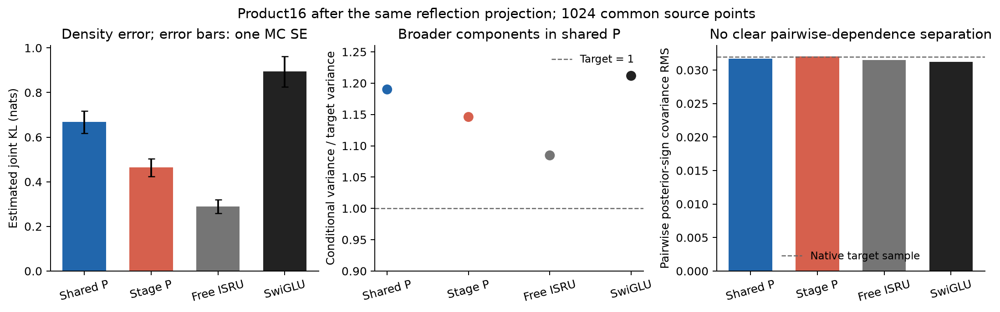

# Sharing does not reduce Product16 density error

The Product16 result rejects the proposed explanation of the sharing SW2
advantage. Shared P has higher estimated joint KL than released stage matrices,
both before and after the selected reflection projection. The direction is
stable under numerical refinement and the paired evaluation intervals exclude zero.

## Purpose and completed comparison

Test whether a shared hidden generator reduces signed density-error accumulation
along the generated paths, despite its worse average velocity-field MSE.
All four existing Product16 models and both frozen fields are included. Each
uses 1,024 common Gaussian sources in four prebound banks. All eight Product16
cells now pass the registered numerical gates, after retaining and refining
every sensitive source. Independent reconstruction agrees within4.98e-14.

| Model | Original KL | Projected KL | Projected MC SE | Projected conditional variance / target |
|---|---:|---:|---:|---:|
| Shared P |0.763|0.668|0.050|1.190|
| Stage P |0.516|0.464|0.040|1.146|
| Free ISRU |0.310|0.289|0.030|1.085|
| SwiGLU |0.890|0.894|0.069|1.212|

Lower KL is better. The variance reference is 1, not 0. KL is estimated from
the signed density-source integral on the numerically qualified continuous
learned flow. It is not an exact finite-Heun-map likelihood. Formal training
settings and checkpoints are unchanged.

The paired stage-minus-shared contrasts are:

| Field | Mean difference, nats | Four-comparison-adjusted interval | Change from previous resolution |
|---|---:|---:|---:|
| Original |-0.247|[-0.377,-0.129]|-1.61e-4|
| Projected |-0.204|[-0.320,-0.092]|-1.31e-4|

Intervals are 98.75% paired bootstrap intervals, retaining the planned family
of four task-by-field comparisons. Whole source paths are resampled within
each common bank. Raw precision and uncertainty are in
[the statistics](product-density-statistics.json), and the independent
qualification is in [the audit](product-adaptive-independent.json).

## The discrepancy has a concrete geometric component

Purpose: distinguish mode width from a simple dependence explanation. The
target factorizes in its known latent basis. Target posterior responsibilities
define each component's residual mean and variance, normalized by its native
standard deviation. Their population references are 0 and 1.

Shared P produces broader components than Stage P, while Free ISRU is closer
to the target width. Pairwise posterior-sign covariance RMS is 0.031--0.032
for the projected models, near the native target sample's 0.032. These pairwise
measurements do not show a clear dependence separation. They cannot rule out
higher-order dependence or non-Gaussian shape errors.

A population KL lower bound derived from mode masses, centroids and widths
has plug-in values 0.277 for Shared P, 0.223 for Stage P, 0.110 for Free ISRU and 0.296 for SwiGLU.
Its width terms are 0.186, 0.140, 0.049 and 0.215, respectively. Thus width is a
specific discrepancy to investigate, but these moments do not explain all
of the measured joint KL. Native target draws themselves give a positive
plug-in value 0.043, illustrating finite-sample bias. The bound is a population
statement, not an exact inequality for these noisy plug-in estimates.
[Geometry and calibration](product-geometry.json),
[derivation and measurement definitions](../product-metric-diagnosis.md).

## Keep density and sliced-distance conclusions separate

The earlier large group-stratified comparison favors Shared P over Stage P
in projected SW2, 0.055 versus 0.063. SwiGLU has 0.039 and Free ISRU 0.063.
Those same frozen models have the opposite density ordering above; a general
claim that sharing improves distribution matching is too broad.

The small 1,024-source SW2 cohort is a diagnostic, not the primary ranking:
model pooled scores range 0.119--0.127, while an exact target-law endpoint
control gives 0.124 against the separate target bank. This control transforms
the same independent Gaussian coordinates by the exact target inverse CDF;
its population KL is 0. It calibrates the finite-sample floor and is not the
native oracle flow trajectory. The new small-cohort scores do not replace
the earlier large-bank sampling evidence.

## Next research decision

Do not select an oracle time window to support the rejected density explanation.
Confirmation time profiles remain unopened. The next structural control is
to separate sharing from the coordinate system used to release the matrices:
the existing P+Delta construction also changes the mean effective update.
A zero-mean orthogonal contrast basis preserves mean(W)=P while representing
the same released-stage function class and parameter count.
[Mathematics and registered control](../sharing-optimization-control.md).
That new model has not been implemented or trained.

The two Ring8 state models still need their final refinement/audit; the full
two-task conclusion remains open. No new image run or finalized report was
changed. The full goal remains identifying which ODE constraints help and why,
including results that refute the initial explanation.
