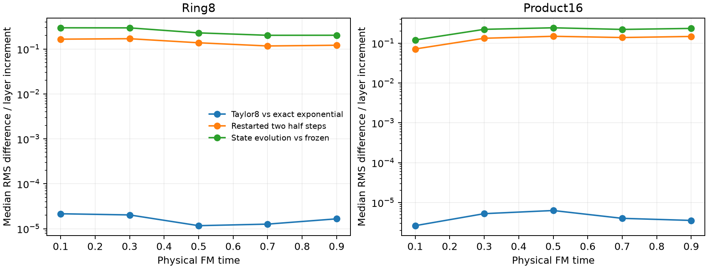
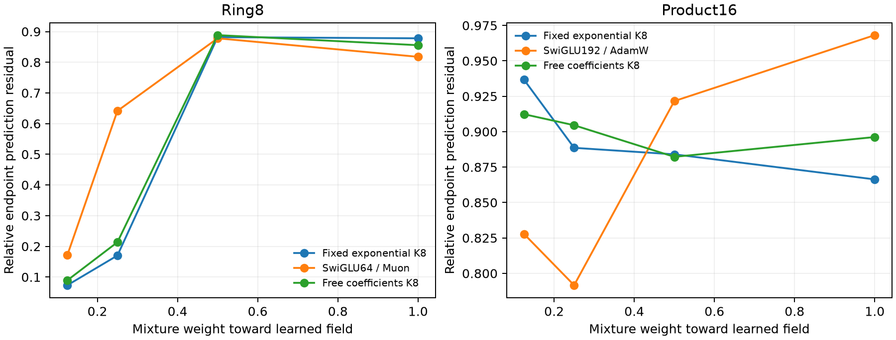

# Completed frozen-checkpoint diagnosis

These findings use final20k CPU checkpoints, separate from the pending
common-bank comparison. The two coefficient trajectories are complete;
the two state-flow trajectories and final evaluation pipelines are active.

## Exponential accuracy is not the same as a reusable hidden flow

At five physical times, eight fixed states per time and six local layers:

| Task | Median truncation / increment | Median restart defect / increment | Median feedback correction / increment |
|---|---:|---:|---:|
| Ring8 | 1.647e-5 | 0.139 | 0.247 |
| Product16 | 5.118e-6 | 0.131 | 0.207 |

Truncation compares native Taylor8 with the exact conditional matrix
exponential. Restart compares two exact half-time maps that each recompute
D with one full map. Feedback compares four midpoint steps of the
state-dependent ISRU equation with the conditional exponential. Ratios
use RMS of the layer increment, not its total output. These are probes of
learned states, not a global bound.

The exact-exponential full-model replacement barely changes predicted
velocity (maximum shift5.282e-5 RMS on these probes). State-evolving
replacement changes it by0.077–0.931 RMS and worsens fixed-weight oracle fit.
This resolves the proposed operator difference; whether retraining it is
useful is tested by the two newly launched state-flow trajectories.

[Full raw probe results](frozen-diagnosis.json),
[derivation](mathematical-basis.md), [state-stage decision](state-execution.md).

At each physical time, curves summarize the median over six layers on the
same eight states. The vertical scale is logarithmic. Recomputing the
generator produces much larger changes than improving exponential accuracy.

## First-order error transport is not an adequate full-model explanation yet

All ten fixed/free/ordinary model-task cases were checked on64common noise
sources with160native Heun steps, plus320step refinement. Oracle Jacobians
pass directional finite differences. A constant-field witness verifies that
each time-window intervention integrates its declared20%interval exactly.

The variational equation predicts the effect of a small mixture perturbation
away from the oracle. At the full learned field, however, relative endpoint
prediction residuals range0.792–0.968. For Ring8 fixed-K8 it rises from0.073
at perturbation weight0.125 to0.878 at weight1.000. Its predicted strongest
repair window is0.600–0.800; the measured strongest window is0.000–0.200.
The other Ring8 models also fail to predict the strongest repair window.

Consequently, a linearized transport score cannot presently explain the
full learned model's sampling quality. The bounded diagnostics reject that
extrapolation. They do not invalidate the local sensitivity identity. Direct
window interventions remain observations, and their nonlinear effects need
to be analyzed before proposing a targeted architectural change.

Product16 already has a large residual at weight0.125, so an additional
local-calibration check used weights0.001,0.004,0.016 for the fixed-K8
models. At0.001, the relative residual is0.001 for Ring8 and0.008 for
Product16 and grows as the perturbation increases. This verifies the local
regime empirically; it does not rescue the extrapolation to1.000.
[Additional calibration](small-perturbation-check.json).

Paired endpoint displacement compares a particular shared-noise coupling;
it is not pooled SW2. The common-bank distribution measurements continue
independently. No sampling winner is inferred from this endpoint table.

[Eight existing cases](transport-existing.json),
[two new coefficient cases](transport-new.json).

Each curve uses64common sources and160Heun steps. The residual compares
the variational prediction with actual integrated endpoints at the stated
mixture weight. Curves are deterministic evaluation probes, not training
repeat variability or SW2 confidence bands.
