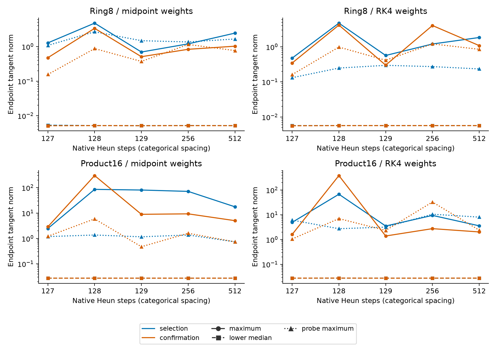
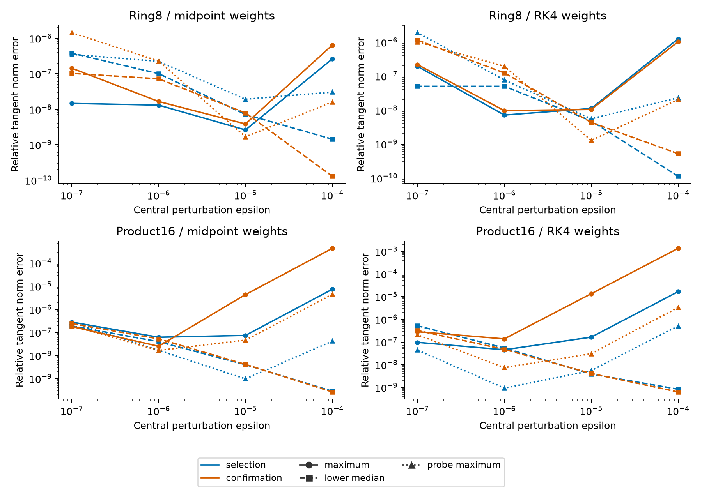

# Rare-source derivative and sampler-resolution diagnosis

The large cached sensitivities are genuine derivatives of the128-step sampler.
All24fixed roles pass the component finite-difference gate at1e-5and1e-6.
Their behavior across time meshes differs: median controls are stable,
whereas several extreme sources change substantially. The full-bank generation
benefit now needs the same resolution intervention before a mechanism claim.

All four frozen weights, both splits and all24prebound roles are retained. The unchanged sampler uses all five registered step counts. There is no generation-quality estimate from these selected sources.

| Case | Split | Max-source tangent127 | 128 | 129 | 256 | 512 | FD1e-5 | FD1e-6 |
|---|---|---:|---:|---:|---:|---:|---|---|
| ring_midpoint_trained | selection | 1.277 | 4.757 | 0.696 | 1.197 | 2.448 | pass | pass |
| ring_midpoint_trained | confirmation | 0.476 | 3.366 | 0.509 | 0.833 | 1.024 | pass | pass |
| ring_rk4_trained | selection | 0.477 | 4.739 | 0.568 | 1.205 | 1.846 | pass | pass |
| ring_rk4_trained | confirmation | 0.346 | 4.173 | 0.301 | 4.058 | 1.085 | pass | pass |
| product_midpoint_trained | selection | 2.467 | 85.659 | 80.653 | 71.266 | 17.630 | pass | pass |
| product_midpoint_trained | confirmation | 2.884 | 298.812 | 8.929 | 9.311 | 5.022 | pass | pass |
| product_rk4_trained | selection | 4.926 | 67.331 | 3.512 | 9.416 | 3.574 | pass | pass |
| product_rk4_trained | confirmation | 1.602 | 381.359 | 1.390 | 2.749 | 2.025 | pass | pass |

All maximum, lower-median and original-probe controls are shown. The512-step run is the finest observed value, not a certified continuous solution. Nearby non-dyadic counts and finer counts answer different resolution questions.

Every registered perturbation scale is kept. The graph shows relative vector-norm error; the table/JSON separately retain the component gate, which has an absolute term. Do not turn convergence at one scale into agreement at every scale.

## Product16 RK4 confirmation: three controls

| Fixed role | Tangent128 | Tangent129 | Tangent512 | Native128-to512 endpoint distance |
|---|---:|---:|---:|---:|
| Maximum at128 |381.359|1.390|2.025|1.481|
| Lower median at128 |0.028|0.028|0.028|0.003|
| Maximum of the original derivative probe |6.997|2.329|2.390|3.048|

The maximum at128has actual crossed displacement1.801, versus derivative
norm381.359. Its finite-difference relative L2error decreases from1.340e-3
at1e-4to1.340e-5at1e-5and1.374e-7at1e-6. At1e-7roundoff starts to
matter, giving2.835e-7. The original coarse-scale failures remain recorded.
The median control stays near0.028at every mesh. The original-probe maximum
also responds to resolution: its tangent rises to32.678at256before falling
to2.390at512. Thus a nearby-count check alone is not a convergence test.

These are sources selected using128-step behavior. A drop at other meshes
cannot establish that the whole population is less sensitive there. The next
experiment keeps every source/target bank and compares native/crossed generation
at127/129/512/2048, anchored to cached128. It will test the generation benefit
itself rather than substituting selected-source sensitivity for sample quality.

## Claim candidates

- Claim: the recorded extreme128-step derivatives are real local responses.
  - Evidence: all24roles pass at1e-5/1e-6; cached and augmented-primal replay qualify.
  - Allowed wording: verified derivatives at the fixed source identities.
  - Uncertainty: local response does not predict a finite displacement automatically.
  - Next check: full-bank generation across time meshes.
  - Decision: keep.
- Claim: these selected-source sensitivities depend on outer sampling resolution.
  - Evidence: all five counts and all24roles in summary.json; two complete figures.
  - Allowed wording: strong source-local mesh dependence, stable median controls.
  - Uncertainty: selection is conditioned on128;512is not a continuous reference.
  - Next check: retain all sources, both streams and all four frozen models.
  - Decision: keep.
