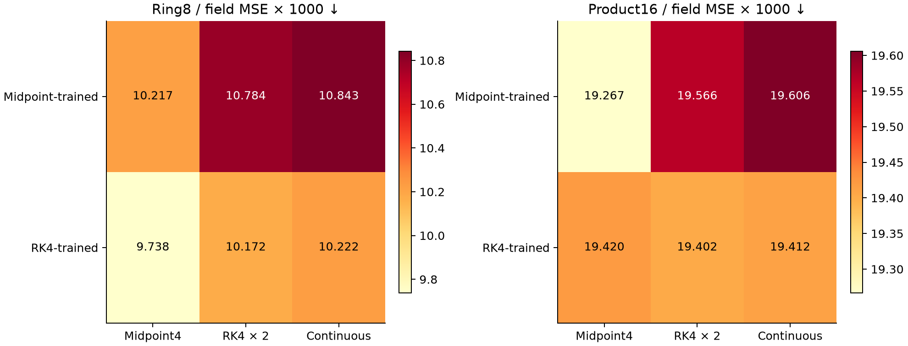
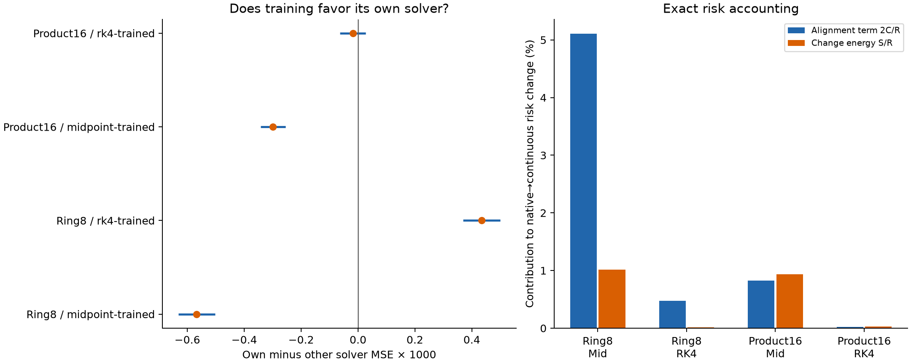

# The hidden solver bias reaches the field and can reduce its error

The complete-field test rules out a simple own-solver compensation story on
Ring8: both sets of trained weights fit the oracle field better when evaluated
with midpoint than RK4. Removing midpoint's numerical bias also worsens the
midpoint-trained field MSE by 6.121% on Ring8 and 1.762% on Product16. The internal
solver difference is therefore exposed at the task output, with a measurable
error-correcting direction. Generation value is a separate next test.

## Frozen-weight intervention

Four retained 20k checkpoints, all 4,096 original selection-field inputs per task,
all six internal solves changed together. The two continuous passes integrate
each layer from its actual sequential input, rather than reusing native-state
reference endpoints. Original/identity and own-solver patches replay exactly;
model tensors and RNG remain unchanged. All points qualify in the independent
local reconstruction and continuous-reference checks. No training was added.

Rows fix learned weights; columns change only the hidden solver. Values are
per-coordinate field MSE × 1000 to show small differences legibly. Ring8 favors
midpoint in both rows. Product16 favors midpoint for midpoint-trained weights,
while RK4-trained weights have a smaller advantage with their original method.

| Task | Trained with | Midpoint MSE | RK4 MSE | Continuous MSE | Native exposure S/R | Native-to-continuous risk change |
|---|---|---:|---:|---:|---:|---:|
| Ring8 | midpoint | 0.010 | 0.011 | 0.011 | 1.016e-02 | 6.121% |
| Ring8 | rk4 | 0.010 | 0.010 | 0.010 | 1.629e-04 | 0.488% |
| Product16 | midpoint | 0.019 | 0.020 | 0.020 | 9.383e-03 | 1.762% |
| Product16 | rk4 | 0.019 | 0.019 | 0.019 | 2.865e-04 | 0.051% |

## Why the risk changes

For error e=F_num-v_oracle and field change delta=F_cont-F_num, the exact
identity is R_cont-R_num=2C+S, where R=E||e||²,S=E||delta||²,C=E<e,delta>.
Positive C means the change toward continuous solving points partly along the
remaining field error; it makes that error larger. Its size cannot be inferred
from hidden-state accuracy alone. The full cohort reconstructs this identity
independently. Native midpoint exposure S/R is about .010 on both tasks, so its
effect is not erased by the complete readout.

Left: own-solver risk minus other-solver risk, with paired four-comparison-adjusted
intervals. The strong compensation hypothesis requires negative differences in
all four cases; Ring8 RK4-trained weights contradict it. Right: the two exact
terms for replacing each model's native solver by a continuous solve.

## Research decision

More faithful solving did not improve generation in the prior matched training.
This observation now shows why simply treating hidden numerical error as harmful
is inadequate: its direction can reduce complete-field error. The next test
keeps these weights and evaluates the crossed solvers on all original common
sampling banks, with the native sampler and ordinary controls retained. Record
the field-based solver ranking before opening these new sampling outcomes.
Do not promote a new architecture from this field diagnostic alone.

## Claim candidates

- Claim: native hidden numerical bias affects the complete learned field.
  - Evidence: full 4,096-input sequential interventions, independent references,
    risk exposure and exact accounting.
  - Allowed wording: measured field-level exposure and direction in these models.
  - Forbidden stronger wording: improved generative distribution or FID.
  - Uncertainty: frozen fields on the retained evaluation distribution.
  - Next check: actual common-bank sampling after the crossed substitutions.
  - Decision: keep.
- Claim: the strong own-solver compensation explanation is not supported.
  - Evidence: crossed field risks and paired contrasts, especially Ring8 RK4 weights.
  - Allowed wording: both Ring8 weight sets prefer midpoint on the full field probe.
  - Forbidden stronger wording: no learned compensation exists in any model.
  - Uncertainty: task-specific preferences and conditional evaluation variation.
  - Next check: preserve all four cases in the sampling test.
  - Decision: revise the mechanism toward directed numerical bias.
