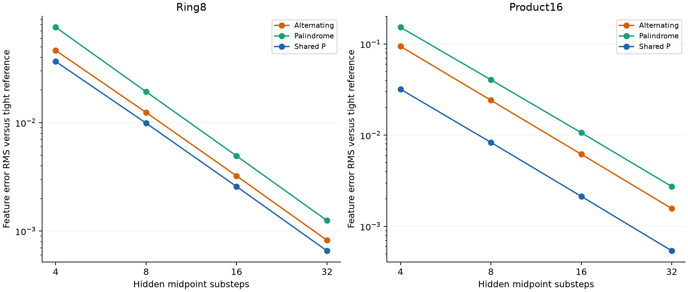
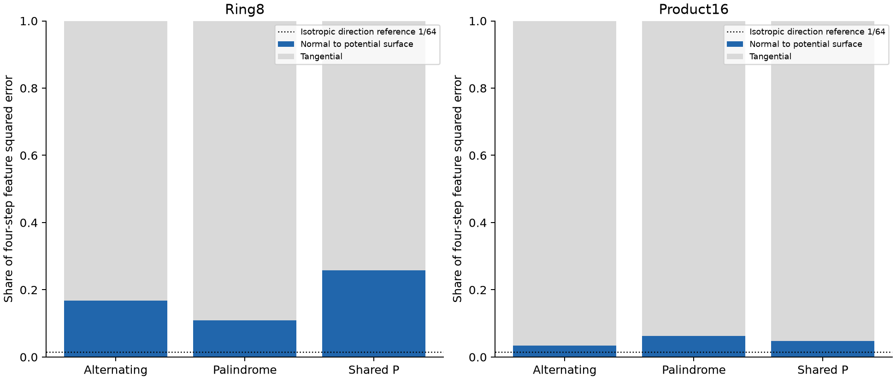
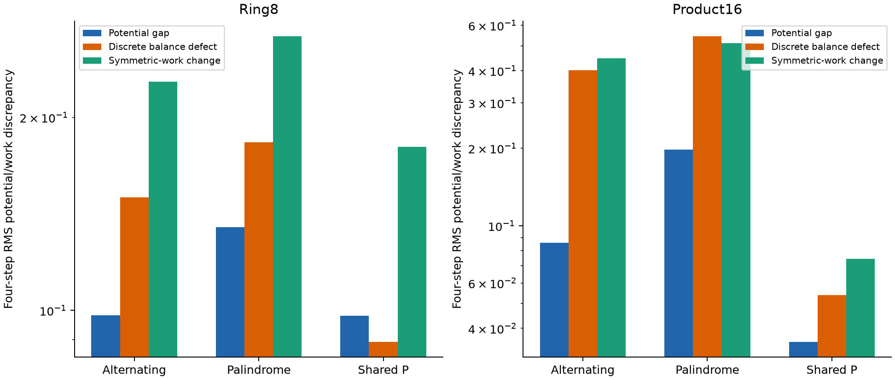

# Hidden ISRU flow: potential and direction

**2880/2880 captured local states qualify against the two continuous
references. The normal component accounts for 0.034--0.258
of the four-step feature squared error across the six models.** This directly
measures the learned hidden solver; it does not rank generation performance.

## Purpose and inputs

Investigate the observed change in generation when the trained four-step
hidden computation is refined toward its continuous limit. Shared P, palindrome
and alternating checkpoints are fixed at20k, one per task. Each uses the same
80 registered interpolation inputs: two pairs from every bank at five times.
All six local-solve entrances are retained. No new data, weights or training.

For q(y)=ISRU(y), the potential E has gradient q and exact evolution
dE/ds=q^T sym(P)q. The skew part redirects states without direct instantaneous
potential work. Native midpoint need not satisfy the continuous balance.
[Derivation, settings and hypotheses](../hidden-energy-protocol.md).

| Task | Model | Qualified local states | Feature error RMS | Normal share | Tangential share | Energy gap RMS | Balance defect RMS | Work change RMS |
|---|---|---:|---:|---:|---:|---:|---:|---:|
| Ring8 | Alternating | 480/480 | 0.046 | 0.168 | 0.832 | 0.098 | 0.150 | 0.227 |
| Ring8 | Palindrome | 480/480 | 0.076 | 0.109 | 0.891 | 0.135 | 0.183 | 0.268 |
| Ring8 | Shared P | 480/480 | 0.037 | 0.258 | 0.742 | 0.098 | 0.089 | 0.180 |
| Product16 | Alternating | 480/480 | 0.094 | 0.034 | 0.966 | 0.086 | 0.402 | 0.447 |
| Product16 | Palindrome | 480/480 | 0.153 | 0.063 | 0.937 | 0.198 | 0.545 | 0.512 |
| Product16 | Shared P | 480/480 | 0.032 | 0.047 | 0.953 | 0.035 | 0.054 | 0.074 |

The reference is the same hidden field, with its four exact stage boundaries.
Two DOP853 tolerances independently qualify each endpoint and its accumulated
symmetric work. A more accurate local map is not asserted to generate better
samples; the earlier full sampling refinement already separates those objects.

At the reference endpoint, project the coarse-minus-reference feature vector
onto q and its orthogonal complement. These components sum exactly to that
feature difference. Shares pool squared norms over all captured states/layers;
they are not averages of unstable pointwise ratios. The1/64 line is an isotropic
geometric reference, not an estimated null distribution or significance test.
The normal component measures first-order potential change, not every nonlinear
energy effect. The bounded Taylor remainder is independently checked. The
symmetric part of P can also redirect features, so tangential error is not
attributed exclusively to the skew part.

Potential gap equals symmetric-work change plus discrete balance defect minus
the tight reference closure, with signed per-state quantities. The displayed
RMS magnitudes need not add: work and balance changes can cancel. A large
balance defect alone therefore need not account for the resulting potential gap.

## Interpretation and next check

Feature error, potential change and downstream velocity change are distinct.
The normal/tangential shares describe the hidden difference, not how strongly
the remaining network responds to it. Any proposed energy explanation must
retain the measured directional component and numerical floor. A subsequent
one-layer-at-a-time replacement can test how each component affects the full
output, but requires its own registered native-map checks. No energy penalty,
new activation, architecture promotion or generation claim follows here.

## Verification

Both native dataset commands and both independent verifiers exit0. Independent
maps/work/geometry reconstruct within1.56e-13; every source/bank/time
binding is exact. All native4/8/16/32 maps replay in NumPy within their registered
tolerance. Both continuous references, midpoint outputs and input arrays remain
in hash-bound raw files. Every unresolved state would remain visible; none is
removed. All original parameters and buffers remain unchanged.

## Claim candidates

- Claim: coarse hidden error can be separated into potential-normal and tangential components.
  - Evidence: all states, exact decomposition and independent scalar-potential bounds.
  - Allowed wording: finite-state component shares and measured numerical balance defects.
  - Forbidden stronger wording: these shares explain the sampling gap or prove a new FFN advantage.
  - Uncertainty: deterministic registered states; reference floors are numerical diagnostics.
  - Next check: registered one-layer native interventions on the complete output.
  - Decision: retain measured components, with no generation attribution.
