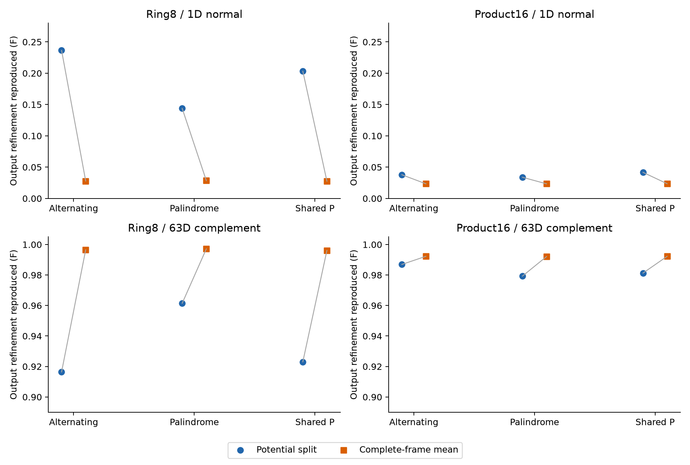
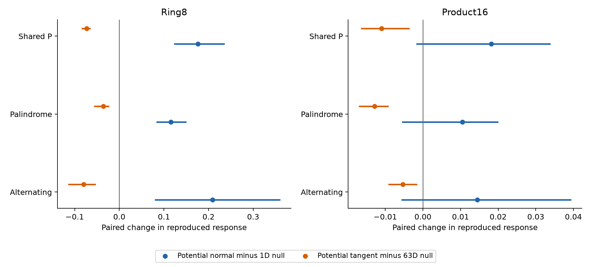

# Equal-dimension controls change the mechanism interpretation

**The strong tangential-specificity hypothesis fails in 6/6
models. Every adjusted paired interval is negative in 6/6.**
A generic 63D correction reproduces more of the full local-refinement output
change than the potential-tangential correction. Large tangential F therefore
does not by itself establish unusual ODE sensitivity.

## Purpose and fixed intervention

Keep the six trained checkpoints, all six local layers and all 80 original
inputs. Before observing these outputs, bind one complete orthonormal frame
per model/layer using evaluation RNG 0. For every one of its 64 directions,
remove the 1D projection of the same native-minus-reference feature difference,
or remove its 63D complement. Compare with the prior exact potential-normal
and potential-tangential interventions, with the same downstream network.
No weights, response function, data or image architecture are changed.

The top row compares two 1D corrections; the bottom compares two 63D corrections.
Points, rather than bar lengths, show the high-F complement results. Complete
frames have exactly the expected mean feature-removal energy at every state.
The potential normal captures more of the output change, while its complement
captures less than the corresponding dimension-matched mean.

| Task | Model | Potential normal F | Random 1D mean F | Potential tangent F | Random 63D mean F | Delta N | Delta T |
|---|---|---:|---:|---:|---:|---:|---:|
| Ring8 | Alternating | 0.236 | 0.028 | 0.916 | 0.997 | 0.209 | -0.080 |
| Ring8 | Palindrome | 0.144 | 0.028 | 0.961 | 0.997 | 0.115 | -0.036 |
| Ring8 | Shared P | 0.203 | 0.027 | 0.923 | 0.996 | 0.176 | -0.073 |
| Product16 | Alternating | 0.038 | 0.023 | 0.987 | 0.992 | 0.014 | -0.005 |
| Product16 | Palindrome | 0.034 | 0.023 | 0.979 | 0.992 | 0.010 | -0.013 |
| Product16 | Shared P | 0.042 | 0.024 | 0.981 | 0.992 | 0.018 | -0.011 |

## Paired conditional evidence

Intervals enumerate all eight-bank resamples and adjust nominally for the 12
registered contrasts. Tangent-minus-null is negative in every case. Normal
specificity has positive adjusted intervals in 3/6
models, all on Ring8; Product16 intervals cross zero.

| Task | Model | Delta N adjusted interval | Delta T adjusted interval |
|---|---|---|---|
| Ring8 | Alternating | [0.079, 0.361] | [-0.115, -0.052] |
| Ring8 | Palindrome | [0.083, 0.151] | [-0.057, -0.023] |
| Ring8 | Shared P | [0.122, 0.236] | [-0.085, -0.064] |
| Product16 | Alternating | [-0.006, 0.039] | [-0.009, -0.002] |
| Product16 | Palindrome | [-0.006, 0.020] | [-0.017, -0.009] |
| Product16 | Shared P | [-0.002, 0.034] | [-0.016, -0.004] |

The earlier observation that tangential changes carry most output response
remains true, but its interpretation changes: a generic high-dimensional
complement carries even more. The potential-normal coordinate is structured,
especially on Ring8, despite being only one of 64 dimensions.

## Feature error concentration and finite response gain

The preceding exact geometry audit found potential-normal feature error
enriched by 2.158--16.489 relative to the 1/64 geometric reference. That alone
can increase its absolute output effect. Dividing squared output displacement
by squared removed feature length also reveals a task difference: Ring8's
normal gains exceed the null, whereas Product16's are lower. These are finite
intervention gains, not Jacobian estimates or a linear scaling law.

| Task | Model | Actual normal gain | Null 1D gain | Normal gain ratio | Actual tangent gain | Null 63D gain |
|---|---|---:|---:|---:|---:|---:|
| Ring8 | Alternating | 0.010 | 0.004 | 2.252 | 0.018 | 0.019 |
| Ring8 | Palindrome | 0.010 | 0.005 | 1.962 | 0.026 | 0.026 |
| Ring8 | Shared P | 0.005 | 0.004 | 1.218 | 0.019 | 0.017 |
| Product16 | Alternating | 0.170 | 0.216 | 0.788 | 0.437 | 0.435 |
| Product16 | Palindrome | 0.141 | 0.215 | 0.655 | 0.438 | 0.422 |
| Product16 | Shared P | 0.210 | 0.263 | 0.798 | 0.536 | 0.529 |

## Verification and research decision

Both native datasets and both independent verifiers exit 0. All 2880 original
states, all 36 frames and all 64 directions are retained. Frame generation,
candidate projections, exact mean feature-energy identities, full-output
metrics and bank intervals reconstruct independently; maximum candidate
reconstruction error is 0.000e+00. Identity upstream states, original
normal/tangent outputs and final native roundtrips are exact.

Do not promote a direction-only architecture or a larger generation comparison
from high tangential F/G. The next mathematical question is why the trained
hidden solver's error concentrates along the potential normal, and why the
remaining network treats that direction differently across tasks. A quantitative
solver-bias prediction is more informative than another activation search.

## Claim candidates

- Claim: the tested potential tangent is not superior to an equal-dimension
  generic complement on these fixed models and inputs.
  - Evidence: all six paired contrasts and their adjusted negative intervals.
  - Allowed wording: the strong six-case tangential-specificity prediction is
    falsified on this complete fixed cohort.
  - Forbidden stronger wording: no ODE feature computation can ever be useful.
  - Uncertainty: one bound complete frame per layer, fixed checkpoints and inputs.
  - Next check: predict the actual hidden discretization error quantitatively.
  - Decision: discard tangential dominance alone as a novelty claim.
- Claim: the potential normal carries above-null output response on Ring8.
  - Evidence: three positive adjusted paired intervals, feature enrichment and
    the supporting finite-response gains; Product16 remains inconclusive.
  - Allowed wording: task-dependent canonical-normal structure.
  - Forbidden stronger wording: general generation or image-quality improvement.
  - Uncertainty: no training-population inference or exclusive ODE advantage.
  - Next check: separate numerical bias from downstream feature sensitivity.
  - Decision: retain the mathematical mechanism question.
