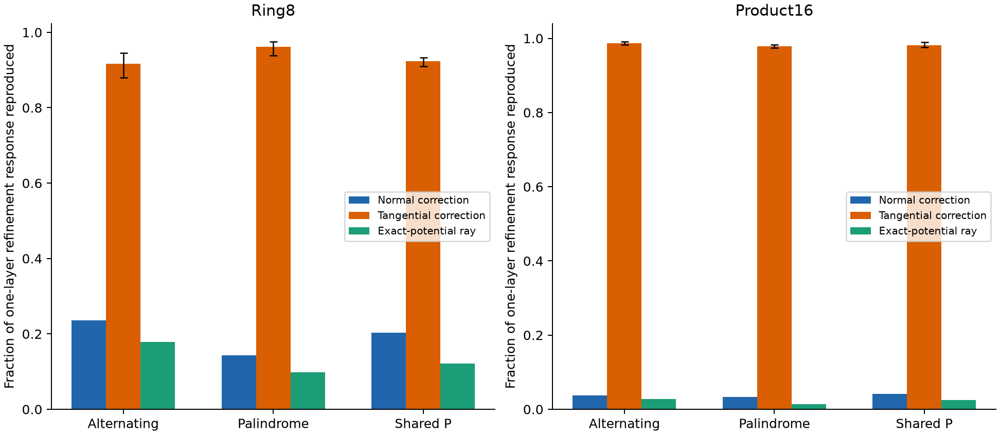
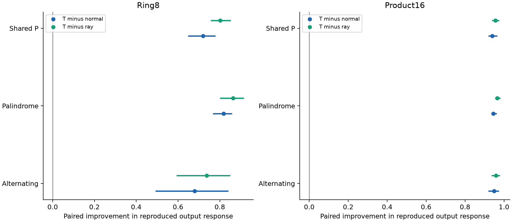

# Which hidden component reaches the output?

**Tangential correction reproduces most of the single-layer refinement response
in all 6/6 fixed models. All 6/6 satisfy the three registered
conditions with positive lower adjusted input-bank intervals.** Matching the
potential while retaining the original feature direction reproduces much less.

## Controlled experiment

Reuse all80original interpolation inputs per checkpoint and all six local layers.
Replace exactly one layer per forward call, preserving its exact upstream state
and all native downstream computation. Compare full continuous-reference output,
normal correction, tangential correction and an exact-potential ray correction.
The ray changes only amplitude and matches the reference potential. All2880ray
points qualify; identity hooks and native roundtrips are bit-identical.

The reported fraction is1 minus the squared residual to the full one-layer
reference response, divided by the original response energy. It measures a
finite intervention's output effect. It is not the earlier oracle-endpoint
calibration, a generation-quality score or a percentage improvement in FID.

| Task | Model | Normal correction | Tangential correction | Exact-potential ray | Adjusted T-minus-N interval | Adjusted T-minus-ray interval |
|---|---|---:|---:|---:|---|---|
| Ring8 | Alternating | 0.236 | 0.916 | 0.179 | [0.492, 0.840] | [0.593, 0.850] |
| Ring8 | Palindrome | 0.144 | 0.961 | 0.098 | [0.767, 0.858] | [0.800, 0.915] |
| Ring8 | Shared P | 0.203 | 0.923 | 0.121 | [0.649, 0.780] | [0.756, 0.852] |
| Product16 | Alternating | 0.038 | 0.987 | 0.028 | [0.920, 0.974] | [0.936, 0.979] |
| Product16 | Palindrome | 0.034 | 0.979 | 0.014 | [0.935, 0.963] | [0.953, 0.982] |
| Product16 | Shared P | 0.042 | 0.981 | 0.025 | [0.920, 0.966] | [0.939, 0.975] |

Tangential correction closely reproduces the full response in both tasks.
Normal and exact-potential corrections have much smaller effects. This direct
intervention strengthens the earlier feature-space observation: the small
potential-normal component does not become the main output effect downstream.
The result concerns the inspected states and layers; it does not identify the
skew part of P as the sole source of direction changes.

Both registered contrasts favor tangential correction in every fixed model,
with positive nominal18-comparison-adjusted conditional intervals. Banks jointly
resample residual and response energies. The intervals describe these weights'
input variation, not repeated training trajectories.

## Consequence

An energy-only account of the hidden-refinement output change is rejected on
this cohort. The supported mechanism is direction-sensitive feature computation.
It explains which local difference reaches the complete model's prediction;
it does not yet establish why the final generated distribution improves or
worsens. No spectral cap, energy penalty or new architecture follows automatically.

Both native datasets and both independent verifiers exit0. Candidate and exact
ray reconstruction errors are at most1.78e-15. Every layer, bank, time,
oracle-field diagnostic and source binding is retained. All weights/buffers and
the image trainer remain fixed. [Protocol and definitions](../hidden-readout-protocol.md).

## Claim candidates

- Claim: tangential correction carries the observed full-output refinement response.
  - Evidence: six-model single-layer interventions, exact energy control and adjusted paired intervals.
  - Allowed wording: direct conditional effect on the registered80inputs and all six layers.
  - Forbidden stronger wording: improved generation, unique skew-P benefit or a new winning FFN.
  - Uncertainty: fixed weights and finite interpolation inputs; no sample trajectories are changed here.
  - Next check: relate direction-sensitive hidden computation to a qualified distribution intervention.
  - Decision: keep the local output mechanism.
