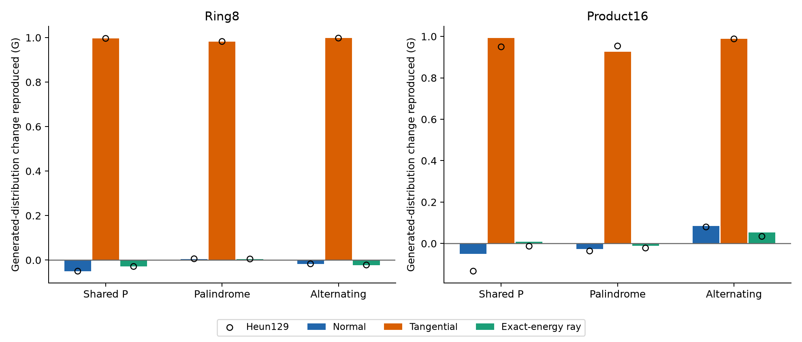
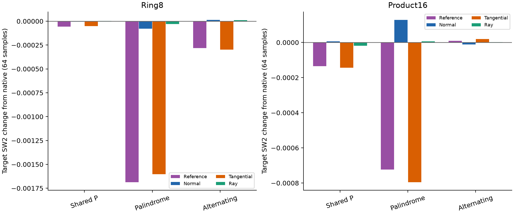

# From hidden direction to the terminal distribution

**12/12model/grid comparisons meet the registered numerical gates;
12/12both qualify and support the directional prediction.** The raw
point prediction is supported in12/12comparisons. All cases,
failed gates and both grids are retained.

## Intervention and primary question

Change only blocks.0.ffn.ode1on each actual field evaluation. All other local
layers, weights, time embedding and native Heunsampler stay fixed. This first
layer passed the earlier interpolation qualification in all six focal models;
the failed all-layer surrogate is not reclassified as passing. Compare native,
full-refinement, normal, tangential and exact-energy-ray arms on the same64
sources: first eight from each original bank. Ordinary SwiGLUand FreeISRUare
evaluated on those same sources/targets. No training is performed.

Gcompares sorted projected endpoint distributions to the full-refinement arm:
1-minus quantile residual energy divided by the native-to-reference energy.
It is not source-paired endpoint error or target-quality improvement.

Filled bars use Heun128; open circles use129, both with inner1024. These are
two distinct finite sampling grids, not proof of continuous outer convergence.
Hatched bars and crosses mark unresolved numerical gates.
Inspect the complete numerical gates before interpreting any direction contrast.

| Task | Model | Heun steps | G normal | G tangential | G exact-energy ray | Numerical gates | Direction prediction |
|---|---|---:|---:|---:|---:|---|---|
| Ring8 | Shared P | 128 | -0.050 | 0.996 | -0.029 | pass | supports |
| Ring8 | Shared P | 129 | -0.050 | 0.996 | -0.029 | pass | supports |
| Ring8 | Palindrome | 128 | 0.004 | 0.982 | 0.004 | pass | supports |
| Ring8 | Palindrome | 129 | 0.006 | 0.983 | 0.005 | pass | supports |
| Ring8 | Alternating | 128 | -0.018 | 0.998 | -0.023 | pass | supports |
| Ring8 | Alternating | 129 | -0.017 | 0.998 | -0.022 | pass | supports |
| Product16 | Shared P | 128 | -0.051 | 0.992 | 0.009 | pass | supports |
| Product16 | Shared P | 129 | -0.133 | 0.950 | -0.013 | pass | supports |
| Product16 | Palindrome | 128 | -0.026 | 0.926 | -0.012 | pass | supports |
| Product16 | Palindrome | 129 | -0.036 | 0.954 | -0.022 | pass | supports |
| Product16 | Alternating | 128 | 0.085 | 0.989 | 0.054 | pass | supports |
| Product16 | Alternating | 129 | 0.080 | 0.988 | 0.034 | pass | supports |

## Agreement with the actual target

Negative bars mean improved targetSW2relative to the same checkpoint's native
sampler; positive bars mean worse. The figure shows within-checkpoint changes,
and the full table retains ordinary SwiGLU/FreeISRUcontrols on the same samples.
TargetSW2answers whether refinement or its component improves the target fit.
Ganswers which component reproduces the refinement's distribution change.
They must not be substituted for each other. The64sample values below cannot
be ranked against historical32768sample evaluations.

| Task | Model | Heun | Native SW2 | Full refinement | Normal | Tangential | Exact-energy ray |
|---|---|---:|---:|---:|---:|---:|---:|
| Ring8 | Shared P | 128 | 0.407 | 0.407 | 0.407 | 0.407 | 0.407 |
| Ring8 | Shared P | 129 | 0.407 | 0.407 | 0.407 | 0.407 | 0.407 |
| Ring8 | Free ISRU | 128 | 0.408 | — | — | — | — |
| Ring8 | Free ISRU | 129 | 0.408 | — | — | — | — |
| Ring8 | SwiGLU | 128 | 0.419 | — | — | — | — |
| Ring8 | SwiGLU | 129 | 0.419 | — | — | — | — |
| Ring8 | Palindrome | 128 | 0.406 | 0.404 | 0.405 | 0.404 | 0.406 |
| Ring8 | Palindrome | 129 | 0.406 | 0.404 | 0.406 | 0.404 | 0.406 |
| Ring8 | Alternating | 128 | 0.409 | 0.409 | 0.409 | 0.409 | 0.409 |
| Ring8 | Alternating | 129 | 0.409 | 0.408 | 0.409 | 0.408 | 0.409 |
| Product16 | Shared P | 128 | 0.419 | 0.418 | 0.419 | 0.418 | 0.419 |
| Product16 | Shared P | 129 | 0.418 | 0.418 | 0.418 | 0.418 | 0.418 |
| Product16 | Free ISRU | 128 | 0.438 | — | — | — | — |
| Product16 | Free ISRU | 129 | 0.439 | — | — | — | — |
| Product16 | SwiGLU | 128 | 0.424 | — | — | — | — |
| Product16 | SwiGLU | 129 | 0.424 | — | — | — | — |
| Product16 | Palindrome | 128 | 0.420 | 0.419 | 0.420 | 0.419 | 0.420 |
| Product16 | Palindrome | 129 | 0.420 | 0.419 | 0.420 | 0.419 | 0.420 |
| Product16 | Alternating | 128 | 0.420 | 0.420 | 0.420 | 0.420 | 0.420 |
| Product16 | Alternating | 129 | 0.420 | 0.420 | 0.420 | 0.420 | 0.420 |

## Numerical checks

Every arm retains inner512/1024and outer128/129. Five field-call batches
per arm retain inputs, first-layer states, two DOP853references, all exact
candidate outputs and downstream fields. Per-point local/output gates, inner
endpoint shifts, bank/pooledGstability and effect-resolution gates are fixed
in the protocol. Identity trajectories and final native roundtrips are exact.
Both native entries and independent verifiers exit0; candidate reconstruction
error is at most1.776e-15. Raw arrays bind all original banks and checkpoints.

## Geometry control and interpretation

Potential-normal error occupies one of64feature dimensions, while its tangent
complement occupies63. A large tangential share alone does not establish
unusual directional sensitivity. For a uniformly random unit normal r,
E[||rr^T delta||²]=||delta||²/64. The [completed local-output control](../hidden-null-results/analysis-report.md)
compares equally dimensioned components and rejects the strong tangential-
specificity prediction on all six models. That result concerns local outputs,
not this pilot's terminal-distribution G. Together they identify a route for
the refinement effect without establishing an ODE-specific benefit. The next
question is a quantitative prediction of hidden numerical bias; high G alone
does not select an architecture or justify a larger sampling comparison.

## Claim candidates and next decision

- Claim: the listed fixed-first-layer interventions do or do not support the
  registered directional terminal-distribution prediction on this pilot.
  - Evidence: six focal checkpoints, both fixed grids, both inner resolutions,
    all five arms, DOPsnapshot gates and four ordinary model controls.
  - Allowed wording: conditional empirical distribution response on64sources.
  - Forbidden stronger wording: population generation improvement, continuous
    outer-flow convergence, or an advantage exclusive to ODEparameter sharing.
  - Uncertainty: finite-direction empirical distributions, fixed weights and
    a bounded source pilot. Retain unresolved comparisons explicitly.
  - Next check: use the complete precision and local-null evidence to test a
    parameter-free hidden solver-bias prediction before architecture selection.
  - Decision: keep the measured outcome and its exact scope.
