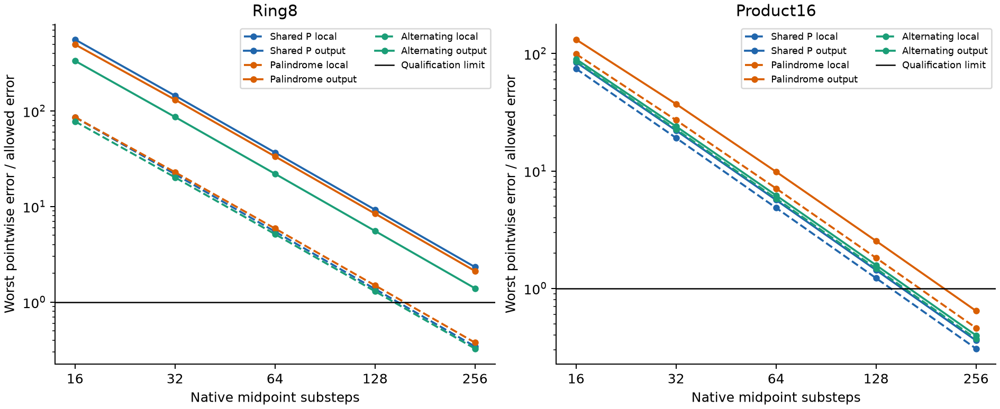
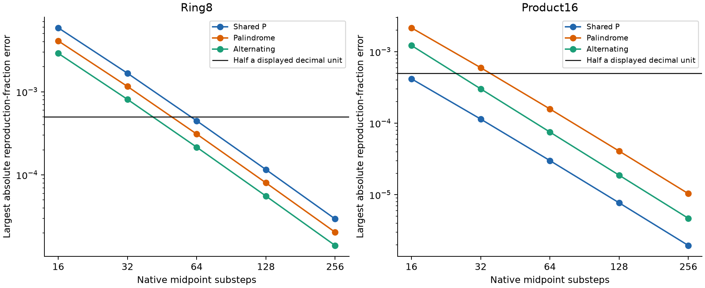

# Can native refinement replace the continuous reference?

**Common qualified levels: []. Selected resolution: None.** No common surrogate qualifies through256; do not launch sampling under this protocol.

The complete comparison retains six fixed20kseed0models,80registered inputs
per model and all six separate local-layer interventions. Each of five native
resolutions is compared with the already qualified DOP853local and full-output
reference/normal/tangential/exact-potential-ray interventions. There is no new
training or sampling-performance comparison.

## Pointwise approximation

Every curve reports the worst of all input points, modes and layers for its
model. A value below1passes the registered bound. Local and output errors are
scaled by the original intervention response, not by raw feature magnitude.
The curves determine whether numerical replacement is admissible on this cohort.

## Reproduction-fraction stability

The ordinate is the maximum absolute Fdifference over layer, input-bank and
whole-model aggregates. The fixed bound0.0005is half the three-decimal display
unit. Passing this aggregate check alone does not override pointwise failures.

| Task | Model | Steps | Local error / limit | Output error / limit | Largest F error | Qualified |
|---|---|---:|---:|---:|---:|---|
| Ring8 | Shared P | 16 | 86.344 | 560.722 | 5.873e-03 | no |
| Ring8 | Shared P | 32 | 21.801 | 144.798 | 1.669e-03 | no |
| Ring8 | Shared P | 64 | 5.476 | 36.790 | 4.472e-04 | no |
| Ring8 | Shared P | 128 | 1.372 | 9.272 | 1.159e-04 | no |
| Ring8 | Shared P | 256 | 0.343 | 2.327 | 2.953e-05 | no |
| Ring8 | Palindrome | 16 | 86.353 | 497.345 | 4.088e-03 | no |
| Ring8 | Palindrome | 32 | 22.892 | 131.486 | 1.158e-03 | no |
| Ring8 | Palindrome | 64 | 5.894 | 33.504 | 3.100e-04 | no |
| Ring8 | Palindrome | 128 | 1.495 | 8.439 | 8.030e-05 | no |
| Ring8 | Palindrome | 256 | 0.377 | 2.117 | 2.044e-05 | no |
| Ring8 | Alternating | 16 | 77.936 | 335.202 | 2.895e-03 | no |
| Ring8 | Alternating | 32 | 20.210 | 86.652 | 8.098e-04 | no |
| Ring8 | Alternating | 64 | 5.145 | 22.030 | 2.155e-04 | no |
| Ring8 | Alternating | 128 | 1.298 | 5.554 | 5.568e-05 | no |
| Ring8 | Alternating | 256 | 0.326 | 1.394 | 1.416e-05 | no |
| Product16 | Shared P | 16 | 74.285 | 84.454 | 4.177e-04 | no |
| Product16 | Shared P | 32 | 19.128 | 22.126 | 1.143e-04 | no |
| Product16 | Shared P | 64 | 4.853 | 5.661 | 3.005e-05 | no |
| Product16 | Shared P | 128 | 1.222 | 1.431 | 7.714e-06 | no |
| Product16 | Shared P | 256 | 0.307 | 0.360 | 1.955e-06 | yes |
| Product16 | Palindrome | 16 | 99.097 | 131.812 | 2.157e-03 | no |
| Product16 | Palindrome | 32 | 27.104 | 37.189 | 5.977e-04 | no |
| Product16 | Palindrome | 64 | 7.103 | 9.856 | 1.583e-04 | no |
| Product16 | Palindrome | 128 | 1.818 | 2.536 | 4.081e-05 | no |
| Product16 | Palindrome | 256 | 0.460 | 0.643 | 1.037e-05 | yes |
| Product16 | Alternating | 16 | 85.799 | 89.810 | 1.222e-03 | no |
| Product16 | Alternating | 32 | 22.684 | 24.003 | 3.025e-04 | no |
| Product16 | Alternating | 64 | 5.833 | 6.205 | 7.526e-05 | no |
| Product16 | Alternating | 128 | 1.479 | 1.578 | 1.877e-05 | no |
| Product16 | Alternating | 256 | 0.372 | 0.398 | 4.686e-06 | yes |

Both native datasets and both independent verifiers exit0. Independent endpoint
and candidate reconstruction agrees within5.329e-15. Source arrays,
checkpoint identities, native roundtrips and unchanged parameters/buffers are
retained. Exact one-layer matrix work is(2L+40)/48relative to the original
six-layer network for direct replacement by a refined endpoint; runtime and
every failed level remain in summary.json. Component corrections additionally
need the coarse endpoint, so their matrix work is(48+2L)/48before hook and
projection overhead. The producer's one_layer_matrix_work_multiplier records
only the ideal direct-endpoint replacement, not measured intervention speed.

## Decision

No common surrogate qualifies through256; do not launch sampling under this protocol. This finite interpolation-state qualification does not establish
accuracy on generated trajectories. That requires a separate fixed-layer
resolution check before full-bank sampling. No final-distribution improvement,
ODE-specific advantage or new image architecture is inferred here.

## Claim candidates

- Claim: the listed native resolutions meet or fail the fixed reference limits.
  - Source evidence: all2880states, five resolutions, four intervention modes;
    independent NumPy reconstruction and complete layer/bank/model aggregates.
  - Allowed wording: numerical qualification on this complete registered cohort.
  - Forbidden stronger wording: generated trajectories are qualified or improve.
  - Uncertainty: new trajectory states can have different stiffness and response.
  - Next check: fixed-layer on-trajectory resolution and original-bank sampling.
  - Decision: retain the numerical outcome without changing thresholds.
