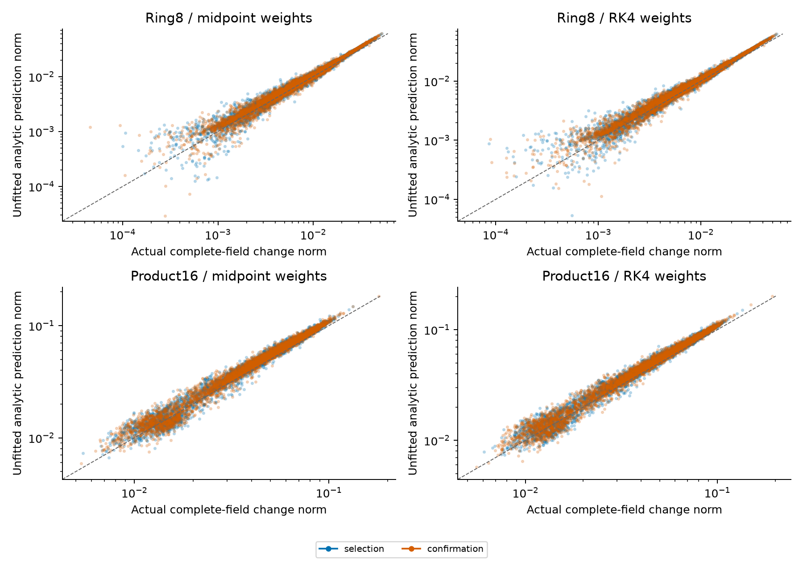
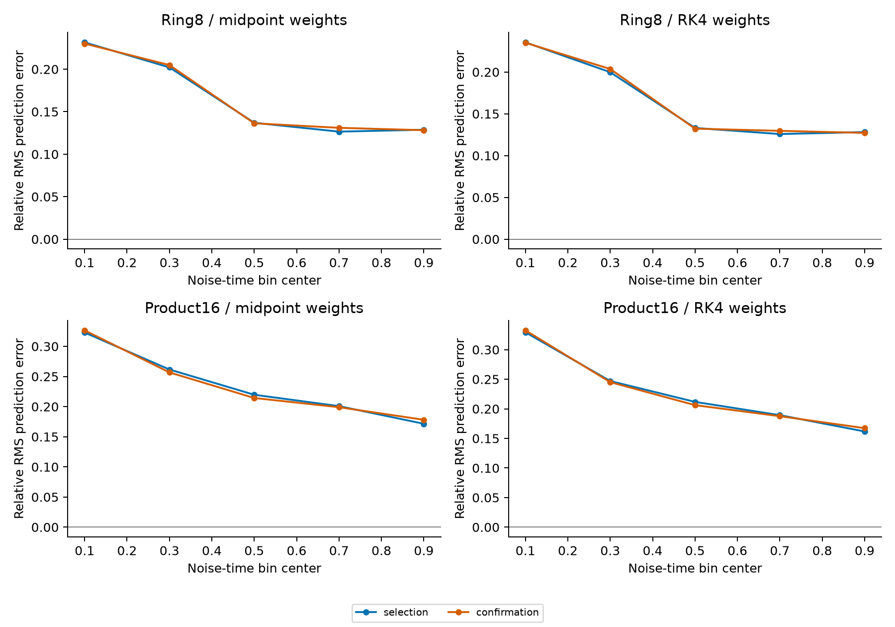

# The ODE-derived correction predicts the learned field change

The unfitted analytic correction predicts the actual solver-induced change in
the complete learned velocity field. The registered Product16 RK4 criterion
passes on both field streams. Its score is 0.962 on each, with relative RMS
error 0.196 and vector alignment 0.987. The same calculation also predicts the
sign of the oracle-risk change in all eight cases.

## Question and intervention

The earlier sampler study established a persistent same-weight midpoint benefit.
Here the prediction is computed from the ODE equations, without using the measured
field difference as an input or fitting its amplitude. For each internal flow
f(y)=P ISRU(y), both solver defects enter the prescribed correction G. The
coupled equations y'=f(y), z'=Df(y)z+G(y) pass the response through all six local
flows and the original normalization, time conditioning, SiLU and readout.

Four frozen models and their two existing field streams are retained. Each
field set has 4,096 inputs; both trained solvers use the same sets within a task.
The reference uses 256 RK4 steps. Every original and refined numerical flag,
input and output remains available.

| Weights | Stream | Score vs zero change | Relative RMS error | Alignment |
|---|---|---:|---:|---:|
| Ring8 midpoint | Selection |0.982|0.134|0.996|
| Ring8 midpoint | Confirmation |0.982|0.136|0.997|
| Ring8 RK4 | Selection |0.983|0.132|0.997|
| Ring8 RK4 | Confirmation |0.982|0.134|0.997|
| Product16 midpoint | Selection |0.957|0.207|0.985|
| Product16 midpoint | Confirmation |0.957|0.207|0.985|
| Product16 RK4 | Selection |0.962|0.196|0.987|
| Product16 RK4 | Confirmation |0.962|0.196|0.987|

Score equals one minus squared prediction error divided by the squared error
of predicting zero change. It is not fitted explained variance. Thus the
Product16 RK4 prediction leaves about 3.8% of the zero predictor's squared error.

Every input is shown. Norms track the identity line, while the table's alignment
and relative error check vector direction as well. The smaller Ring8 responses
have greater relative scatter. All observed responses are positive-norm here;
log axes cover their actual range without dropping points.

The five fixed time bins retain every input. Prediction is less accurate near
the noisy end: Product16 RK4 has relative RMS error about 0.33 in the first bin
and 0.16-0.17 in the final bin. Its score remains positive in every bin on both
streams. Zero relative error is perfect; one corresponds to predicting no change.

## The field-risk and generation rankings still differ

For Product16 RK4 weights, midpoint inference increases mean oracle field MSE.
The analytic correction predicts that increase, even though the previous
full-bank study showed improved generation at every prescribed outer mesh.

| Product16 RK4 stream | Actual field-risk change | Analytic prediction |
|---|---:|---:|
| Selection |+2.335e-5|+2.418e-5|
| Confirmation |+2.601e-5|+2.356e-5|

This separates two causal links. The analytic ODE correction predicts the
complete-field intervention. Its effect on the generated distribution must
still be calculated through the learned sampler and target functional. Average
field fitting cannot supply that last step.

## Numerical and source checks

The full producer and independent NumPy reconstruction both exit 0. All eight
refined numerical cells qualify; saved-array/risk arithmetic agrees within
2.17e-18. Full256-step outputs are checked against128-step refinements, with
independent DOP853 and whole-network derivative controls on the fixed prefixes.
The original32->64failures remain in the record. All5,175frozen source files
remain unchanged; parameters, buffers, methods and RNG are preserved. GPU4 was
released after186.177 seconds. Both figures have been visually reviewed.

## Next computation

Propagate this analytic correction through the actual sampler and target loss.
The measured256-step observer stage takes a median7.232 seconds per4,096 inputs.
At that rate the primary two-stream Heun2048 test projects to about132 GPUhours.
The next registered task compiles the same coupled RK4step and validates it
against every saved eager output before selecting a faster execution. FP64,
256steps, both defects and the original banks remain fixed.

## Claim candidates

- Claim: the analytic correction quantitatively predicts complete-field solver changes.
  - Evidence: all four frozen models, both complete field sets and the unfitted table above.
  - Allowed wording: the recorded ODE-derived approximation to this field intervention.
  - Uncertainty: fixed learned weights and finite solver budgets; target transport remains untested.
  - Next check: analytic response of the actual learned sampler and target functional.
  - Decision: keep.
- Claim: the oracle-risk increase for Product16 RK4 is predicted analytically.
  - Evidence: signed risk identity and both field streams, independently reconstructed.
  - Allowed wording: a predicted field-risk increase alongside a measured sampling improvement.
  - Uncertainty: field-risk agreement does not determine distributional response.
  - Next check: calculate that response rather than substituting field MSE.
  - Decision: keep.
