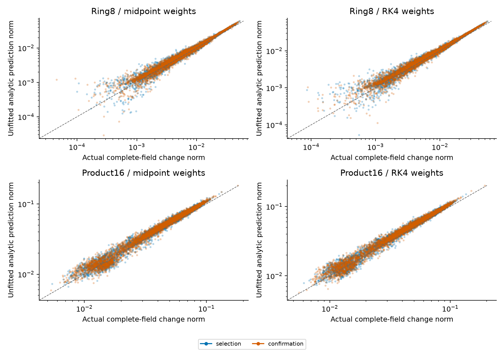
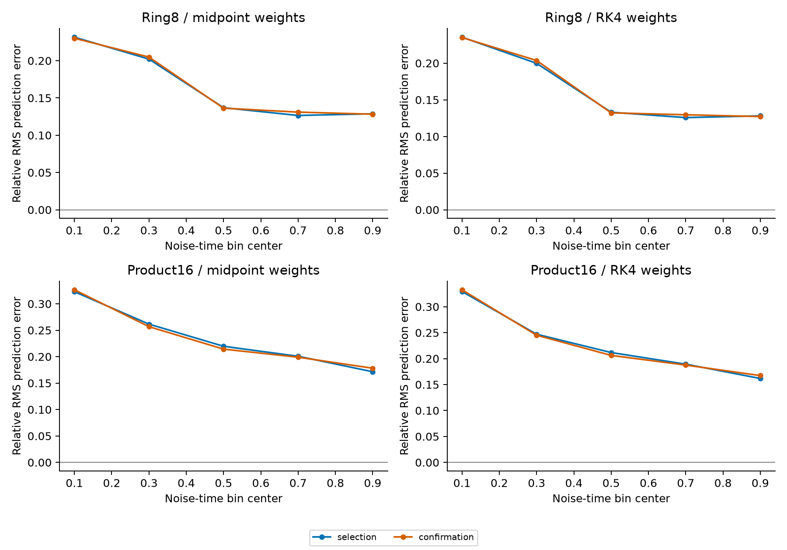

# ODE-derived prediction of the complete learned field

The registered refined field-prediction criterion passes on the two ProductRK4 streams. All four frozen models, both original streams and every4096-input field set are retained. The correction is derived from BOTH solvers and passed through all six local flows and the original network, without fitting its amplitude.

| Weights | Stream | Score vs zero | Relative RMS error | Alignment | Numerical |
|---|---|---:|---:|---:|---|
| ring_midpoint_trained | selection | 0.982 | 0.134 | 0.996 | qualified |
| ring_midpoint_trained | confirmation | 0.982 | 0.136 | 0.997 | qualified |
| ring_rk4_trained | selection | 0.983 | 0.132 | 0.997 | qualified |
| ring_rk4_trained | confirmation | 0.982 | 0.134 | 0.997 | qualified |
| product_midpoint_trained | selection | 0.957 | 0.207 | 0.985 | qualified |
| product_midpoint_trained | confirmation | 0.957 | 0.207 | 0.985 | qualified |
| product_rk4_trained | selection | 0.962 | 0.196 | 0.987 | qualified |
| product_rk4_trained | confirmation | 0.962 | 0.196 | 0.987 | qualified |

Every input is shown. The diagonal compares vector norms; alignment and relative error in the table assess direction as well. Axes use log scales over the observed positive range, with a symmetric-log fallback if a zero occurs. No source is omitted. Norm agreement alone is insufficient.

The five prespecified equal time bins reveal whether aggregate prediction conceals a weak time range. Relative RMS error is zero for a perfect prediction and one for predicting zero change. The table score is one minus its square. No time bin or source is selected after evaluation.

## Next causal link

The earlier full-bank study establishes a same-weight sampling benefit across the prescribed outer meshes. This field experiment tests its analytic precursor. Next propagate the analytic correction through the actual learned sampler and target functional; a field prediction alone does not quantify final distribution quality.

## Claim candidates

- Claim: the unfitted analytic field account passes.
  - Evidence: all4096inputs per case, independent saved-array arithmetic and original/refined numerical flags.
  - Allowed wording: the recorded ODE-derived approximation to complete-field solver differences.
  - Uncertainty: fixed learned weights, finite solver budget and reference resolution.
  - Next check: analytic forcing through the actual sampler and target metric.
  - Decision: keep for target-response testing.
