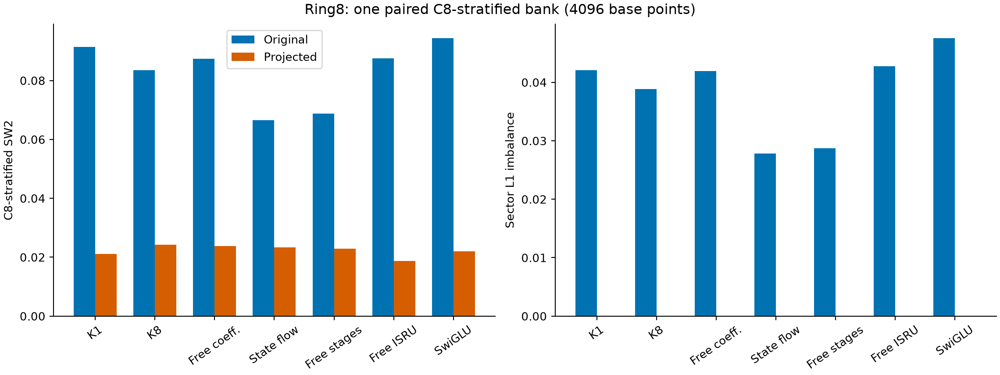
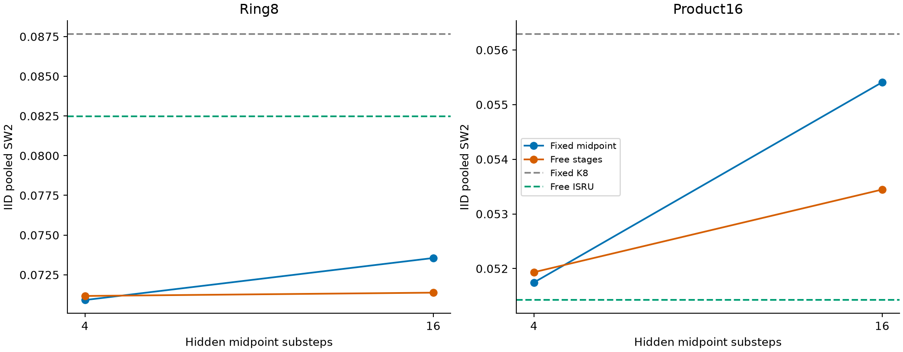

# Completed numerical and symmetry controls

All25cases and78scores independently recompute within2.78e-17. The failed
float32 C8bundle is preserved; this completed C8cohort uses float64 uniformly.

## Ring8 symmetry intervention

| Model | Original SW2 | Projected SW2 | Original sector L1 |
|---|---:|---:|---:|
| K1 | 0.091 | 0.021 | 0.042 |
| K8 | 0.083 | 0.024 | 0.039 |
| Free coeff. | 0.087 | 0.024 | 0.042 |
| State flow | 0.067 | 0.023 | 0.028 |
| Free stages | 0.069 | 0.023 | 0.029 |
| Free ISRU | 0.088 | 0.019 | 0.043 |
| SwiGLU | 0.094 | 0.022 | 0.048 |

State flow leads ordinary controls before projection; its lead disappears or
reverses afterwards on this paired bank. Free ISRU has the lowest projected
score. Projected sector counts are equal by construction. These observations
support an asymmetry/mode-allocation explanation of this particular Ring8 gap,
not an intrinsic equivariance guarantee of the hidden ODE.

The8rotations of each point are correlated. There are4096independent base
points, not32768independent observations. No bank-level confidence interval
is estimated from the rotations, and these absolute scores are not mixed with
the iid pooled-bank scores. The released stage-operator model is not included.

## Internal refinement

Fixed midpoint changes Ring8 0.071->0.074 and Product16 0.052->0.055 when
refined4->16. Free stages change0.071->0.071 and0.052->0.053. This keeps the
Ring8 within-family signal while shrinking Product16's fixed-midpoint gain.

The14outer-resolution cases use512common points each. Their largest absolute
SW2 change at Heun128->512 is7.065e-4. This is a bounded numerical observation,
not a full-bank error bound. The new released-stage models were not part of
those14cases and require their own outer-refinement check.
