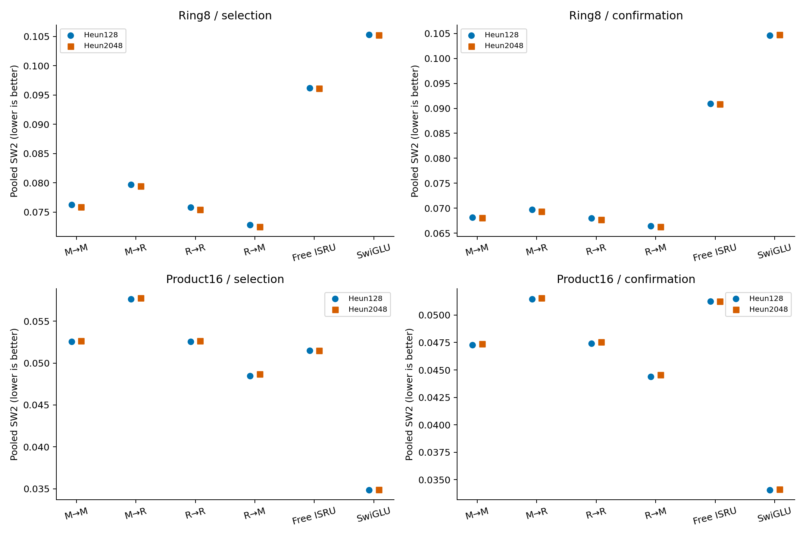
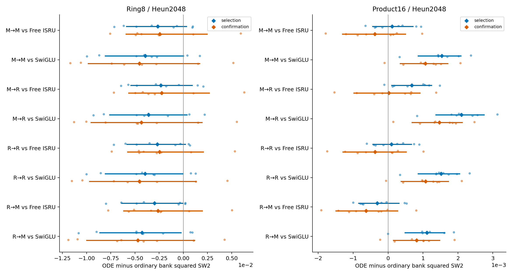

# Same-bank ordinary controls

Ring8: ODE has lower pooled SW2 in 16/16 comparisons; 3/16 have a negative adjusted upper bootstrap bound.

Product16: ODE has lower pooled SW2 in 4/16 comparisons; 0/16 have a negative adjusted upper bootstrap bound.

All original models use the same banks, targets, directions and native sampler. M/R denote midpoint/RK4 training and inference. Ordinary optimizer and capacity labels remain fixed. Every producer and independent metric check completed before this report.

The two meshes are prescribed observations. Points are complete pooled scores, without error bars. The comparison determines whether the useful internal-solver effect reaches ordinary-model quality.

| Task | Stream | Model | SW2 128 | SW2 2048 | Parameters | Dense MACs |
|---|---|---|---:|---:|---:|---:|
| Ring8 | confirmation | M→M | 0.068 | 0.068 | 56,706 | 227,648 |
| Ring8 | confirmation | M→R | 0.070 | 0.069 | 56,706 | 227,648 |
| Ring8 | confirmation | R→M | 0.066 | 0.066 | 56,706 | 227,648 |
| Ring8 | confirmation | R→R | 0.068 | 0.068 | 56,706 | 227,648 |
| Ring8 | confirmation | Free ISRU | 0.091 | 0.091 | 56,706 | 55,616 |
| Ring8 | confirmation | SwiGLU64 / Muon | 0.105 | 0.105 | 56,766 | 55,232 |
| Ring8 | selection | M→M | 0.076 | 0.076 | 56,706 | 227,648 |
| Ring8 | selection | M→R | 0.080 | 0.079 | 56,706 | 227,648 |
| Ring8 | selection | R→M | 0.073 | 0.073 | 56,706 | 227,648 |
| Ring8 | selection | R→R | 0.076 | 0.075 | 56,706 | 227,648 |
| Ring8 | selection | Free ISRU | 0.096 | 0.096 | 56,706 | 55,616 |
| Ring8 | selection | SwiGLU64 / Muon | 0.105 | 0.105 | 56,766 | 55,232 |
| Product16 | confirmation | M→M | 0.047 | 0.047 | 58,512 | 229,440 |
| Product16 | confirmation | M→R | 0.051 | 0.052 | 58,512 | 229,440 |
| Product16 | confirmation | R→M | 0.044 | 0.045 | 58,512 | 229,440 |
| Product16 | confirmation | R→R | 0.047 | 0.048 | 58,512 | 229,440 |
| Product16 | confirmation | Free ISRU | 0.051 | 0.051 | 58,512 | 57,408 |
| Product16 | confirmation | SwiGLU192 / AdamW | 0.034 | 0.034 | 108,624 | 106,560 |
| Product16 | selection | M→M | 0.053 | 0.053 | 58,512 | 229,440 |
| Product16 | selection | M→R | 0.058 | 0.058 | 58,512 | 229,440 |
| Product16 | selection | R→M | 0.048 | 0.049 | 58,512 | 229,440 |
| Product16 | selection | R→R | 0.053 | 0.053 | 58,512 | 229,440 |
| Product16 | selection | Free ISRU | 0.051 | 0.051 | 58,512 | 57,408 |
| Product16 | selection | SwiGLU192 / AdamW | 0.035 | 0.035 | 108,624 | 106,560 |

Each contrast retains eight paired banks; negative favors ODE. Diamonds show means, lines the registered adjusted bootstrap intervals. These conditional intervals and the separate exact sign tests measure different summaries. Full values are in summary.json.

## Claim candidates

- Claim: the listed same-bank quality and matrix-work comparisons.
  - Evidence: all 48 model/stream/mesh rows and 32 primary contrasts, bound to complete independent outputs.
  - Allowed wording: task- and configuration-specific comparison at the recorded budgets.
  - Uncertainty: fixed trained weights and finite evaluation banks; different ordinary configurations remain labeled.
  - Next check: review mode/gap effects and the independent comparison audit before any image decision.
  - Decision: retain the complete comparison; no automatic image promotion.
