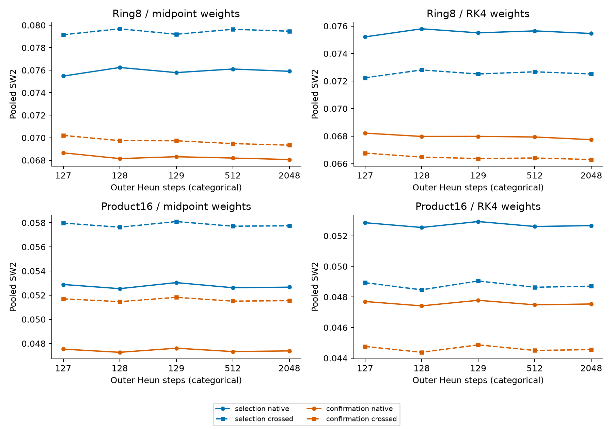
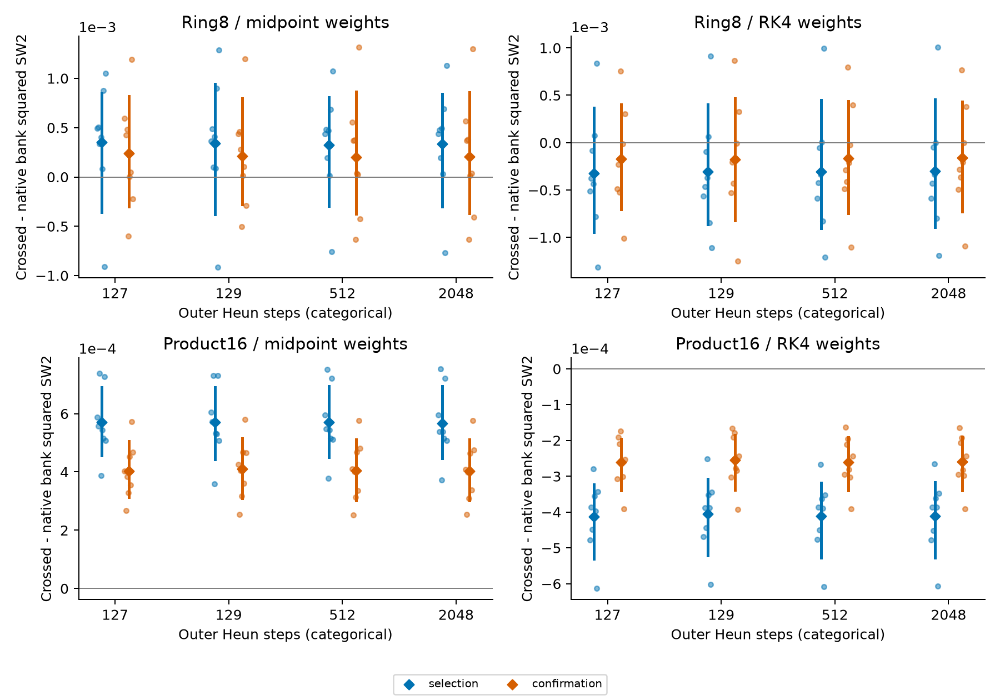

# The midpoint generation benefit survives the outer sampler check

For fixed Product16 RK4-trained weights, replacing two internal RK4 steps with
four midpoint steps improves pooled SW2at every prescribed outer resolution,
on both evaluation streams. At Heun2048all 16 paired banks improve and both
32-contrast-adjusted mean-change intervals lie below zero. The registered
finer-mesh criterion passes.

## Intervention and main result

All four original checkpoints trained for 20,000 updates, both existing streams, eight banks of 4,096 source/target samples and 256 projections are unchanged. Native and crossed hidden solves each
use eight applications of P per local flow. Only outer Heun resolution changes.128is
replayed against every original cached endpoint before new-count observations.

| Product16 RK4weights | Heun steps | Native SW2 | Midpoint SW2 | Banks improving |
|---|---:|---:|---:|---:|
| Selection |128|0.053|0.048|8/8|
| Selection |2048|0.053|0.049|8/8|
| Confirmation |128|0.047|0.044|8/8|
| Confirmation |2048|0.048|0.045|8/8|

At2048the pooled squared-loss changes are-4.015e-4and-2.749e-4.
The adjusted paired-bank intervals are[-5.279e-4,-3.162e-4]and
[-3.396e-4,-1.915e-4], respectively. Pooled and bank-mean changes are different
quantities; their complete values remain in summary.json.

The five prescribed meshes preserve the gap. Across all 40 within-weight pooled
comparisons (four weights, two streams, five counts), midpoint has lowerSW2than
RK4. This direction also holds for weights trained with RK4, which argues against
an explanation based only on retaining a model's training solver. Ring8 paired
bank effects are less decisive, as shown below.

Product16 RK4weights favor midpoint in every bank at every count. Midpoint-trained
Product16 weights worsen in every bank when switched to RK4. Ring8 retains its
pooled direction, while adjusted bank intervals cross zero. Every bank remains
visible; no favorable mesh is selected.

## What this changes

The earlier source-local probe found extreme128-step derivatives that changed
sharply on nearby meshes. The population benefit survives those same neighboring
counts and finer512/2048sampling. The selected extreme responses therefore do
not explain the useful gap as a128-only effect in this cohort.2048is the finest
prescribed observation, not a certified continuous reference.

These scores quantify a within-weight solver intervention. Comparing FFN
architectures requires ordinary models on these same banks. The next mechanism
test asks whether the analytically derived BOTH-solver correction predicts the
complete-field change without using the measured change as an input. The
learned-defect-field protocol fixes that test before full-field observations.

## Verification and execution

All four producers and four independent NumPy verifiers exit0. All720metrics
reconstruct within1.12e-16. A separate recursive enumeration checks all 32
adjusted contrasts exactly. All 5,127 frozen producer files remain unchanged.
Only physical GPUs 4-7 on 145were used; all four contexts were released. Resource
summaries retain every monitor poll with an active evaluation worker.

The first analysis attempt exited1when its source-hash helper received a
string instead of Path. Correcting that type and moving legends outside the
plots leaves every numeric result unchanged. The failed log/receipt, original
frozen source and corrected actual exits are retained; no generation reran.

## Claim candidates

- Claim: the ProductRK4same-weight midpoint benefit survives the prescribed meshes.
  - Evidence: both streams, all40pooled comparisons, all banks and adjusted intervals.
  - Allowed wording: a measured within-model generation benefit at the fixed meshes.
  - Uncertainty: fixed weights and empirical evaluation distributions; no continuous-limit claim.
  - Next check: unfitted analytic hidden-defect prediction of complete-field change.
  - Decision: keep.
- Claim: coarse hidden solver bias can have useful generative effects here.
  - Evidence: matched internal work, crossed frozen weights, stable outer-resolution gap.
  - Allowed wording: useful direction of the recorded solver intervention.
  - Uncertainty: its analytic quantitative account still needs a learned test.
  - Next check: propagate both derived defects through the complete existing network.
  - Decision: keep for mechanism testing.
