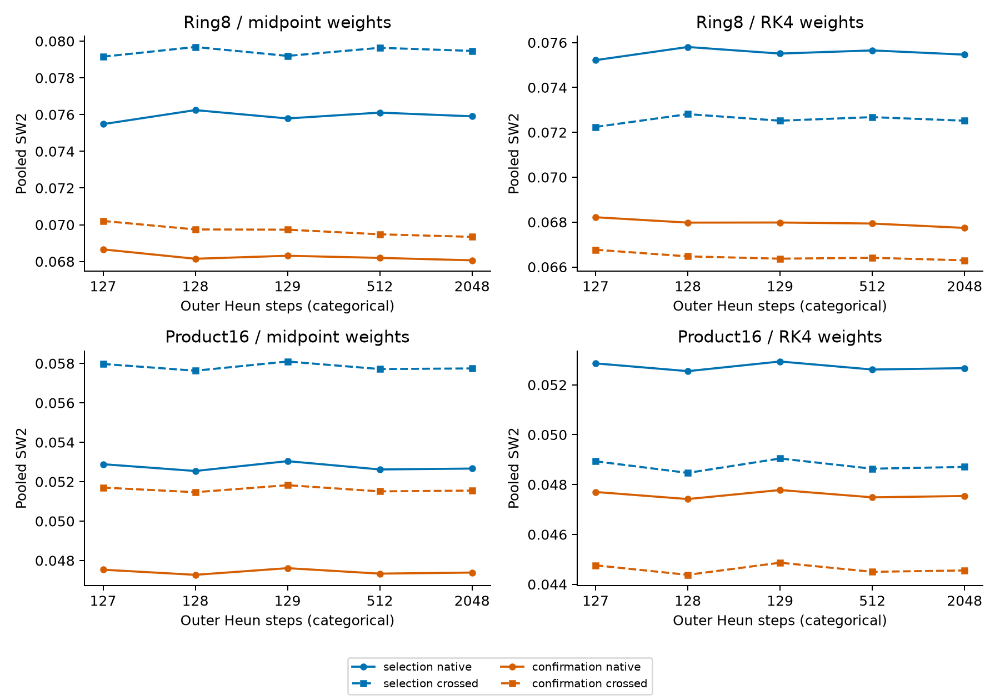
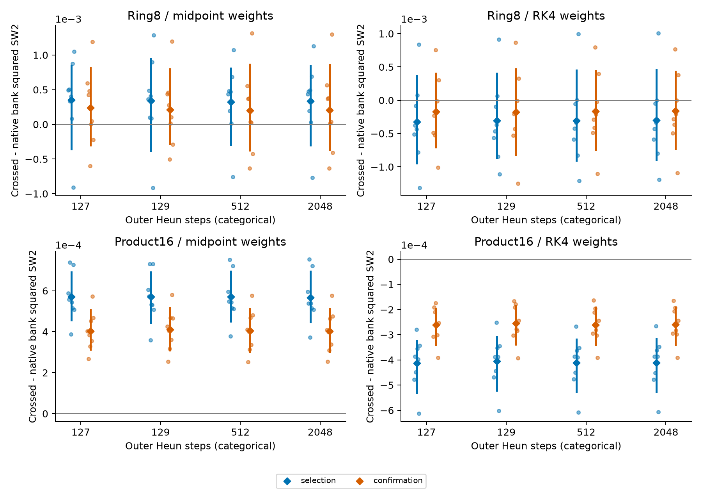

# Full-bank outer-resolution intervention

The registered ProductRK4benefit survives the2048-step test on both streams.

All four frozen20kweights, both original streams, eight4096-source banks and five prescribed meshes are retained. All formal producers/independent verifiers terminate0. Full-bank128endpoint/metric replay gates pass before new meshes. No model is retrained or best mesh selected.

Compare the same-weight native/crossed gap across neighboring and finer time meshes.2048is a finer observation, not a continuous reference.

| Weights | Split | Heun steps | Native SW2 | Crossed SW2 | Banks improving |
|---|---|---:|---:|---:|---:|
| product_midpoint_trained | confirmation | 127 | 0.048 | 0.052 | 0/8 |
| product_midpoint_trained | confirmation | 128 | 0.047 | 0.051 | 0/8 |
| product_midpoint_trained | confirmation | 129 | 0.048 | 0.052 | 0/8 |
| product_midpoint_trained | confirmation | 512 | 0.047 | 0.052 | 0/8 |
| product_midpoint_trained | confirmation | 2048 | 0.047 | 0.052 | 0/8 |
| product_midpoint_trained | selection | 127 | 0.053 | 0.058 | 0/8 |
| product_midpoint_trained | selection | 128 | 0.053 | 0.058 | 0/8 |
| product_midpoint_trained | selection | 129 | 0.053 | 0.058 | 0/8 |
| product_midpoint_trained | selection | 512 | 0.053 | 0.058 | 0/8 |
| product_midpoint_trained | selection | 2048 | 0.053 | 0.058 | 0/8 |
| product_rk4_trained | confirmation | 127 | 0.048 | 0.045 | 8/8 |
| product_rk4_trained | confirmation | 128 | 0.047 | 0.044 | 8/8 |
| product_rk4_trained | confirmation | 129 | 0.048 | 0.045 | 8/8 |
| product_rk4_trained | confirmation | 512 | 0.047 | 0.045 | 8/8 |
| product_rk4_trained | confirmation | 2048 | 0.048 | 0.045 | 8/8 |
| product_rk4_trained | selection | 127 | 0.053 | 0.049 | 8/8 |
| product_rk4_trained | selection | 128 | 0.053 | 0.048 | 8/8 |
| product_rk4_trained | selection | 129 | 0.053 | 0.049 | 8/8 |
| product_rk4_trained | selection | 512 | 0.053 | 0.049 | 8/8 |
| product_rk4_trained | selection | 2048 | 0.053 | 0.049 | 8/8 |
| ring_midpoint_trained | confirmation | 127 | 0.069 | 0.070 | 2/8 |
| ring_midpoint_trained | confirmation | 128 | 0.068 | 0.070 | 2/8 |
| ring_midpoint_trained | confirmation | 129 | 0.068 | 0.070 | 2/8 |
| ring_midpoint_trained | confirmation | 512 | 0.068 | 0.069 | 2/8 |
| ring_midpoint_trained | confirmation | 2048 | 0.068 | 0.069 | 2/8 |
| ring_midpoint_trained | selection | 127 | 0.075 | 0.079 | 1/8 |
| ring_midpoint_trained | selection | 128 | 0.076 | 0.080 | 1/8 |
| ring_midpoint_trained | selection | 129 | 0.076 | 0.079 | 1/8 |
| ring_midpoint_trained | selection | 512 | 0.076 | 0.080 | 1/8 |
| ring_midpoint_trained | selection | 2048 | 0.076 | 0.079 | 1/8 |
| ring_rk4_trained | confirmation | 127 | 0.068 | 0.067 | 6/8 |
| ring_rk4_trained | confirmation | 128 | 0.068 | 0.066 | 5/8 |
| ring_rk4_trained | confirmation | 129 | 0.068 | 0.066 | 6/8 |
| ring_rk4_trained | confirmation | 512 | 0.068 | 0.066 | 6/8 |
| ring_rk4_trained | confirmation | 2048 | 0.068 | 0.066 | 6/8 |
| ring_rk4_trained | selection | 127 | 0.075 | 0.072 | 6/8 |
| ring_rk4_trained | selection | 128 | 0.076 | 0.073 | 6/8 |
| ring_rk4_trained | selection | 129 | 0.076 | 0.073 | 6/8 |
| ring_rk4_trained | selection | 512 | 0.076 | 0.073 | 6/8 |
| ring_rk4_trained | selection | 2048 | 0.075 | 0.073 | 6/8 |

Points retain every paired bank; diamonds show means and lines the32-contrast-adjusted conditional bootstrap intervals. A negative value favors the crossed hidden solver. These are fixed-weight evaluation draws.

## Claim candidates

- Claim: The registered ProductRK4benefit survives the2048-step test on both streams.
  - Evidence: complete same-source sampling, full128identity gates, independently reconstructed metrics and exact bootstrap enumeration.
  - Allowed wording: the observed same-weight solver substitution has the recorded outer-mesh dependence.
  - Uncertainty: finite meshes, fixed learned models, empirical target banks.
  - Next check: apply the analytic two-solver defect to the complete field and target functional.
  - Decision: keep for the analytic mechanism test.
