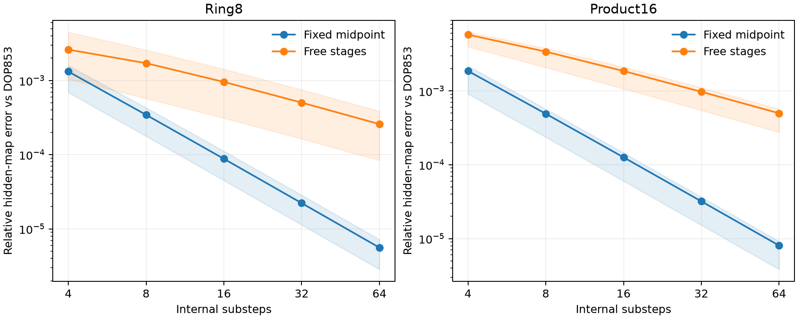

# What the completed controls establish

**State feedback and sharing a single generator are the positive within-family
interventions. Prescribing exponential or midpoint coefficients has not improved
fixed-budget sampling consistently. Fixed midpoint retains its expected numerical
order. Ordinary controls remain stronger on Product16.**

The six new 20k trajectories and all28selection/14confirmation metric rows
are complete and independently recomputed. Training remains seed0. All18
resolution cases and seven float64 symmetry cases are complete and independently
recomputed. Two additional stage-operator trajectories and their fresh common-bank
evaluations are also complete. Each cohort retains its own bound arrays.
These are width64/depth3 synthetic velocity MLPs with replaceable FFNs,
not JiT image-prediction models; no image-transfer improvement is claimed.

## Main comparison

Confirmation pooled SW2, lower is better:

| Model | Ring8 | Product16 |
|---|---:|---:|
| Fixed exponential K8 |0.088|0.056|
| Free Taylor coefficients |0.089|0.055|
| State flow / midpoint4 |0.071|0.052|
| Free midpoint stages |0.071|0.052|
| Free ISRU |0.082|0.051|
| SwiGLU |0.091|0.034|

The two coefficient-release controls match their reference initial
functions and common gradients. They retain the same P applications and
response function. Free Taylor coefficients add42scalars; free midpoint
stages add24. State feedback retains the fixed-K8 parameter count and eight
P applications per solve, but reevaluates the nonlinearity along the path.
It does not have the fixed-K8 initial hidden function.

State flow beats fixed K8 in all eight Ring8 banks and six of eight Product16
banks. On Product16, ordinary Free ISRU still wins at the same parameter
count, and the wider native SwiGLU remains clearly better. Ring8 SwiGLU64
uses Muon0.02; Product16 SwiGLU192 and all focal variants use AdamW0.0003.
The ordinary comparisons retain these configuration labels.

[Complete field/sampling tables and figure](completed-comparison.md),
[exact paired effects](results/paired-effects.json),
[bound metric artifacts](results-completion.json).

## The released parameters are active

Taylor coefficients depart from their exponential initialization and affect
features: resetting them to1 at frozen weights raises field MSE from0.011
to0.034 on Ring8 and from0.018 to0.195 on Product16. Yet the separately
trained fixed-coefficient reference has similar sampling quality. A model
using a supplied mechanism is not proof that the mechanism is essential.

Free midpoint gamma values reach1.520 on Ring8 and1.972 on Product16.
Resetting them at frozen weights shifts predicted velocities by0.059/0.064
RMS, respectively. Product16 field MSE rises from0.019 to0.024; Ring8 field
MSE is almost unchanged despite a nonzero vector-field change. Their similar
trained sampling scores are therefore not explained by coefficients simply
remaining inert at their initial values.

[Taylor reset diagnostic](coefficient-effects.json),
[midpoint reset diagnostic](stage-effects.json). These are fixed-weight
interventions, not substitute retraining comparisons.

## A concrete mathematical benefit of the solver constraint

At learned layer entrances, compare each local solve with an adaptive
DOP853 solution of the actual autonomous field `y'=P ISRU(y)` in float64.
The adaptive reference is checked again with tighter tolerances. Over six
layers and eight states per layer, median observed convergence rates at the
32->64 refinement are:

| Model | Ring8 rate | Product16 rate |
|---|---:|---:|
| Fixed midpoint |1.992|1.992|
| Learned midpoint stages |0.973|0.971|

Rate2 means halving the internal step reduces local-map error about fourfold;
rate1 means about twofold. The prescribed midpoint stages provide a real
second-order approximation to a well-defined continuous hidden field. Free
stages relinquish that property while attaining similar scores at their
trained four-step budget. Thus approximation order and generation quality
are distinct observations. Classical solver order is not itself a new result;
the full-sample effect of this distinction is being checked.

Lines show medians and shading the interquartile range over six learned
layers. The reference solves the same local field, not the physical data
velocity. [Exact layer results](trained-convergence.json).

## Does the signal survive finer internal integration?

Full32768-sample checks reuse the same checkpoint, source/target arrays and
Heun128 outer sampler. Only the hidden integration changes from4to16steps.

| Hidden model | Ring8,4steps | Ring8,16steps | Product16,4steps | Product16,16steps |
|---|---:|---:|---:|---:|
| Fixed midpoint |0.071|0.074|0.052|0.055|
| Free midpoint stages |0.071|0.071|0.052|0.053|

Ring8 retains its gain over fixed exponential K8(0.088). The fixed-midpoint
Product16 advantage shrinks from0.052versus0.056to0.055versus0.056. Thus the
Product16 result should not be described as a substantial continuous-flow
advantage. More accurate internal integration does not improve sampling at
these frozen weights. This is a resolution intervention, not retraining
at each resolution or a comparison at equal inference cost.

All14outer-resolution and four full internal-refinement cases independently
recompute within2.78e-17. [Bound verification](numerical-resolution/COMPLETE.json),
[all64scores](numerical-resolution/scores.csv). The failed float32 C8 shortcut
is preserved. All seven symmetry cases subsequently completed in float64,
with independent verification of all25cases and 78 scores. No mixed-precision
symmetry ranking is reported.

## What is unresolved

The completed sharing control now tests a single P against a larger stage-dependent
class at equal matrix work and identical initial function. On its separate fresh
confirmation cohort, shared/released pooled SW2 is0.091/0.111 on Ring8 and
0.064/0.073 on Product16, with shared better in all eight banks per task.
Released stages use their additional matrices, and Product16 field fitting improves
while generation worsens. Sharing therefore has measured value in this comparison.
[Full sharing analysis and figures](sharing-results/analysis-report.md).

Full-bank CUDA refinement then reproduces CPUwithin3.44e-8and independently
recomputes all16pooled/128bank rows within2.78e-17. Heun128->512preserves
the gap. Internal4->16retains the pooled sharing lead: Ring8 shared/released
0.091/0.103, Product16 0.069/0.082. Ring8bank support falls to5/8with an
approximate mean-gap interval crossing zero; Product16stays8/8. Thus the
fixed-budget architectural result is stronger than a two-task claim about
the continuous hidden-flow limit.
[Complete refinement](sharing-results/full-resolution/analysis.md).

This supports autonomy/parameter reuse at this budget, not a benefit unique to ODEs
or a coupling of hidden time with physical FM time. The P+Delta parameterization
changes optimization geometry, and Free ISRU/SwiGLU still beat the ODE family on
Product16. Their CPU cost is also much lower. No image promotion follows.

The completed Ring8 C8 intervention removes the state-flow lead over ordinary
controls on its paired stratified bank: state flow0.067->0.023, Free ISRU
0.088->0.019 and SwiGLU0.094->0.022. This points to symmetry/mode allocation
as an error component to test, not an equivariance guarantee of hidden ODEs.
Released stage operators were absent from that earlier cohort. The new complete
eight-case sharing intervention includes them: Ring8 shared/stage SW2 changes
from 0.072/0.096 to 0.024/0.021 under C8 projection; Product16 changes
from 0.059/0.068 to 0.055/0.063 under selected reflections. Ring8 reverses,
Product16 retains the gap. The selected-symmetry explanation is insufficient
across tasks. [New analysis and examples](sharing-symmetry/analysis-report.md).
[Completed numerical findings](numerical-findings.md),
[registered symmetry test](sharing-symmetry-followup.md),
[next exact density-error diagnostic](post-symmetry-decision.md).

[Numerical/symmetry protocol](numerical-followup.md),
[single-generator control](operator-sharing-control.md),
[mathematical derivation](mathematical-basis.md).

## Density-transport diagnostic is numerically qualified

The exact observer preserves native sampling and passes oracle derivatives,
complete-map determinant checks and all sixteen original/projected pilot cells.
Six qualify at512steps; ten require1024under unchanged tolerances. On the
new field banks, instantaneous density-source RMSdoes not reproduce the
known Product16sampling order. [Measured diagnostics and figures](density-transport/analysis-report.md).
The next object is signed along-path accumulation on four prebound256-source
banks at common1024/2048steps. That comparison is [prepared, not launched](density-formal-next.md).
