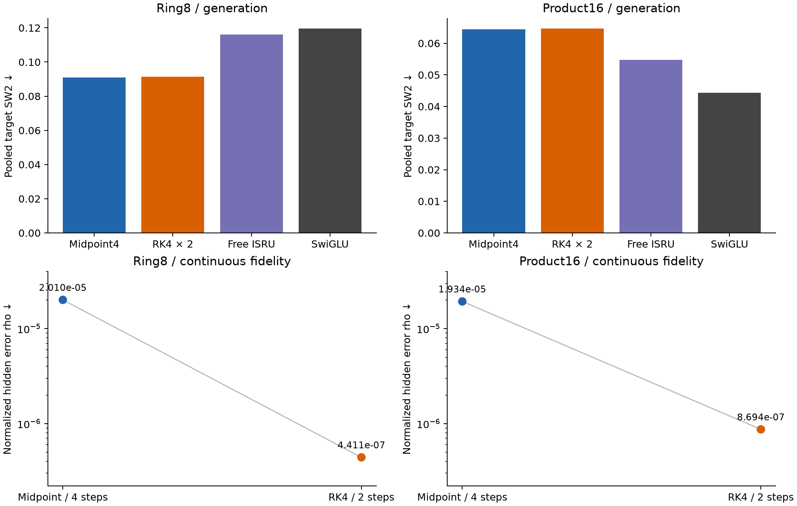
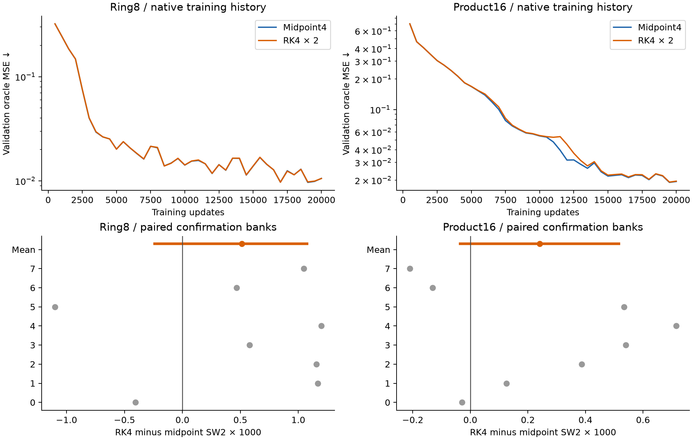

# More faithful hidden ODE solves do not improve this generator comparison

At the same parameter count and dense matrix work, RK4 reduces normalized hidden
solver error by about 46x on Ring8 and 22x on Product16. Target SW2 does not improve
on the confirmation split of either task. The registered two-task quality
prediction fails while the hidden-fidelity prediction succeeds.

## What changed

Both models solve y'=P ISRU(y), with the same trainable tensors, initialization,
training data stream, AdamW 3e-4 and 20k updates. Four explicit midpoint steps are
replaced by two classical RK4 steps. Both use eight P applications per local solve.
The numerical RK4 step is copied from the attributed torchdiffeq source. This is
state-updated synthetic feature evolution, not image-model frozen-D Taylor K8.

The lower row shows successful numerical intervention; the upper row shows its
absence of a generation gain. Ordinary controls stay in the comparison. On
Product16 the native SwiGLU configuration remains stronger than both ODE variants.

| Task | Model | Field MSE | Pooled SW2 | Bank SW2 mean ± SD | Hidden rho |
|---|---|---:|---:|---:|---:|
| Ring8 | Midpoint / 4 steps | 0.010 | 0.091 | 0.118 ± 0.040 | 2.010e-05 |
| Ring8 | Free ISRU | 0.011 | 0.116 | 0.132 ± 0.047 | — |
| Ring8 | SwiGLU64 / Muon | 0.011 | 0.120 | 0.133 ± 0.049 | — |
| Ring8 | RK4 / 2 steps | 0.010 | 0.091 | 0.118 ± 0.040 | 4.411e-07 |
| Product16 | Midpoint / 4 steps | 0.019 | 0.064 | 0.081 ± 0.006 | 1.934e-05 |
| Product16 | Free ISRU | 0.015 | 0.055 | 0.073 ± 0.006 | — |
| Product16 | SwiGLU192 / AdamW | 0.015 | 0.044 | 0.066 ± 0.006 | — |
| Product16 | RK4 / 2 steps | 0.019 | 0.065 | 0.081 ± 0.007 | 8.694e-07 |

Both selection/confirmation outcomes, every bank and all hidden layers remain
in summary.json. Ring8 selection pooled SW2 decreases slightly, but confirmation
increases; Product16 increases on both splits. These differences do not establish
a useful RK4 candidate. No checkpoint or sampling bank is chosen after evaluation.

Training histories use the unchanged native validation probe. Bottom panels
show all eight confirmation-bank differences and the registered adjusted interval;
negative favors RK4. The tiny quality shifts contrast with the large reduction
in hidden solver error. This rejects continuous-solve accuracy as a sufficient
explanation for this architecture's generation performance at this budget.

## Interpretation and next question

The earlier modified-equation calculation successfully predicted the midpoint
bias. Removing much of that bias during training is now shown not to buy better
samples here. Mathematical fidelity is measurable, but its usefulness depends
on how the complete network exposes those hidden changes to the predicted field.
The next bounded diagnostic should measure that exposure directly: compare
complete-field changes from faithful hidden solves with the actual field-error
scale, using frozen learned weights and all local solves. It should distinguish
weak output sensitivity from learned compensation before another architecture.

## Claim candidates

- Claim: equal-matrix-work RK4 improves hidden continuous fidelity on both tasks.
  - Evidence: all 1,920 states, both reference checks, eight actual observer exits 0.
  - Allowed wording: the recorded same-budget solver comparison is more faithful.
  - Forbidden stronger wording: ODE models generally outperform ordinary FFNs.
  - Uncertainty: learned endpoints and these task/operator configurations.
  - Next check: full-field exposure and learned compensation.
  - Decision: keep.
- Claim: better hidden accuracy is insufficient for improved target SW2 here.
  - Evidence: both complete training trajectories and common-bank comparisons;
    independent NumPy reconstruction includes both ordinary controls.
  - Allowed wording: the registered cross-task quality prediction fails.
  - Forbidden stronger wording: every possible continuous-depth design is useless.
  - Uncertainty: this isolates solver faithfulness within the fixed hidden field.
  - Next check: complete-field sensitivity at the retained learned weights.
  - Decision: keep.
