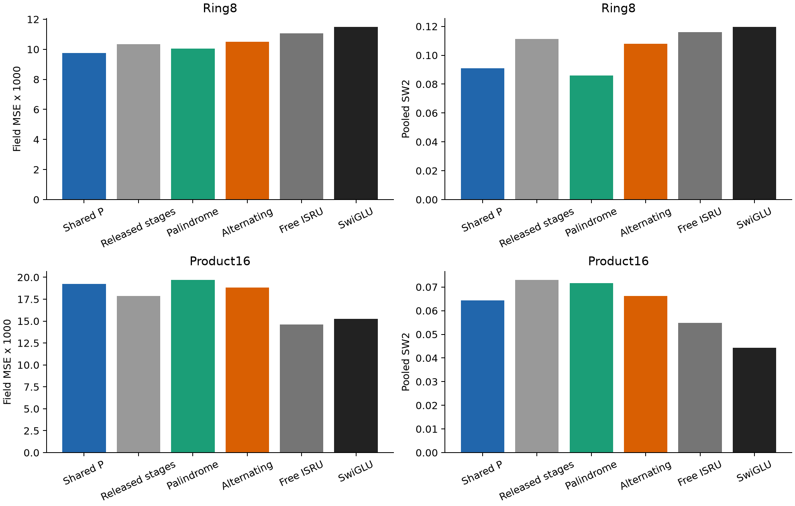
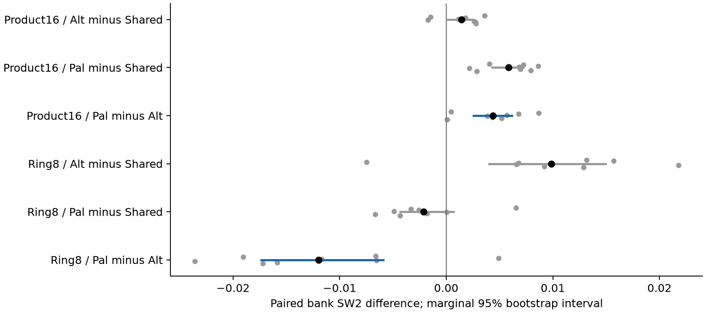

# Matched stage order: initial comparison

**The symmetric schedule improves sampling against alternating stages on
Ring8 and worsens it on Product16.** The predicted leading-term cancellation
is verified in trained features. It does not give a consistent generation
benefit across these two tasks at the trained resolution.

## Purpose and controlled change

Both models learn the same P/B tensors, start from the same zero-B function
and data stream, and use the native20k seed0AdamW recipe. Only the chronological
order changes: palindrome(+--+) versus alternating(+-+-). Both use four
midpoint stages and eight matrix applications. This removes the capacity and
coordinate differences present in the earlier shared-versus-released comparison.
Ring8SwiGLU64uses Muon0.02; Product16SwiGLU192and all focal variants use
AdamW0.0003.

## Common-bank results

Heun128, internal4steps, eight common4096-source banks, pooled32768samples:

| Model | Ring8 field MSE | Ring8 SW2 | Product16 field MSE | Product16 SW2 |
|---|---:|---:|---:|---:|
| Shared P | 0.010 | 0.091 | 0.019 | 0.064 |
| Released stages | 0.010 | 0.111 | 0.018 | 0.073 |
| Palindrome | 0.010 | 0.086 | 0.020 | 0.072 |
| Alternating | 0.010 | 0.108 | 0.019 | 0.066 |
| Free ISRU | 0.011 | 0.116 | 0.015 | 0.055 |
| SwiGLU64/192 | 0.011 | 0.120 | 0.015 | 0.044 |

Palindrome beats alternating in7/8Ring8banks, with mean paired SW2difference
-0.012 and marginal95%empirical-bootstrap interval[-0.017,-0.006]. On
Product16 it wins0/8banks: difference+0.004, interval[0.002,0.006]. These
intervals describe sampling-bank variation at fixed trained weights.
The pooled Ring8improvement over shared P is0.005; its paired-bank interval
includes zero. Product16ordinary Free ISRU and SwiGLU remain stronger.

## What the trained feature maps do

The palindrome's leading bracket coefficient is exactly zero at every
captured entrance, and reversing its schedule leaves predictions unchanged.
Its different stage directions remain active: replacing them by shared P at
frozen weights increases selection field MSE0.011->0.028on Ring8 and
0.020->0.179on Product16. Cancellation therefore does not collapse the learned
model to the autonomous shared-P map; higher-order stage action remains.

Alternating stages also remain active. Reversing them raises selection field
MSE0.011->0.227on Ring8 and0.019->0.818on Product16. Both schedules use their
extra directions, but the useful order differs by task. Frozen interventions
measure learned dependence; the separately trained matched pair measures the
benefit of imposing the schedule.

Native reconstruction covers six models,180layer/time records and five local
horizons. Independent NumPy vector error is7.11e-15. The complete field/bank
metrics are independently recomputed from retained arrays. Same-process cost
checks confirm equal dense MACs:227,648perRing8example and229,440perProduct16
example. The two schedules have81,282/83,088parameters respectively.

## Numerical follow-up complete

The complete sweeps preserve the opposite task effects. At internal16,
Ring8palindrome/alternating is0.084/0.107; Product16is0.087/0.075. External
Heun128->512keeps the ordering. Full source/array verification and the
research decision are in [the completed numerical analysis](numerical-results/analysis-report.md).
