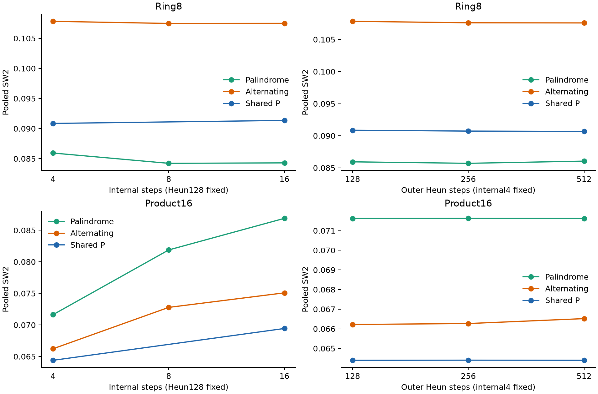
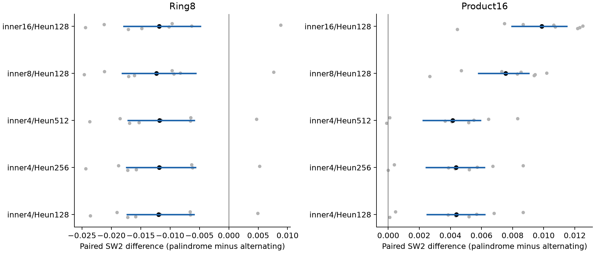

# Matched order control: complete numerical follow-up

**The opposite task effects survive every registered numerical setting.**
Palindrome remains lower than alternating on Ring8; alternating remains lower
on Product16. The task-general benefit of cancelling the leading stage-order
term is rejected in this comparison.

These are width 64/depth 3 synthetic velocity MLPs. Both schedules use the same
P/B coordinates, initial function and native 20k training recipe. Four internal
midpoint steps are the trained architecture; midpoint is order two. The step
counts below are not Taylor orders. All comparisons retain the same eight
4,096-source banks and frozen 20k checkpoints.

## Complete pooled SW2

| Task | Internal steps | Heun steps | Palindrome | Alternating | Shared P |
|---|---:|---:|---:|---:|---:|
| Ring8 | 4 | 128 | 0.086 | 0.108 | 0.091 |
| Ring8 | 4 | 256 | 0.086 | 0.108 | 0.091 |
| Ring8 | 4 | 512 | 0.086 | 0.108 | 0.091 |
| Ring8 | 8 | 128 | 0.084 | 0.107 | --- |
| Ring8 | 16 | 128 | 0.084 | 0.107 | 0.091 |
| Product16 | 4 | 128 | 0.072 | 0.066 | 0.064 |
| Product16 | 4 | 256 | 0.072 | 0.066 | 0.064 |
| Product16 | 4 | 512 | 0.072 | 0.067 | 0.064 |
| Product16 | 8 | 128 | 0.082 | 0.073 | --- |
| Product16 | 16 | 128 | 0.087 | 0.075 | 0.069 |

The shared-P internal-8 point was not measured. Shared-P refinements come from
the earlier verified CUDA study with the same checkpoints and array hashes;
its largest original CPU/CUDA pooled-score difference was 3.44e-8.

## What refinement changes

Ring8's within-pair result survives both sweeps: trained-resolution SW2 is
0.086/0.108 (palindrome/alternating), and 16 internal steps give 0.084/0.107. The
palindrome leads seven of eight paired banks at every setting. Its trained
resolution contrast with shared P remains smaller and has an unresolved
paired interval in the initial comparison.

Product16 keeps the opposite ordering: 0.072/0.066 at internal 4 and 0.087/0.075
at internal 16. More accurate hidden integration worsens sampling for both
trained models at these frozen weights. Outer 128->512 has a much smaller
effect. The trained finite-step map therefore contributes materially on this
task. Both schedules remain above the shared-P reference, and the original
Heun128 ordinary Free ISRU/SwiGLU references remain 0.055/0.044.

## Mechanism decision

The local composition does what its derivation predicts: palindrome cancels
the leading bracket, while learned higher-order stage action remains active.
Frozen mean-collapse and reversal tests establish that the extra directions
are used. The matched retraining comparison and full numerical sweeps show
that imposing this cancellation helps Ring8 relative to alternating stages
and hurts Product16. This gives a task-dependent composition bias.

Keep that within-pair finding. Reject a general sampling advantage from this
cancellation and deprioritize promoting this architecture to CelebA. The next
question is which constraint is actually implied by the FM target field or
image predictor, and whether a hidden P constraint controls that quantity.
Derive and verify that connection before registering another architecture.

## Verification

All eight native observation tasks exited 0. Independent NumPy reconstructs
all 24 rows (twenty unique cells plus four repeated anchors), retaining every
source, within 2.78e-17. The optional CPU bank batching preserves all endpoint
values. Ten completed old full-batch prefix rows were audited exactly before
retiring only our two duplicate workers; their actual -15 exits and unstarted
receipt are retained separately. Both published frozen trees and finalized
reports remain unchanged. Detailed statistics and figure meanings accompany
this analysis.
