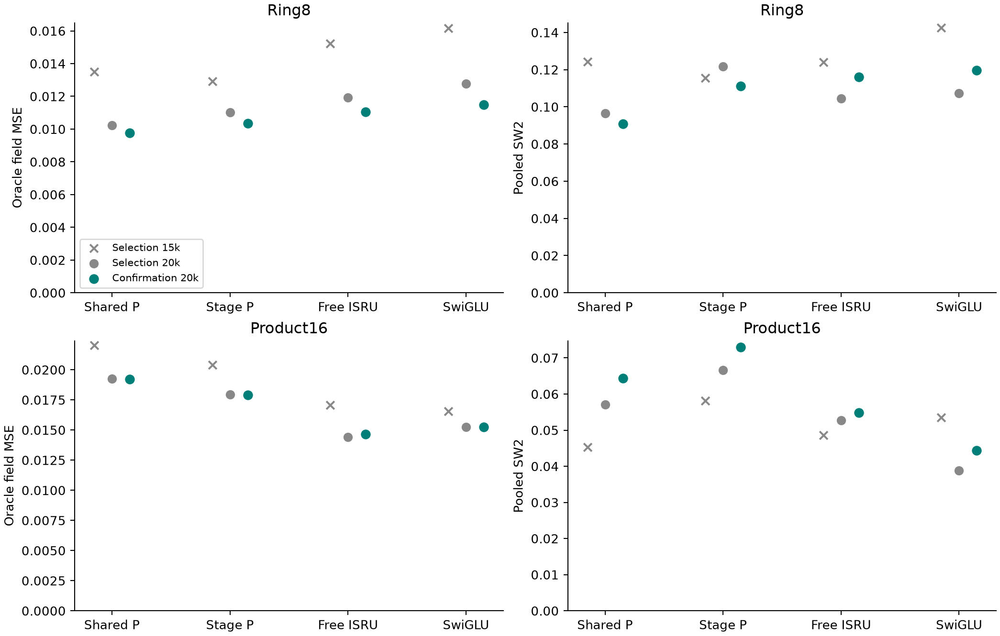
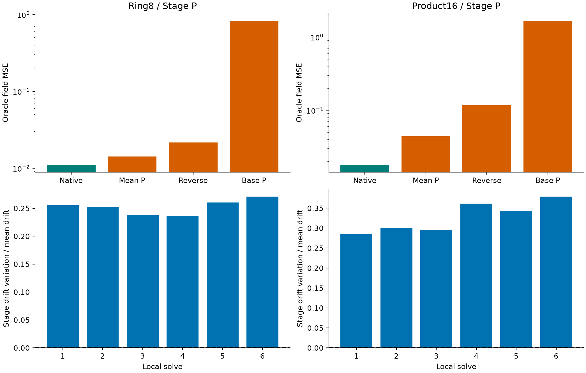
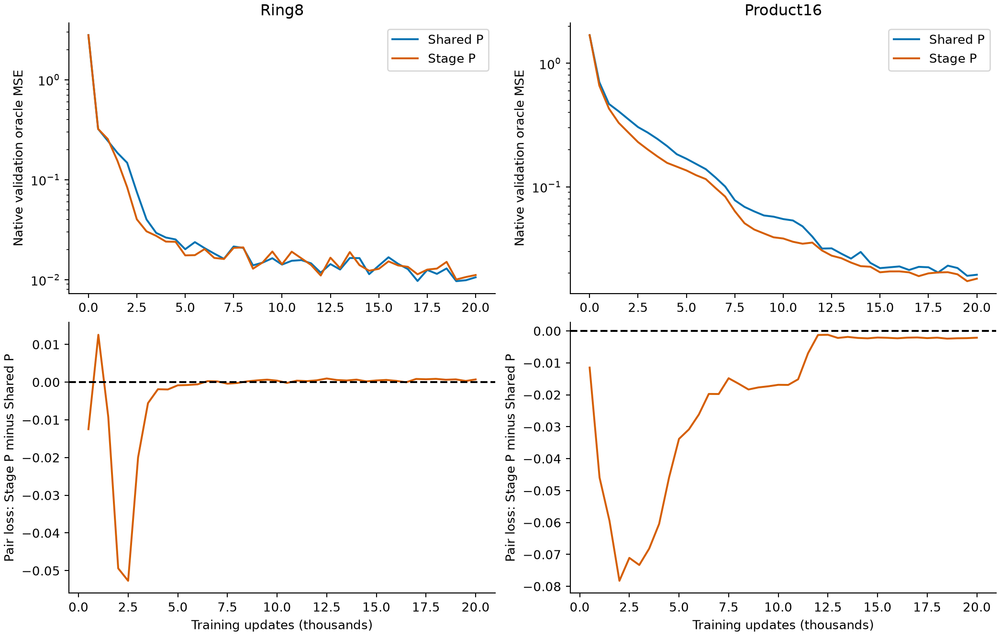
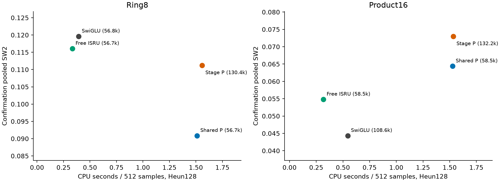

# A shared hidden generator improves the matched stage comparison

The four-step state-flow FFN samples better when its stages share P than
when they can learn separate matrices. This is the positive structural
finding of the new control. It supports the autonomous sharing constraint
at this training budget; it does not distinguish that constraint from
ordinary recurrent weight sharing.

## Purpose and controlled comparison

Compare y'=P ISRU(y), using four midpoint steps, with a stage-dependent
version P_1=P and P_j=P+Delta_j for j=2,3,4. All offsets start at zero.
Formal checkpoints verify identical common initialization, recipes and
data-RNG states at 0/15k/20k. Both use eight matrix applications per local
solve. Released stages add 73,728 parameters; this is a same-work nested
class, not a parameter-matched comparison. All runs use training seed 0.

Fresh evaluation streams were fixed before training. The primary endpoint
is 20k; each pooled score uses eight common banks of 4,096 samples, 256
directions and Heun128. All eight model/task cases and both selected
checkpoints independently recompute. [Full comparison](comparison.md).

| Model | Ring8 SW2 | Product16 SW2 |
|---|---:|---:|
| Shared P | **0.091** | 0.064 |
| Separate stage matrices | 0.111 | 0.073 |
| Free ISRU | 0.116 | 0.055 |
| SwiGLU reference | 0.120 | **0.044** |

Shared P wins all eight paired banks on each task. It has 56,706/58,512
parameters, versus 130,434/132,240 for released stages. Their dense work
is identical at 227,648/229,440 MACs per example. Exact scores, conditional
effects and provenance are in [comparison.json](comparison.json).

## The released matrices are used, but that use is not a sampling advantage

Stage drift variation relative to the mean drift has median 0.252 on Ring8
and 0.314 on Product16. Reversing the stages changes predicted velocities
by 0.098/0.310 RMS. Product16 oracle field MSE rises from 0.018 to 0.118
under this reversal. Averaging the matrices also changes the model; the
shared reference is an exact null for every such ordering intervention.

These observations rule out inactive offsets as an explanation for the
matched training result. They do not show that making a trained model
shared after the fact helps: removing its offsets sharply worsens fit.
The useful comparison is the separately trained shared model.

## Field fitting and distribution matching diverge on Product16

Released stages improve confirmation field MSE from 0.019 to 0.018, yet
their pooled SW2 worsens from 0.064 to 0.073. They also have lower late
training pair loss. A failure to fit the training task therefore cannot
explain this Product16 sampling gap. Ring8's late pair losses are close,
with the shared model slightly lower; a pure generalization interpretation
is less clean there. The overlapping P+Delta parameterization changes
optimization, as detailed in the [derivation](../mathematical-basis.md).

## Practical disposition

Keep the shared generator when investigating this family. Do not promote
released stages to images. Shared flow still loses Product16 to Free ISRU
at the same parameter count, and it uses about four times the dense work.
Its measured CPU sampling time is about 4.5--4.8 times Free ISRU's; these
are same-host CPU measurements, not GPU speed claims.

The next mechanism question is whether sharing reduces harmful asymmetry
and mode allocation errors. Existing Ring8 projection controls remove the
state-flow lead over ordinary models on their paired stratified sample.
The released-stage model was not in that cohort. A targeted follow-up must
compare shared/released fields before and after the same symmetry projection;
the current evidence does not yet attribute their gap to symmetry.
The old outer-resolution cohort also omitted released stage operators.
Their new512-point check changes SW2 by at most2.464e-4 at Heun128->512,
but full-bank refinement is still required. [Registered next checks](../sharing-symmetry-followup.md).

## Claim decisions

- Keep: shared P improves these two fixed-budget stage comparisons at equal
  dense work and with fewer parameters. Evidence: all paired banks and the
  exact recipe/initialization checks.
- Keep: released stage actions are active and order-dependent. Evidence:
  independent bracket checks and frozen-weight interventions.
- Weaken: better field MSE implies better generation. Product16 supplies a
  direct counterexample in the matched pair.
- Not established: an advantage unique to ODEs, a general FFN replacement,
  or a useful coupling between hidden time and physical flow-matching time.
