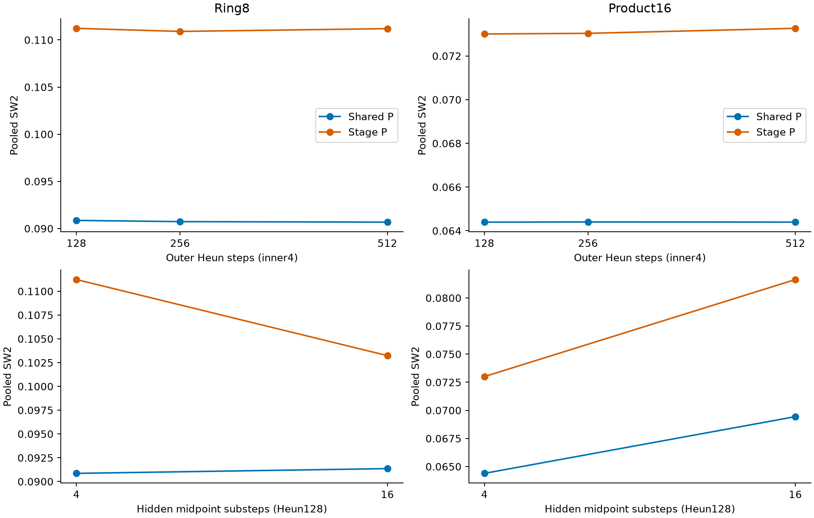

# Sharing survives outer refinement; the Ring8 hidden-limit evidence weakens

The shared-generator lead persists in pooled scores after both outer and
hidden refinement. Ring8's paired-bank support weakens with16hidden substeps;
Product16 retains all8paired-bank wins. All scores use the same new sharing
confirmation sources, targets and directions.

| Inner steps | Outer Heun | Ring8 shared | Ring8 stage | Shared wins | Product16 shared | Product16 stage | Shared wins |
|---:|---:|---:|---:|---:|---:|---:|---:|
| 4 | 128 | 0.091 | 0.111 | 8/8 | 0.064 | 0.073 | 8/8 |
| 4 | 256 | 0.091 | 0.111 | 8/8 | 0.064 | 0.073 | 8/8 |
| 4 | 512 | 0.091 | 0.111 | 7/8 | 0.064 | 0.073 | 8/8 |
| 16 | 128 | 0.091 | 0.103 | 5/8 | 0.069 | 0.082 | 8/8 |

Each row/model uses32768samples in eight common banks. CUDA Heun128
reproduces the completed CPU primary scores within3.44e-8. Independent NumPy
recomputation of all16pooled and128bank scores differs by at most2.78e-17.
The new piecewise-stage reference preserves all four quarter-interval matrices
under hidden refinement. Neither the checkpoint nor response changes.

At16hidden substeps, Ring8's mean bank difference (stage minus shared) is
0.006, with approximate conditional95%interval[-0.002,0.015] and5/8wins.
Its pooled gap is0.012. Product16's pooled gap is0.012and sharing wins8/8.
Thus the fixed-budget result is stronger than the claim of a two-task
continuous-hidden-flow advantage. The outer solver does not explain the
primary gap; the hidden discretization contributes to its Ring8 size.

Both hidden models have verified second-order convergence to their defined
autonomous/piecewise fields. Their matched architectural difference is the
stationarity of P. A shared P still gives a state-dependent Jacobian
P diag(q'(y)), so stationarity leaves nonlinear adaptation along the path.

The GPU job used one idle physical145GPU4, checked occupancy after every
resolution, and then exited. Sampling/metric compute summed to53.824seconds.
GPU telemetry and the launch/readiness receipts are included. No other task
was stopped. Raw generated arrays remain outside Git.

Next: test whether the sharing gap follows symmetry-breaking/mode-allocation
errors, as registered in [the follow-up](../../sharing-symmetry-followup.md).
